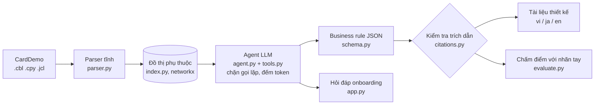

# LegacyLens: đọc hiểu hệ thống COBOL không có tài liệu, có trích dẫn từng dòng

[](../../actions/workflows/ci.yml)

Kỹ sư mới vào một dự án mainframe thường phải tự đọc hàng chục nghìn dòng COBOL để biết chương trình nào làm gì,
quy tắc nghiệp vụ nằm ở đâu và sửa một copybook thì ảnh hưởng chỗ nào. LegacyLens làm phần việc đó:

1. **Phân tích tĩnh** (không dùng LLM): đọc COBOL dạng cột cố định, copybook và JCL, dựng đồ thị phụ thuộc
   chương trình → copybook → file/dataset → job, kể cả `CICS XCTL PROGRAM(biến)` khi biến được gán bằng `VALUE`
   hoặc `MOVE`.
2. **Agent LLM** đi theo đồ thị bằng 6 tool (`program_outline`, `read_paragraph`, `read_lines`, `open_copybook`,
   `who_uses`, `search_code`), trích business rule ra JSON theo schema Pydantic, mỗi rule kèm `program:dòng-dòng`.
3. **Kiểm tra trích dẫn tự động**: dòng được trích phải tồn tại, là code (không phải comment) và chứa ít nhất một
   tên biến, mã lỗi hoặc thông báo mà rule nhắc tới. Rule nào trượt được đánh dấu ngay trong tài liệu.
4. **Tài liệu thiết kế** tiếng Việt, tiếng Nhật (設計書) hoặc tiếng Anh, và giao diện hỏi đáp onboarding.

Dữ liệu: [AWS CardDemo](https://github.com/aws-samples/aws-mainframe-modernization-carddemo) (Apache-2.0), ứng dụng
thẻ tín dụng mainframe mẫu mà AWS công bố để thử công cụ hiện đại hóa: COBOL, CICS, VSAM, JCL, thêm các module
IMS, DB2, MQ. Repo không chứa mã CardDemo; `make data` tải về và ghim commit `59cc6c2` để số dòng trong nhãn tay
không lệch.

## Bối cảnh

FPT Software công khai rằng hệ thống legacy của khách hàng "chứa hàng chục năm business logic không được ghi chép",
kỹ sư COBOL đang nghỉ hưu, và công cụ xMainframe của họ giảm 30% thời gian onboarding
([FPT, 2024](https://fptsoftware.com/newsroom/news-and-press-releases/news/fpt-leverages-ai-to-optimize-legacy-systems-for-enterprises);
[FPT, From Legacy to Leverage](https://fptsoftware.com/newsroom/news-and-press-releases/news/from-legacy-to-leverage-how-fpt-modernizes-systems-for-enterprise-ai-value)).
Tháng 12/2025 FPT và SCSK lập liên doanh COBOL PARK cho thị trường hệ thống COBOL tài chính tại Nhật
([Vietstock](https://en.vietstock.vn/2025/12/fpt-and-scsk-unveil-cobol-park-to-drive-legacy-system-modernisation-974-626107.htm)).
LegacyLens là bản thu nhỏ của bước "đọc lại mã và viết lại tài liệu" trong quy trình đó, làm để hiểu bài toán,
không phải sản phẩm của FPT.

## Kiến trúc



Nguyên tắc: phần chắc chắn (ai gọi ai, đọc ghi file nào, đoạn nào ở dòng nào) do parser làm; LLM chỉ diễn giải,
và mọi câu nó viết phải chỉ được dòng code làm bằng chứng.

## Chạy

Không cần GPU, chạy được trên Codespaces 2 nhân. Phần LLM mặc định là mô hình open-weight Qwen2.5 Instruct chạy bằng
Ollama trên Colab T4 miễn phí (`notebooks/colab_llm.ipynb` in ra URL để điền vào `.env`). Code gọi qua API kiểu
OpenAI nên cũng chạy với vLLM, LiteLLM hay API trả phí mà không phải sửa.

```bash
make install            # thư viện
make test               # 43 test offline, LLM giả lập, vài giây (1 test cần `make data`)
make data               # tải CardDemo
make stats graph        # thống kê + reports/graph.json, reports/graph.mmd
make check-gold         # nhãn tay trong gold/ phải trích đúng dòng
make review PROG=COSGN00C   # xem nhãn tay cạnh dòng code; sửa bằng make gold-ok / gold-set / gold-lines
cp .env.example .env    # dán 4 dòng LLM_ mà notebook Colab in ra (hoặc đặt làm Codespaces secrets)
make ask Q="Where is the password checked?"  # thử khóa LLM
make extract PROGS="CBTRN02C COSGN00C"   # agent trích rule -> out/rules/, chi phí -> reports/runs.jsonl
make doc PROGS="CBTRN02C"                # docs/generated/CBTRN02C.vi.md và .ja.md
make eval               # reports/eval.md
make eval-qa            # agent trả lời 20 câu onboarding -> reports/eval_qa.md
make ui                 # giao diện hỏi đáp, cổng 8501
```

Lệnh lẻ: `PYTHONPATH=src python -m legacylens.cli --src data/carddemo/app --help`
(`outline`, `ask "câu hỏi"`, `graph --focus CVACT01Y`, ...).

## Kết quả

Phân tích tĩnh trên CardDemo @ `59cc6c2` (đo bằng `make stats`):

| Chỉ số | Giá trị |
| --- | --- |
| Chương trình COBOL | 44 (25 online CICS, 19 batch) |
| Copybook | 62 |
| Bước JCL | 119 |
| Dòng code (không tính comment, dòng trống) | 22.904 |
| Paragraph | 870 |
| Đồ thị | 225 nút, 710 cạnh |

Trích business rule (chỉ điền số tự đo, xem `reports/eval.md`):

| Chỉ số | Giá trị |
| --- | --- |
| Nhãn tay | 50 rule, 5 chương trình (CBTRN02C, COSGN00C, COTRN02C, CBACT04C, COBIL00C) |
| Precision / Recall / F1 | 20.0% / 6.0% / 9.2% |
| Trích dẫn qua kiểm tra | 93.3% |
| Token và thời gian mỗi chương trình | 22959 token, 299.6 giây (mô hình qwen2.5:7b-instruct) |
| Agent trả lời đúng 20 câu onboarding (`make eval-qa`) | 2/20, trích đúng dòng 0.0% (mô hình qwen2.5:7b-instruct) |
| Người trả lời 20 câu, chỉ đọc code / dùng LegacyLens | [X] phút / [X] phút |

### Các lần thử

| Lần | Thay đổi | Mô hình | P / R / F1 | Token mỗi chương trình |
| --- | --- | --- | --- | --- |
| 1 | Bản đầu, prompt gốc | qwen2.5:7b-instruct | 20.0% / 6.0% / 9.2% | 22959 |

## Cách chấm

- Nhãn tay ở `gold/rules.jsonl` (50 rule), cùng schema với đầu ra. Nhãn do AI soạn nháp; mỗi nhãn đã qua `make check-gold` và được tôi đọc
  lại đối chiếu với mã nguồn.
- Câu hỏi onboarding ở `onboarding/questions.jsonl`: mỗi câu có nhóm từ khóa bắt buộc và vùng dòng mong đợi.
  Câu trả lời đúng khi chứa đủ từ khóa và có trích dẫn chạm vùng đó. `onboarding/BAI_KIEM_TRA.md` là phiếu cho
  bài kiểm tra bấm giờ với người thật.
- Rule dự đoán khớp rule nhãn tay khi cùng chương trình, dòng trích phủ ít nhất 50% dòng của nhãn và ít nhất 25%
  dòng trích nằm trong vùng nhãn (trích cả chương trình thì không khớp). Ghép một-một, phủ nhiều nhất trước.
- Chỉ chấm các chương trình có nhãn, nên chương trình chưa gán nhãn không bị tính là sai.

## Một lỗi gặp khi gán nhãn

Đọc `CBACT04C` (tính lãi hằng tháng), lời gọi `1050-UPDATE-ACCOUNT` cho tài khoản cuối cùng nằm ở nhánh `ELSE`
dòng 219-220 của `IF END-OF-FILE = 'N'`. Vòng `PERFORM UNTIL END-OF-FILE = 'Y'` kiểm tra điều kiện trước mỗi lượt và
`END-OF-FILE` chỉ nhận `'N'` hoặc `'Y'`, nên nhánh này không bao giờ chạy: giao dịch tiền lãi của tài khoản cuối vẫn
được ghi, nhưng số dư của nó không được cộng lãi.

- Tái hiện: `scripts/repro_cbact04c.cbl` giữ nguyên cấu trúc IF/ELSE của vòng lặp với 3 bản ghi của 2 tài khoản.
  Chạy bằng GnuCOBOL 3.1.2 (`cobc -x -free scripts/repro_cbact04c.cbl -o /tmp/repro && /tmp/repro`), tài khoản 101
  được cập nhật số dư, tài khoản 202 thì không. Đây là bản tái hiện luồng điều khiển, không phải chạy chương trình
  gốc với file VSAM.
- Lỗi này đã có người báo trước ở
  [issue #64 của CardDemo](https://github.com/aws-samples/aws-mainframe-modernization-carddemo/issues/64) (mở ngày 03/10/2026), nên đây
  không phải phát hiện mới. Điều đáng nói là một lỗi kiểu này nằm trong mã mẫu chính thức mà đọc lướt khó thấy,
  và đọc theo trích dẫn từng dòng giúp chỉ ra đúng chỗ.

## Giới hạn đã biết

- Parser dùng regex theo dòng, không phải grammar COBOL đầy đủ: chưa xử lý `COPY ... REPLACING`, `EVALUATE`
  lồng phức tạp chỉ được đọc như văn bản, `CALL` động mà biến nhận giá trị từ `LINKAGE` thì giữ nguyên tên biến.
- Giải `MOVE biến TO biến` theo bắc cầu nên có thể dư đích (ước lượng trên, không bỏ sót).
- Kiểm tra trích dẫn chỉ xác nhận dòng có chứa bằng chứng, không chứng minh rule diễn giải đúng; độ đúng đo bằng
  nhãn tay.

## Cấu trúc

```
src/legacylens/
  parser.py     COBOL cột cố định, copybook, JCL
  index.py      gom cả cây mã, đồ thị, impact analysis, xuất JSON/Mermaid
  tools.py      6 tool cho agent, trả text có số dòng
  agent.py      vòng lặp tool calling, LoopGuard, đếm token, sửa JSON lỗi
  schema.py     BusinessRule, Citation, RuleSet, Answer
  citations.py  kiểm tra trích dẫn
  evaluate.py   precision, recall, F1 so với nhãn tay
  qa.py         chấm câu trả lời onboarding
  docgen.py     tài liệu thiết kế vi / ja / en
  cli.py        lệnh dòng lệnh
app.py          giao diện Streamlit
gold/           nhãn tay
onboarding/     20 câu hỏi onboarding + phiếu kiểm tra bấm giờ
tests/          test offline với COBOL mẫu tự viết và LLM giả lập
```
