# 設計書: CBACT04C

_LegacyLens により自動生成。構造は静的解析、目的と業務ルールは LLM が作成し、各ルールはソースと照合済み。_

## 概要

| 種別 | バッチ |
| --- | --- |
| コード行数 | 552 |
| ソース | [cbl/CBACT04C.cbl](https://github.com/aws-samples/aws-mainframe-modernization-carddemo/blob/59cc6c2fd7ebd7ef7925cad552a01a4b8b6e4d5e/app/cbl/CBACT04C.cbl) |

**目的.** このCOBOLプログラムは、アカウントデータを更新するためにバッチトランザクションを処理し、利子と手数料を計算します。TCATBAL、XREF、DISCGRPなどのファイルからデータを読み取り、ACCOUNTファイルを更新し、TRANSACTファイルにトランザクションをログに記録します。

## 入出力

| ファイル / データセット | モード | 行 |
| --- | --- | --- |
| TCATBAL-FILE → `AWS.M2.CARDDEMO.TCATBALF.VSAM.KSDS` | 読込 | [236](https://github.com/aws-samples/aws-mainframe-modernization-carddemo/blob/59cc6c2fd7ebd7ef7925cad552a01a4b8b6e4d5e/app/cbl/CBACT04C.cbl#L236) |
| XREF-FILE → `AWS.M2.CARDDEMO.CARDXREF.VSAM.KSDS` | 読込 | [254](https://github.com/aws-samples/aws-mainframe-modernization-carddemo/blob/59cc6c2fd7ebd7ef7925cad552a01a4b8b6e4d5e/app/cbl/CBACT04C.cbl#L254) |
| DISCGRP-FILE → `AWS.M2.CARDDEMO.DISCGRP.VSAM.KSDS` | 読込 | [272](https://github.com/aws-samples/aws-mainframe-modernization-carddemo/blob/59cc6c2fd7ebd7ef7925cad552a01a4b8b6e4d5e/app/cbl/CBACT04C.cbl#L272) |
| ACCOUNT-FILE → `AWS.M2.CARDDEMO.ACCTDATA.VSAM.KSDS` | 読込・書込 | [291](https://github.com/aws-samples/aws-mainframe-modernization-carddemo/blob/59cc6c2fd7ebd7ef7925cad552a01a4b8b6e4d5e/app/cbl/CBACT04C.cbl#L291) |
| TRANSACT-FILE → `AWS.M2.CARDDEMO.SYSTRAN(+1)` | 書込 | [309](https://github.com/aws-samples/aws-mainframe-modernization-carddemo/blob/59cc6c2fd7ebd7ef7925cad552a01a4b8b6e4d5e/app/cbl/CBACT04C.cbl#L309) |

## 他プログラムへの遷移

| プログラム | 方式 | 行 |
| --- | --- | --- |
| CEE3ABD | CALL | [632](https://github.com/aws-samples/aws-mainframe-modernization-carddemo/blob/59cc6c2fd7ebd7ef7925cad552a01a4b8b6e4d5e/app/cbl/CBACT04C.cbl#L632) |

## 実行ジョブ

INTCALC

## コピー句

`CVTRA01Y`, `CVACT03Y`, `CVTRA02Y`, `CVACT01Y`, `CVTRA05Y`

## 処理フロー (PERFORM)

```mermaid
flowchart TD
    p0["0000-TCATBALF-OPEN"] --> p19["9910-DISPLAY-IO-STATUS"]
    p0["0000-TCATBALF-OPEN"] --> p20["9999-ABEND-PROGRAM"]
    p1["0100-XREFFILE-OPEN"] --> p19["9910-DISPLAY-IO-STATUS"]
    p1["0100-XREFFILE-OPEN"] --> p20["9999-ABEND-PROGRAM"]
    p2["0200-DISCGRP-OPEN"] --> p19["9910-DISPLAY-IO-STATUS"]
    p2["0200-DISCGRP-OPEN"] --> p20["9999-ABEND-PROGRAM"]
    p3["0300-ACCTFILE-OPEN"] --> p19["9910-DISPLAY-IO-STATUS"]
    p3["0300-ACCTFILE-OPEN"] --> p20["9999-ABEND-PROGRAM"]
    p4["0400-TRANFILE-OPEN"] --> p19["9910-DISPLAY-IO-STATUS"]
    p4["0400-TRANFILE-OPEN"] --> p20["9999-ABEND-PROGRAM"]
    p5["1000-TCATBALF-GET-NEXT"] --> p19["9910-DISPLAY-IO-STATUS"]
    p5["1000-TCATBALF-GET-NEXT"] --> p20["9999-ABEND-PROGRAM"]
    p6["1050-UPDATE-ACCOUNT"] --> p19["9910-DISPLAY-IO-STATUS"]
    p6["1050-UPDATE-ACCOUNT"] --> p20["9999-ABEND-PROGRAM"]
    p7["1100-GET-ACCT-DATA"] --> p19["9910-DISPLAY-IO-STATUS"]
    p7["1100-GET-ACCT-DATA"] --> p20["9999-ABEND-PROGRAM"]
    p8["1110-GET-XREF-DATA"] --> p19["9910-DISPLAY-IO-STATUS"]
    p8["1110-GET-XREF-DATA"] --> p20["9999-ABEND-PROGRAM"]
    p9["1200-A-GET-DEFAULT-INT-RATE"] --> p19["9910-DISPLAY-IO-STATUS"]
    p9["1200-A-GET-DEFAULT-INT-RATE"] --> p20["9999-ABEND-PROGRAM"]
    p10["1200-GET-INTEREST-RATE"] --> p9["1200-A-GET-DEFAULT-INT-RATE"]
    p10["1200-GET-INTEREST-RATE"] --> p19["9910-DISPLAY-IO-STATUS"]
    p10["1200-GET-INTEREST-RATE"] --> p20["9999-ABEND-PROGRAM"]
    p11["1300-B-WRITE-TX"] --> p19["9910-DISPLAY-IO-STATUS"]
    p11["1300-B-WRITE-TX"] --> p20["9999-ABEND-PROGRAM"]
    p11["1300-B-WRITE-TX"] --> p22["Z-GET-DB2-FORMAT-TIMESTAMP"]
    p12["1300-COMPUTE-INTEREST"] --> p11["1300-B-WRITE-TX"]
    p14["9000-TCATBALF-CLOSE"] --> p19["9910-DISPLAY-IO-STATUS"]
    p14["9000-TCATBALF-CLOSE"] --> p20["9999-ABEND-PROGRAM"]
    p15["9100-XREFFILE-CLOSE"] --> p19["9910-DISPLAY-IO-STATUS"]
    p15["9100-XREFFILE-CLOSE"] --> p20["9999-ABEND-PROGRAM"]
    p16["9200-DISCGRP-CLOSE"] --> p19["9910-DISPLAY-IO-STATUS"]
    p16["9200-DISCGRP-CLOSE"] --> p20["9999-ABEND-PROGRAM"]
    p17["9300-ACCTFILE-CLOSE"] --> p19["9910-DISPLAY-IO-STATUS"]
    p17["9300-ACCTFILE-CLOSE"] --> p20["9999-ABEND-PROGRAM"]
    p18["9400-TRANFILE-CLOSE"] --> p19["9910-DISPLAY-IO-STATUS"]
    p18["9400-TRANFILE-CLOSE"] --> p20["9999-ABEND-PROGRAM"]
    p21["MAIN"] --> p0["0000-TCATBALF-OPEN"]
    p21["MAIN"] --> p1["0100-XREFFILE-OPEN"]
    p21["MAIN"] --> p2["0200-DISCGRP-OPEN"]
    p21["MAIN"] --> p3["0300-ACCTFILE-OPEN"]
    p21["MAIN"] --> p4["0400-TRANFILE-OPEN"]
    p21["MAIN"] --> p5["1000-TCATBALF-GET-NEXT"]
    p21["MAIN"] --> p6["1050-UPDATE-ACCOUNT"]
    p21["MAIN"] --> p7["1100-GET-ACCT-DATA"]
    p21["MAIN"] --> p8["1110-GET-XREF-DATA"]
    p21["MAIN"] --> p10["1200-GET-INTEREST-RATE"]
    p21["MAIN"] --> p12["1300-COMPUTE-INTEREST"]
    p21["MAIN"] --> p13["1400-COMPUTE-FEES"]
    p21["MAIN"] --> p14["9000-TCATBALF-CLOSE"]
    p21["MAIN"] --> p15["9100-XREFFILE-CLOSE"]
    p21["MAIN"] --> p16["9200-DISCGRP-CLOSE"]
    p21["MAIN"] --> p17["9300-ACCTFILE-CLOSE"]
    p21["MAIN"] --> p18["9400-TRANFILE-CLOSE"]
```

## 業務ルール

| ID | 内容 | 条件 | 結果 | 根拠 | 検証 |
| --- | --- | --- | --- | --- | --- |
| CBACT04C-R1 | ファイルの終わりに達していない場合、次のトランザクションレコードを取得します。 | END-OF-FILE NOT= 'Y' | PERFORM 1000-TCATBALF-GET-NEXT | [189-190](https://github.com/aws-samples/aws-mainframe-modernization-carddemo/blob/59cc6c2fd7ebd7ef7925cad552a01a4b8b6e4d5e/app/cbl/CBACT04C.cbl#L189-L190) | OK |
| CBACT04C-R2 | ファイルの終わりに達していない場合、レコードカウントをインクリメントします。 | END-OF-FILE NOT= 'Y' | ADD 1 TO WS-RECORD-COUNT | [191-192](https://github.com/aws-samples/aws-mainframe-modernization-carddemo/blob/59cc6c2fd7ebd7ef7925cad552a01a4b8b6e4d5e/app/cbl/CBACT04C.cbl#L191-L192) | OK |
| CBACT04C-R3 | アカウントIDが変更された場合、アカウントを更新し、合計利子をリセットします。 | TRANCAT-ACCT-ID NOT= WS-LAST-ACCT-NUM | PERFORM 1050-UPDATE-ACCOUNT, MOVE 0 TO WS-TOTAL-INT | [194-201](https://github.com/aws-samples/aws-mainframe-modernization-carddemo/blob/59cc6c2fd7ebd7ef7925cad552a01a4b8b6e4d5e/app/cbl/CBACT04C.cbl#L194-L201) | OK |
| CBACT04C-R4 | アカウントIDが変更され、これが初めてではない場合、アカウントを更新します。 | TRANCAT-ACCT-ID NOT= WS-LAST-ACCT-NUM AND WS-FIRST-TIME NOT = 'Y' | PERFORM 1050-UPDATE-ACCOUNT | [194-196](https://github.com/aws-samples/aws-mainframe-modernization-carddemo/blob/59cc6c2fd7ebd7ef7925cad552a01a4b8b6e4d5e/app/cbl/CBACT04C.cbl#L194-L196) | OK |
| CBACT04C-R5 | アカウントIDが変更され、これが初めての場合、WS-FIRST-TIMEを 'N' に設定します。 | TRANCAT-ACCT-ID NOT= WS-LAST-ACCT-NUM AND WS-FIRST-TIME = 'Y' | MOVE 'N' TO WS-FIRST-TIME | [194-198](https://github.com/aws-samples/aws-mainframe-modernization-carddemo/blob/59cc6c2fd7ebd7ef7925cad552a01a4b8b6e4d5e/app/cbl/CBACT04C.cbl#L194-L198) | OK |
| CBACT04C-R6 | アカウントIDが変更された場合、アカウントデータを取得します。 | TRANCAT-ACCT-ID NOT= WS-LAST-ACCT-NUM | PERFORM 1100-GET-ACCT-DATA | [194-203](https://github.com/aws-samples/aws-mainframe-modernization-carddemo/blob/59cc6c2fd7ebd7ef7925cad552a01a4b8b6e4d5e/app/cbl/CBACT04C.cbl#L194-L203) | OK |
| CBACT04C-R7 | アカウントIDが変更された場合、クロスリファレンスデータを取得します。 | TRANCAT-ACCT-ID NOT= WS-LAST-ACCT-NUM | PERFORM 1110-GET-XREF-DATA | [194-205](https://github.com/aws-samples/aws-mainframe-modernization-carddemo/blob/59cc6c2fd7ebd7ef7925cad552a01a4b8b6e4d5e/app/cbl/CBACT04C.cbl#L194-L205) | OK |
| CBACT04C-R8 | ファイルの終わりに達した場合、アカウントを更新します。 | END-OF-FILE = 'Y' | PERFORM 1050-UPDATE-ACCOUNT | [219-221](https://github.com/aws-samples/aws-mainframe-modernization-carddemo/blob/59cc6c2fd7ebd7ef7925cad552a01a4b8b6e4d5e/app/cbl/CBACT04C.cbl#L219-L221) | OK |
| CBACT04C-R9 | トランザクションカテゴリーバランスファイルを読み込む。 | none | READ TCATBAL-FILE INTO TRAN-CAT-BAL-RECORD | [326-326](https://github.com/aws-samples/aws-mainframe-modernization-carddemo/blob/59cc6c2fd7ebd7ef7925cad552a01a4b8b6e4d5e/app/cbl/CBACT04C.cbl#L326-L326) | OK |
| CBACT04C-R10 | 読み込みが成功した場合、アプリケーション結果を0に設定する。 | TCATBALF-STATUS = '00' | APPL-RESULT = 0 | [327-328](https://github.com/aws-samples/aws-mainframe-modernization-carddemo/blob/59cc6c2fd7ebd7ef7925cad552a01a4b8b6e4d5e/app/cbl/CBACT04C.cbl#L327-L328) | OK |
| CBACT04C-R11 | ファイルの終わりに達した場合、アプリケーション結果を16に設定する。 | TCATBALF-STATUS = '10' | APPL-RESULT = 16 | [330-331](https://github.com/aws-samples/aws-mainframe-modernization-carddemo/blob/59cc6c2fd7ebd7ef7925cad552a01a4b8b6e4d5e/app/cbl/CBACT04C.cbl#L330-L331) | OK |
| CBACT04C-R12 | その他のファイルステータスの場合、アプリケーション結果を12に設定する。 | TCATBALF-STATUS NOT '00' OR '10' | APPL-RESULT = 12 | [332-333](https://github.com/aws-samples/aws-mainframe-modernization-carddemo/blob/59cc6c2fd7ebd7ef7925cad552a01a4b8b6e4d5e/app/cbl/CBACT04C.cbl#L332-L333) | OK |
| CBACT04C-R13 | アプリケーションが正常な場合、続行する。 | APPL-AOK | CONTINUE | [336-337](https://github.com/aws-samples/aws-mainframe-modernization-carddemo/blob/59cc6c2fd7ebd7ef7925cad552a01a4b8b6e4d5e/app/cbl/CBACT04C.cbl#L336-L337) | OK |
| CBACT04C-R14 | アプリケーションのファイルの終わりの場合、ファイルの終わりフラグを設定する。 | APPL-EOF | END-OF-FILE = 'Y' | [339-340](https://github.com/aws-samples/aws-mainframe-modernization-carddemo/blob/59cc6c2fd7ebd7ef7925cad552a01a4b8b6e4d5e/app/cbl/CBACT04C.cbl#L339-L340) | OK |
| CBACT04C-R15 | ファイル読み込みに失敗した場合、エラーメッセージとステータスを表示する。 | APPL-AOK NOT TRUE | DISPLAY 'ERROR READING TRANSACTION CATEGORY FILE', IO-STATUS = TCATBALF-STATUS, PERFORM 9910-DISPLAY-IO-STATUS, PERFORM 9999-ABEND-PROGRAM | [341-345](https://github.com/aws-samples/aws-mainframe-modernization-carddemo/blob/59cc6c2fd7ebd7ef7925cad552a01a4b8b6e4d5e/app/cbl/CBACT04C.cbl#L341-L345) | OK |
| CBACT04C-R16 | 合計利息を口座レコードの現在の残高に加算する。 | none | ACCT-CURR-BAL = ACCT-CURR-BAL + WS-TOTAL-INT | [352-352](https://github.com/aws-samples/aws-mainframe-modernization-carddemo/blob/59cc6c2fd7ebd7ef7925cad552a01a4b8b6e4d5e/app/cbl/CBACT04C.cbl#L352-L352) | OK |
| CBACT04C-R17 | 現在のサイクルクレジットとデビットフィールドをゼロにリセットする。 | none | ACCT-CURR-CYC-CREDIT = 0, ACCT-CURR-CYC-DEBIT = 0 | [353-354](https://github.com/aws-samples/aws-mainframe-modernization-carddemo/blob/59cc6c2fd7ebd7ef7925cad552a01a4b8b6e4d5e/app/cbl/CBACT04C.cbl#L353-L354) | OK |
| CBACT04C-R18 | アカウントレコードをファイルに上書きする。 | none | REWRITE FD-ACCTFILE-REC FROM ACCOUNT-RECORD | [356-356](https://github.com/aws-samples/aws-mainframe-modernization-carddemo/blob/59cc6c2fd7ebd7ef7925cad552a01a4b8b6e4d5e/app/cbl/CBACT04C.cbl#L356-L356) | OK |
| CBACT04C-R19 | ファイルの上書きが成功した場合、アプリケーション結果を0に設定する。 | ACCTFILE-STATUS = '00' | APPL-RESULT = 0 | [357-358](https://github.com/aws-samples/aws-mainframe-modernization-carddemo/blob/59cc6c2fd7ebd7ef7925cad552a01a4b8b6e4d5e/app/cbl/CBACT04C.cbl#L357-L358) | OK |
| CBACT04C-R20 | ファイルの上書きが失敗した場合、アプリケーション結果を12に設定する。 | ACCTFILE-STATUS <> '00' | APPL-RESULT = 12 | [359-361](https://github.com/aws-samples/aws-mainframe-modernization-carddemo/blob/59cc6c2fd7ebd7ef7925cad552a01a4b8b6e4d5e/app/cbl/CBACT04C.cbl#L359-L361) | OK |
| CBACT04C-R21 | アプリケーション結果がOKでない場合、エラーメッセージを表示し、プログラムをABENDする。 | APPL-AOK = FALSE | DISPLAY 'ERROR RE-WRITING ACCOUNT FILE', IO-STATUS = ACCTFILE-STATUS, PERFORM 9910-DISPLAY-IO-STATUS, PERFORM 9999-ABEND-PROGRAM | [362-369](https://github.com/aws-samples/aws-mainframe-modernization-carddemo/blob/59cc6c2fd7ebd7ef7925cad552a01a4b8b6e4d5e/app/cbl/CBACT04C.cbl#L362-L369) | OK |
| CBACT04C-R22 | アカウントが見つからない場合、エラーメッセージを表示する。 | INVALID KEY | DISPLAY 'ACCOUNT NOT FOUND: ' FD-ACCT-ID | [374-376](https://github.com/aws-samples/aws-mainframe-modernization-carddemo/blob/59cc6c2fd7ebd7ef7925cad552a01a4b8b6e4d5e/app/cbl/CBACT04C.cbl#L374-L376) | OK |
| CBACT04C-R23 | ファイルの読み取りが成功した場合、アプリケーション結果を0に設定する。 | ACCTFILE-STATUS = '00' | APPL-RESULT = 0 | [378-380](https://github.com/aws-samples/aws-mainframe-modernization-carddemo/blob/59cc6c2fd7ebd7ef7925cad552a01a4b8b6e4d5e/app/cbl/CBACT04C.cbl#L378-L380) | OK |
| CBACT04C-R24 | ファイルの読み取りが失敗した場合、アプリケーション結果を12に設定する。 | ACCTFILE-STATUS NOT = '00' | APPL-RESULT = 12 | [381-382](https://github.com/aws-samples/aws-mainframe-modernization-carddemo/blob/59cc6c2fd7ebd7ef7925cad552a01a4b8b6e4d5e/app/cbl/CBACT04C.cbl#L381-L382) | OK |
| CBACT04C-R25 | エラーメッセージを表示し、プログラムが正常でない場合にABENDを実行する。 | APPL-AOK = FALSE | DISPLAY 'ACCOUNT FILE の読み込みでエラー', IO-STATUS = ACCTFILE-STATUS, PERFORM 9910-DISPLAY-IO-STATUS, PERFORM 9999-ABEND-PROGRAM | [386-390](https://github.com/aws-samples/aws-mainframe-modernization-carddemo/blob/59cc6c2fd7ebd7ef7925cad552a01a4b8b6e4d5e/app/cbl/CBACT04C.cbl#L386-L390) | OK |
| CBACT04C-R26 | アカウントが見つからない場合にエラーメッセージを表示する。 | XREFFILE-STATUS = 'INVALID KEY' | DISPLAY 'アカウントが見つかりません: ' FD-XREF-ACCT-ID | [396-398](https://github.com/aws-samples/aws-mainframe-modernization-carddemo/blob/59cc6c2fd7ebd7ef7925cad552a01a4b8b6e4d5e/app/cbl/CBACT04C.cbl#L396-L398) | OK |
| CBACT04C-R27 | 読み込みが成功した場合、APPL-RESULT を 0 に設定する。 | XREFFILE-STATUS = '00' | APPL-RESULT = 0 | [400-401](https://github.com/aws-samples/aws-mainframe-modernization-carddemo/blob/59cc6c2fd7ebd7ef7925cad552a01a4b8b6e4d5e/app/cbl/CBACT04C.cbl#L400-L401) | OK |
| CBACT04C-R28 | 読み込みが失敗した場合、APPL-RESULT を 12 に設定する。 | XREFFILE-STATUS NOT = '00' | APPL-RESULT = 12 | [402-404](https://github.com/aws-samples/aws-mainframe-modernization-carddemo/blob/59cc6c2fd7ebd7ef7925cad552a01a4b8b6e4d5e/app/cbl/CBACT04C.cbl#L402-L404) | OK |
| CBACT04C-R29 | APPL-AOK が false の場合、エラーメッセージを表示し、ABENDを実行する。 | NOT APPL-AOK | DISPLAY 'XREF ファイルの読み込みでエラー', IO-STATUS = XREFFILE-STATUS, PERFORM 9910-DISPLAY-IO-STATUS, PERFORM 9999-ABEND-PROGRAM | [408-412](https://github.com/aws-samples/aws-mainframe-modernization-carddemo/blob/59cc6c2fd7ebd7ef7925cad552a01a4b8b6e4d5e/app/cbl/CBACT04C.cbl#L408-L412) | OK |
| CBACT04C-R30 | DISCLOSURE GROUP RECORD が欠落している場合、エラーを表示する。 | INVALID KEY | DISPLAY 'DISCLOSURE GROUP RECORD が欠落しています', DISPLAY 'デフォルトの GROUP CODE を使用してみてください' | [417-419](https://github.com/aws-samples/aws-mainframe-modernization-carddemo/blob/59cc6c2fd7ebd7ef7925cad552a01a4b8b6e4d5e/app/cbl/CBACT04C.cbl#L417-L419) | OK |
| CBACT04C-R31 | DISCGRP-STATUS が '00' または '23' の場合、APPL-RESULT を 0 に設定する。 | DISCGRP-STATUS = '00' OR '23' | APPL-RESULT = 0 | [422-424](https://github.com/aws-samples/aws-mainframe-modernization-carddemo/blob/59cc6c2fd7ebd7ef7925cad552a01a4b8b6e4d5e/app/cbl/CBACT04C.cbl#L422-L424) | OK |
| CBACT04C-R32 | DISCGRP-STATUS が '00' または '23' でない場合、APPL-RESULT を 12 に設定する。 | DISCGRP-STATUS NOT IN ('00', '23') | APPL-RESULT = 12 | [425-426](https://github.com/aws-samples/aws-mainframe-modernization-carddemo/blob/59cc6c2fd7ebd7ef7925cad552a01a4b8b6e4d5e/app/cbl/CBACT04C.cbl#L425-L426) | OK |
| CBACT04C-R33 | エラーを表示し、APPL-AOKがfalseの場合にABENDします。 | NOT APPL-AOK | DISPLAY 'ERROR READING DISCLOSURE GROUP FILE', IO-STATUS = DISCGRP-STATUS, PERFORM 9910-DISPLAY-IO-STATUS, PERFORM 9999-ABEND-PROGRAM | [431-434](https://github.com/aws-samples/aws-mainframe-modernization-carddemo/blob/59cc6c2fd7ebd7ef7925cad552a01a4b8b6e4d5e/app/cbl/CBACT04C.cbl#L431-L434) | OK |
| CBACT04C-R34 | DISCGRP-STATUSが'23'の場合、FD-DIS-ACCT-GROUP-IDを'DEFAULT'に設定し、1200-A-GET-DEFAULT-INT-RATEを実行します。 | DISCGRP-STATUS = '23' | FD-DIS-ACCT-GROUP-ID = 'DEFAULT', PERFORM 1200-A-GET-DEFAULT-INT-RATE | [436-438](https://github.com/aws-samples/aws-mainframe-modernization-carddemo/blob/59cc6c2fd7ebd7ef7925cad552a01a4b8b6e4d5e/app/cbl/CBACT04C.cbl#L436-L438) | OK |
| CBACT04C-R35 | ファイル読み込みステータスに基づいて結果コードを設定します。 | DISCGRP-STATUS = '00' | APPL-RESULT = 0 | [446-448](https://github.com/aws-samples/aws-mainframe-modernization-carddemo/blob/59cc6c2fd7ebd7ef7925cad552a01a4b8b6e4d5e/app/cbl/CBACT04C.cbl#L446-L448) | OK |
| CBACT04C-R36 | ファイル読み込みエラーの場合の結果コードを設定します。 | DISCGRP-STATUS NOT = '00' | APPL-RESULT = 12 | [449-450](https://github.com/aws-samples/aws-mainframe-modernization-carddemo/blob/59cc6c2fd7ebd7ef7925cad552a01a4b8b6e4d5e/app/cbl/CBACT04C.cbl#L449-L450) | OK |
| CBACT04C-R37 | 読み込み失敗の場合、エラーメッセージを表示し、ABENDします。 | NOT APPL-AOK | DISPLAY 'ERROR READING DEFAULT DISCLOSURE GROUP', IO-STATUS = DISCGRP-STATUS, PERFORM 9910-DISPLAY-IO-STATUS, PERFORM 9999-ABEND-PROGRAM | [452-459](https://github.com/aws-samples/aws-mainframe-modernization-carddemo/blob/59cc6c2fd7ebd7ef7925cad552a01a4b8b6e4d5e/app/cbl/CBACT04C.cbl#L452-L459) | OK |
| CBACT04C-R38 | 取引カテゴリーバランスと割引利率に基づいて月間利息を計算します。 | None | WS-MONTHLY-INT = (TRAN-CAT-BAL * DIS-INT-RATE) / 1200, WS-TOTAL-INT = WS-TOTAL-INT + WS-MONTHLY-INT, PERFORM 1300-B-WRITE-TX | [464-468](https://github.com/aws-samples/aws-mainframe-modernization-carddemo/blob/59cc6c2fd7ebd7ef7925cad552a01a4b8b6e4d5e/app/cbl/CBACT04C.cbl#L464-L468) | OK |
| CBACT04C-R39 | 日付にサフィックスを追加して一意の取引IDを生成します。 | None | TRAN-ID = PARM-DATE + WS-TRANID-SUFFIX | [474-480](https://github.com/aws-samples/aws-mainframe-modernization-carddemo/blob/59cc6c2fd7ebd7ef7925cad552a01a4b8b6e4d5e/app/cbl/CBACT04C.cbl#L474-L480) | OK |
| CBACT04C-R40 | 取引タイプコードを'01'に設定します。 | None | TRAN-TYPE-CD = '01' | [482-482](https://github.com/aws-samples/aws-mainframe-modernization-carddemo/blob/59cc6c2fd7ebd7ef7925cad552a01a4b8b6e4d5e/app/cbl/CBACT04C.cbl#L482-L482) | OK |
| CBACT04C-R41 | トランザクションカテゴリーコードを'05'に設定します。 | None | TRAN-CAT-CD = '05' | [483-483](https://github.com/aws-samples/aws-mainframe-modernization-carddemo/blob/59cc6c2fd7ebd7ef7925cad552a01a4b8b6e4d5e/app/cbl/CBACT04C.cbl#L483-L483) | OK |
| CBACT04C-R42 | トランザクションソースを'System'に設定します。 | None | TRAN-SOURCE = 'System' | [484-484](https://github.com/aws-samples/aws-mainframe-modernization-carddemo/blob/59cc6c2fd7ebd7ef7925cad552a01a4b8b6e4d5e/app/cbl/CBACT04C.cbl#L484-L484) | OK |
| CBACT04C-R43 | トランザクション説明を'Int. for a/c ' + ACCT-IDに設定します。 | None | TRAN-DESC = 'Int. for a/c ' + ACCT-ID | [485-488](https://github.com/aws-samples/aws-mainframe-modernization-carddemo/blob/59cc6c2fd7ebd7ef7925cad552a01a4b8b6e4d5e/app/cbl/CBACT04C.cbl#L485-L488) | OK |
| CBACT04C-R44 | トランザクション金額をWS-MONTHLY-INTに設定します。 | None | TRAN-AMT = WS-MONTHLY-INT | [490-490](https://github.com/aws-samples/aws-mainframe-modernization-carddemo/blob/59cc6c2fd7ebd7ef7925cad552a01a4b8b6e4d5e/app/cbl/CBACT04C.cbl#L490-L490) | OK |
| CBACT04C-R45 | トランザクションマーチャントIDを0に設定します。 | None | TRAN-MERCHANT-ID = 0 | [491-491](https://github.com/aws-samples/aws-mainframe-modernization-carddemo/blob/59cc6c2fd7ebd7ef7925cad552a01a4b8b6e4d5e/app/cbl/CBACT04C.cbl#L491-L491) | OK |
| CBACT04C-R46 | トランザクションマーチャント名、都市、および郵便番号をスペースに設定します。 | None | TRAN-MERCHANT-NAME = SPACES, TRAN-MERCHANT-CITY = SPACES, TRAN-MERCHANT-ZIP = SPACES | [492-494](https://github.com/aws-samples/aws-mainframe-modernization-carddemo/blob/59cc6c2fd7ebd7ef7925cad552a01a4b8b6e4d5e/app/cbl/CBACT04C.cbl#L492-L494) | OK |
| CBACT04C-R47 | トランザクションカード番号をXREF-CARD-NUMに設定します。 | None | TRAN-CARD-NUM = XREF-CARD-NUM | [495-495](https://github.com/aws-samples/aws-mainframe-modernization-carddemo/blob/59cc6c2fd7ebd7ef7925cad552a01a4b8b6e4d5e/app/cbl/CBACT04C.cbl#L495-L495) | OK |
| CBACT04C-R48 | トランザクションタイムスタンプをDB2形式で設定します。 | None | TRAN-ORIG-TS = DB2-FORMAT-TS, TRAN-PROC-TS = DB2-FORMAT-TS | [496-498](https://github.com/aws-samples/aws-mainframe-modernization-carddemo/blob/59cc6c2fd7ebd7ef7925cad552a01a4b8b6e4d5e/app/cbl/CBACT04C.cbl#L496-L498) | OK |
| CBACT04C-R49 | トランザクションレコードをファイルに書き込みます。 | None | FD-TRANFILE-REC = TRAN-RECORD | [500-500](https://github.com/aws-samples/aws-mainframe-modernization-carddemo/blob/59cc6c2fd7ebd7ef7925cad552a01a4b8b6e4d5e/app/cbl/CBACT04C.cbl#L500-L500) | OK |
| CBACT04C-R50 | トランザクションファイルのステータスが'00'の場合、アプリケーション結果を0に設定します。 | TRANFILE-STATUS = '00' | APPL-RESULT = 0 | [501-503](https://github.com/aws-samples/aws-mainframe-modernization-carddemo/blob/59cc6c2fd7ebd7ef7925cad552a01a4b8b6e4d5e/app/cbl/CBACT04C.cbl#L501-L503) | OK |
| CBACT04C-R51 | トランザクションファイルのステータスが'00'でない場合、アプリケーション結果を12に設定します。 | TRANFILE-STATUS != '00' | APPL-RESULT = 12 | [501-505](https://github.com/aws-samples/aws-mainframe-modernization-carddemo/blob/59cc6c2fd7ebd7ef7925cad552a01a4b8b6e4d5e/app/cbl/CBACT04C.cbl#L501-L505) | OK |
| CBACT04C-R52 | アプリケーションが正常でない場合、エラーメッセージを表示し、ABENDを実行します。 | APPL-AOK = False | DISPLAY 'ERROR WRITING TRANSACTION RECORD', IO-STATUS = TRANFILE-STATUS, PERFORM 9910-DISPLAY-IO-STATUS, PERFORM 9999-ABEND-PROGRAM | [507-514](https://github.com/aws-samples/aws-mainframe-modernization-carddemo/blob/59cc6c2fd7ebd7ef7925cad552a01a4b8b6e4d5e/app/cbl/CBACT04C.cbl#L507-L514) | OK |
