# 設計書: CBACT04C

_LegacyLens により自動生成。構造は静的解析、目的と業務ルールは LLM が作成し、各ルールはソースと照合済み。_

## 概要

| 種別 | バッチ |
| --- | --- |
| コード行数 | 552 |
| ソース | [cbl/CBACT04C.cbl](../../data/carddemo/app/cbl/CBACT04C.cbl) |

**目的.** This program processes account transactions by reading balance, reference, discount group, and account data files, computing interest and fees, and writing transaction records.

## 入出力

| ファイル / データセット | モード | 行 |
| --- | --- | --- |
| TCATBAL-FILE → `AWS.M2.CARDDEMO.TCATBALF.VSAM.KSDS` | 読込 | [236](../../data/carddemo/app/cbl/CBACT04C.cbl#L236) |
| XREF-FILE → `AWS.M2.CARDDEMO.CARDXREF.VSAM.KSDS` | 読込 | [254](../../data/carddemo/app/cbl/CBACT04C.cbl#L254) |
| DISCGRP-FILE → `AWS.M2.CARDDEMO.DISCGRP.VSAM.KSDS` | 読込 | [272](../../data/carddemo/app/cbl/CBACT04C.cbl#L272) |
| ACCOUNT-FILE → `AWS.M2.CARDDEMO.ACCTDATA.VSAM.KSDS` | 読込・書込 | [291](../../data/carddemo/app/cbl/CBACT04C.cbl#L291) |
| TRANSACT-FILE → `AWS.M2.CARDDEMO.SYSTRAN(+1)` | 書込 | [309](../../data/carddemo/app/cbl/CBACT04C.cbl#L309) |

## 他プログラムへの遷移

| プログラム | 方式 | 行 |
| --- | --- | --- |
| CEE3ABD | CALL | [632](../../data/carddemo/app/cbl/CBACT04C.cbl#L632) |

## 実行ジョブ

INTCALC

## コピー句

`CVTRA01Y`, `CVACT03Y`, `CVTRA02Y`, `CVACT01Y`, `CVTRA05Y`

## 処理フロー (PERFORM)

```mermaid
flowchart TD
    p0["0000-TCATBALF-OPEN"] --> p19["9910-DISPLAY-IO-STATUS"]
    p0["0000-TCATBALF-OPEN"] --> p20["9999-ABEND-PROGRAM"]
    p1["0100-XREFFILE-OPEN"] --> p19["9910-DISPLAY-IO-STATUS"]
    p1["0100-XREFFILE-OPEN"] --> p20["9999-ABEND-PROGRAM"]
    p2["0200-DISCGRP-OPEN"] --> p19["9910-DISPLAY-IO-STATUS"]
    p2["0200-DISCGRP-OPEN"] --> p20["9999-ABEND-PROGRAM"]
    p3["0300-ACCTFILE-OPEN"] --> p19["9910-DISPLAY-IO-STATUS"]
    p3["0300-ACCTFILE-OPEN"] --> p20["9999-ABEND-PROGRAM"]
    p4["0400-TRANFILE-OPEN"] --> p19["9910-DISPLAY-IO-STATUS"]
    p4["0400-TRANFILE-OPEN"] --> p20["9999-ABEND-PROGRAM"]
    p5["1000-TCATBALF-GET-NEXT"] --> p19["9910-DISPLAY-IO-STATUS"]
    p5["1000-TCATBALF-GET-NEXT"] --> p20["9999-ABEND-PROGRAM"]
    p6["1050-UPDATE-ACCOUNT"] --> p19["9910-DISPLAY-IO-STATUS"]
    p6["1050-UPDATE-ACCOUNT"] --> p20["9999-ABEND-PROGRAM"]
    p7["1100-GET-ACCT-DATA"] --> p19["9910-DISPLAY-IO-STATUS"]
    p7["1100-GET-ACCT-DATA"] --> p20["9999-ABEND-PROGRAM"]
    p8["1110-GET-XREF-DATA"] --> p19["9910-DISPLAY-IO-STATUS"]
    p8["1110-GET-XREF-DATA"] --> p20["9999-ABEND-PROGRAM"]
    p9["1200-A-GET-DEFAULT-INT-RATE"] --> p19["9910-DISPLAY-IO-STATUS"]
    p9["1200-A-GET-DEFAULT-INT-RATE"] --> p20["9999-ABEND-PROGRAM"]
    p10["1200-GET-INTEREST-RATE"] --> p9["1200-A-GET-DEFAULT-INT-RATE"]
    p10["1200-GET-INTEREST-RATE"] --> p19["9910-DISPLAY-IO-STATUS"]
    p10["1200-GET-INTEREST-RATE"] --> p20["9999-ABEND-PROGRAM"]
    p11["1300-B-WRITE-TX"] --> p19["9910-DISPLAY-IO-STATUS"]
    p11["1300-B-WRITE-TX"] --> p20["9999-ABEND-PROGRAM"]
    p11["1300-B-WRITE-TX"] --> p22["Z-GET-DB2-FORMAT-TIMESTAMP"]
    p12["1300-COMPUTE-INTEREST"] --> p11["1300-B-WRITE-TX"]
    p14["9000-TCATBALF-CLOSE"] --> p19["9910-DISPLAY-IO-STATUS"]
    p14["9000-TCATBALF-CLOSE"] --> p20["9999-ABEND-PROGRAM"]
    p15["9100-XREFFILE-CLOSE"] --> p19["9910-DISPLAY-IO-STATUS"]
    p15["9100-XREFFILE-CLOSE"] --> p20["9999-ABEND-PROGRAM"]
    p16["9200-DISCGRP-CLOSE"] --> p19["9910-DISPLAY-IO-STATUS"]
    p16["9200-DISCGRP-CLOSE"] --> p20["9999-ABEND-PROGRAM"]
    p17["9300-ACCTFILE-CLOSE"] --> p19["9910-DISPLAY-IO-STATUS"]
    p17["9300-ACCTFILE-CLOSE"] --> p20["9999-ABEND-PROGRAM"]
    p18["9400-TRANFILE-CLOSE"] --> p19["9910-DISPLAY-IO-STATUS"]
    p18["9400-TRANFILE-CLOSE"] --> p20["9999-ABEND-PROGRAM"]
    p21["MAIN"] --> p0["0000-TCATBALF-OPEN"]
    p21["MAIN"] --> p1["0100-XREFFILE-OPEN"]
    p21["MAIN"] --> p2["0200-DISCGRP-OPEN"]
    p21["MAIN"] --> p3["0300-ACCTFILE-OPEN"]
    p21["MAIN"] --> p4["0400-TRANFILE-OPEN"]
    p21["MAIN"] --> p5["1000-TCATBALF-GET-NEXT"]
    p21["MAIN"] --> p6["1050-UPDATE-ACCOUNT"]
    p21["MAIN"] --> p7["1100-GET-ACCT-DATA"]
    p21["MAIN"] --> p8["1110-GET-XREF-DATA"]
    p21["MAIN"] --> p10["1200-GET-INTEREST-RATE"]
    p21["MAIN"] --> p12["1300-COMPUTE-INTEREST"]
    p21["MAIN"] --> p13["1400-COMPUTE-FEES"]
    p21["MAIN"] --> p14["9000-TCATBALF-CLOSE"]
    p21["MAIN"] --> p15["9100-XREFFILE-CLOSE"]
    p21["MAIN"] --> p16["9200-DISCGRP-CLOSE"]
    p21["MAIN"] --> p17["9300-ACCTFILE-CLOSE"]
    p21["MAIN"] --> p18["9400-TRANFILE-CLOSE"]
```

## 業務ルール

| ID | 内容 | 条件 | 結果 | 根拠 | 検証 |
| --- | --- | --- | --- | --- | --- |
| CBACT04C-R1 | Open files for reading and writing. | At the start of the program. | Files are opened and their status is displayed. | [234-250](../../data/carddemo/app/cbl/CBACT04C.cbl#L234-L250), [252-268](../../data/carddemo/app/cbl/CBACT04C.cbl#L252-L268), [270-286](../../data/carddemo/app/cbl/CBACT04C.cbl#L270-L286), [289-305](../../data/carddemo/app/cbl/CBACT04C.cbl#L289-L305), [307-323](../../data/carddemo/app/cbl/CBACT04C.cbl#L307-L323) | OK |
| CBACT04C-R2 | Retrieve account data and compute interest. | When processing each account record. | Interest is computed and transaction records are written. | [372-391](../../data/carddemo/app/cbl/CBACT04C.cbl#L372-L391), [462-470](../../data/carddemo/app/cbl/CBACT04C.cbl#L462-L470), [473-515](../../data/carddemo/app/cbl/CBACT04C.cbl#L473-L515) | NG: cited lines contain none of the rule's fields, codes or messages |
| CBACT04C-R3 | Handle errors during file operations. | When an I/O operation fails. | Display error status and terminate the program. | [635-648](../../data/carddemo/app/cbl/CBACT04C.cbl#L635-L648) | NG: cited lines contain none of the rule's fields, codes or messages |
