# Tài liệu thiết kế: CBACT04C

_Sinh tự động bởi LegacyLens. Phần cấu trúc lấy từ phân tích tĩnh; mục đích và quy tắc do LLM viết, mỗi quy tắc đã được đối chiếu với mã nguồn._

## Tổng quan

| Loại | Batch |
| --- | --- |
| Số dòng code | 552 |
| Mã nguồn | [cbl/CBACT04C.cbl](https://github.com/aws-samples/aws-mainframe-modernization-carddemo/blob/59cc6c2fd7ebd7ef7925cad552a01a4b8b6e4d5e/app/cbl/CBACT04C.cbl) |

**Mục đích.** Chương trình COBOL này xử lý giao dịch lô để cập nhật dữ liệu tài khoản, bao gồm việc tính toán lãi suất và phí, bằng cách đọc từ và ghi vào nhiều tệp. Nó đọc dữ liệu từ các tệp như TCATBAL, XREF và DISCGRP, cập nhật tệp ACCOUNT và ghi giao dịch trong tệp TRANSACT.

## Dữ liệu vào ra

| File / dataset | Chế độ | Dòng |
| --- | --- | --- |
| TCATBAL-FILE → `AWS.M2.CARDDEMO.TCATBALF.VSAM.KSDS` | đọc | [236](https://github.com/aws-samples/aws-mainframe-modernization-carddemo/blob/59cc6c2fd7ebd7ef7925cad552a01a4b8b6e4d5e/app/cbl/CBACT04C.cbl#L236) |
| XREF-FILE → `AWS.M2.CARDDEMO.CARDXREF.VSAM.KSDS` | đọc | [254](https://github.com/aws-samples/aws-mainframe-modernization-carddemo/blob/59cc6c2fd7ebd7ef7925cad552a01a4b8b6e4d5e/app/cbl/CBACT04C.cbl#L254) |
| DISCGRP-FILE → `AWS.M2.CARDDEMO.DISCGRP.VSAM.KSDS` | đọc | [272](https://github.com/aws-samples/aws-mainframe-modernization-carddemo/blob/59cc6c2fd7ebd7ef7925cad552a01a4b8b6e4d5e/app/cbl/CBACT04C.cbl#L272) |
| ACCOUNT-FILE → `AWS.M2.CARDDEMO.ACCTDATA.VSAM.KSDS` | đọc và ghi | [291](https://github.com/aws-samples/aws-mainframe-modernization-carddemo/blob/59cc6c2fd7ebd7ef7925cad552a01a4b8b6e4d5e/app/cbl/CBACT04C.cbl#L291) |
| TRANSACT-FILE → `AWS.M2.CARDDEMO.SYSTRAN(+1)` | ghi | [309](https://github.com/aws-samples/aws-mainframe-modernization-carddemo/blob/59cc6c2fd7ebd7ef7925cad552a01a4b8b6e4d5e/app/cbl/CBACT04C.cbl#L309) |

## Chuyển sang chương trình khác

| Chương trình | Cách gọi | Dòng |
| --- | --- | --- |
| CEE3ABD | CALL | [632](https://github.com/aws-samples/aws-mainframe-modernization-carddemo/blob/59cc6c2fd7ebd7ef7925cad552a01a4b8b6e4d5e/app/cbl/CBACT04C.cbl#L632) |

## Job chạy chương trình này

INTCALC

## Copybook dùng

`CVTRA01Y`, `CVACT03Y`, `CVTRA02Y`, `CVACT01Y`, `CVTRA05Y`

## Luồng xử lý (PERFORM)

```mermaid
flowchart TD
    p0["0000-TCATBALF-OPEN"] --> p19["9910-DISPLAY-IO-STATUS"]
    p0["0000-TCATBALF-OPEN"] --> p20["9999-ABEND-PROGRAM"]
    p1["0100-XREFFILE-OPEN"] --> p19["9910-DISPLAY-IO-STATUS"]
    p1["0100-XREFFILE-OPEN"] --> p20["9999-ABEND-PROGRAM"]
    p2["0200-DISCGRP-OPEN"] --> p19["9910-DISPLAY-IO-STATUS"]
    p2["0200-DISCGRP-OPEN"] --> p20["9999-ABEND-PROGRAM"]
    p3["0300-ACCTFILE-OPEN"] --> p19["9910-DISPLAY-IO-STATUS"]
    p3["0300-ACCTFILE-OPEN"] --> p20["9999-ABEND-PROGRAM"]
    p4["0400-TRANFILE-OPEN"] --> p19["9910-DISPLAY-IO-STATUS"]
    p4["0400-TRANFILE-OPEN"] --> p20["9999-ABEND-PROGRAM"]
    p5["1000-TCATBALF-GET-NEXT"] --> p19["9910-DISPLAY-IO-STATUS"]
    p5["1000-TCATBALF-GET-NEXT"] --> p20["9999-ABEND-PROGRAM"]
    p6["1050-UPDATE-ACCOUNT"] --> p19["9910-DISPLAY-IO-STATUS"]
    p6["1050-UPDATE-ACCOUNT"] --> p20["9999-ABEND-PROGRAM"]
    p7["1100-GET-ACCT-DATA"] --> p19["9910-DISPLAY-IO-STATUS"]
    p7["1100-GET-ACCT-DATA"] --> p20["9999-ABEND-PROGRAM"]
    p8["1110-GET-XREF-DATA"] --> p19["9910-DISPLAY-IO-STATUS"]
    p8["1110-GET-XREF-DATA"] --> p20["9999-ABEND-PROGRAM"]
    p9["1200-A-GET-DEFAULT-INT-RATE"] --> p19["9910-DISPLAY-IO-STATUS"]
    p9["1200-A-GET-DEFAULT-INT-RATE"] --> p20["9999-ABEND-PROGRAM"]
    p10["1200-GET-INTEREST-RATE"] --> p9["1200-A-GET-DEFAULT-INT-RATE"]
    p10["1200-GET-INTEREST-RATE"] --> p19["9910-DISPLAY-IO-STATUS"]
    p10["1200-GET-INTEREST-RATE"] --> p20["9999-ABEND-PROGRAM"]
    p11["1300-B-WRITE-TX"] --> p19["9910-DISPLAY-IO-STATUS"]
    p11["1300-B-WRITE-TX"] --> p20["9999-ABEND-PROGRAM"]
    p11["1300-B-WRITE-TX"] --> p22["Z-GET-DB2-FORMAT-TIMESTAMP"]
    p12["1300-COMPUTE-INTEREST"] --> p11["1300-B-WRITE-TX"]
    p14["9000-TCATBALF-CLOSE"] --> p19["9910-DISPLAY-IO-STATUS"]
    p14["9000-TCATBALF-CLOSE"] --> p20["9999-ABEND-PROGRAM"]
    p15["9100-XREFFILE-CLOSE"] --> p19["9910-DISPLAY-IO-STATUS"]
    p15["9100-XREFFILE-CLOSE"] --> p20["9999-ABEND-PROGRAM"]
    p16["9200-DISCGRP-CLOSE"] --> p19["9910-DISPLAY-IO-STATUS"]
    p16["9200-DISCGRP-CLOSE"] --> p20["9999-ABEND-PROGRAM"]
    p17["9300-ACCTFILE-CLOSE"] --> p19["9910-DISPLAY-IO-STATUS"]
    p17["9300-ACCTFILE-CLOSE"] --> p20["9999-ABEND-PROGRAM"]
    p18["9400-TRANFILE-CLOSE"] --> p19["9910-DISPLAY-IO-STATUS"]
    p18["9400-TRANFILE-CLOSE"] --> p20["9999-ABEND-PROGRAM"]
    p21["MAIN"] --> p0["0000-TCATBALF-OPEN"]
    p21["MAIN"] --> p1["0100-XREFFILE-OPEN"]
    p21["MAIN"] --> p2["0200-DISCGRP-OPEN"]
    p21["MAIN"] --> p3["0300-ACCTFILE-OPEN"]
    p21["MAIN"] --> p4["0400-TRANFILE-OPEN"]
    p21["MAIN"] --> p5["1000-TCATBALF-GET-NEXT"]
    p21["MAIN"] --> p6["1050-UPDATE-ACCOUNT"]
    p21["MAIN"] --> p7["1100-GET-ACCT-DATA"]
    p21["MAIN"] --> p8["1110-GET-XREF-DATA"]
    p21["MAIN"] --> p10["1200-GET-INTEREST-RATE"]
    p21["MAIN"] --> p12["1300-COMPUTE-INTEREST"]
    p21["MAIN"] --> p13["1400-COMPUTE-FEES"]
    p21["MAIN"] --> p14["9000-TCATBALF-CLOSE"]
    p21["MAIN"] --> p15["9100-XREFFILE-CLOSE"]
    p21["MAIN"] --> p16["9200-DISCGRP-CLOSE"]
    p21["MAIN"] --> p17["9300-ACCTFILE-CLOSE"]
    p21["MAIN"] --> p18["9400-TRANFILE-CLOSE"]
```

## Quy tắc nghiệp vụ

| Mã | Nội dung | Điều kiện | Kết quả | Trích dẫn | Kiểm tra |
| --- | --- | --- | --- | --- | --- |
| CBACT04C-R1 | Nếu không đạt đến cuối tệp, lấy ghi tiếp theo của giao dịch. | END-OF-FILE NOT= 'Y' | PERFORM 1000-TCATBALF-GET-NEXT | [189-190](https://github.com/aws-samples/aws-mainframe-modernization-carddemo/blob/59cc6c2fd7ebd7ef7925cad552a01a4b8b6e4d5e/app/cbl/CBACT04C.cbl#L189-L190) | đúng |
| CBACT04C-R2 | Tăng số lượng ghi nếu không đạt đến cuối tệp. | END-OF-FILE NOT= 'Y' | ADD 1 TO WS-RECORD-COUNT | [191-192](https://github.com/aws-samples/aws-mainframe-modernization-carddemo/blob/59cc6c2fd7ebd7ef7925cad552a01a4b8b6e4d5e/app/cbl/CBACT04C.cbl#L191-L192) | đúng |
| CBACT04C-R3 | Nếu số tài khoản thay đổi, cập nhật tài khoản và đặt tổng lãi suất về 0. | TRANCAT-ACCT-ID NOT= WS-LAST-ACCT-NUM | PERFORM 1050-UPDATE-ACCOUNT, MOVE 0 TO WS-TOTAL-INT | [194-201](https://github.com/aws-samples/aws-mainframe-modernization-carddemo/blob/59cc6c2fd7ebd7ef7925cad552a01a4b8b6e4d5e/app/cbl/CBACT04C.cbl#L194-L201) | đúng |
| CBACT04C-R4 | Nếu số tài khoản thay đổi và không phải là lần đầu tiên, cập nhật tài khoản. | TRANCAT-ACCT-ID NOT= WS-LAST-ACCT-NUM AND WS-FIRST-TIME NOT = 'Y' | PERFORM 1050-UPDATE-ACCOUNT | [194-196](https://github.com/aws-samples/aws-mainframe-modernization-carddemo/blob/59cc6c2fd7ebd7ef7925cad552a01a4b8b6e4d5e/app/cbl/CBACT04C.cbl#L194-L196) | đúng |
| CBACT04C-R5 | Nếu số tài khoản thay đổi và là lần đầu tiên, đặt WS-FIRST-TIME thành 'N'. | TRANCAT-ACCT-ID NOT= WS-LAST-ACCT-NUM AND WS-FIRST-TIME = 'Y' | MOVE 'N' TO WS-FIRST-TIME | [194-198](https://github.com/aws-samples/aws-mainframe-modernization-carddemo/blob/59cc6c2fd7ebd7ef7925cad552a01a4b8b6e4d5e/app/cbl/CBACT04C.cbl#L194-L198) | đúng |
| CBACT04C-R6 | Nếu số tài khoản thay đổi, lấy dữ liệu tài khoản. | TRANCAT-ACCT-ID NOT= WS-LAST-ACCT-NUM | PERFORM 1100-GET-ACCT-DATA | [194-203](https://github.com/aws-samples/aws-mainframe-modernization-carddemo/blob/59cc6c2fd7ebd7ef7925cad552a01a4b8b6e4d5e/app/cbl/CBACT04C.cbl#L194-L203) | đúng |
| CBACT04C-R7 | Nếu số tài khoản thay đổi, lấy dữ liệu tham chiếu. | TRANCAT-ACCT-ID NOT= WS-LAST-ACCT-NUM | PERFORM 1110-GET-XREF-DATA | [194-205](https://github.com/aws-samples/aws-mainframe-modernization-carddemo/blob/59cc6c2fd7ebd7ef7925cad552a01a4b8b6e4d5e/app/cbl/CBACT04C.cbl#L194-L205) | đúng |
| CBACT04C-R8 | Nếu đạt đến cuối tệp, cập nhật tài khoản. | END-OF-FILE = 'Y' | PERFORM 1050-UPDATE-ACCOUNT | [219-221](https://github.com/aws-samples/aws-mainframe-modernization-carddemo/blob/59cc6c2fd7ebd7ef7925cad552a01a4b8b6e4d5e/app/cbl/CBACT04C.cbl#L219-L221) | đúng |
| CBACT04C-R9 | Đọc tệp danh mục giao dịch. | none | READ TCATBAL-FILE INTO TRAN-CAT-BAL-RECORD | [326-326](https://github.com/aws-samples/aws-mainframe-modernization-carddemo/blob/59cc6c2fd7ebd7ef7925cad552a01a4b8b6e4d5e/app/cbl/CBACT04C.cbl#L326-L326) | đúng |
| CBACT04C-R10 | Đặt kết quả ứng dụng thành 0 cho việc đọc thành công. | TCATBALF-STATUS = '00' | APPL-RESULT = 0 | [327-328](https://github.com/aws-samples/aws-mainframe-modernization-carddemo/blob/59cc6c2fd7ebd7ef7925cad552a01a4b8b6e4d5e/app/cbl/CBACT04C.cbl#L327-L328) | đúng |
| CBACT04C-R11 | Đặt kết quả ứng dụng thành 16 cho cuối tệp. | TCATBALF-STATUS = '10' | APPL-RESULT = 16 | [330-331](https://github.com/aws-samples/aws-mainframe-modernization-carddemo/blob/59cc6c2fd7ebd7ef7925cad552a01a4b8b6e4d5e/app/cbl/CBACT04C.cbl#L330-L331) | đúng |
| CBACT04C-R12 | Đặt kết quả ứng dụng thành 12 cho trạng thái tệp khác. | TCATBALF-STATUS NOT '00' OR '10' | APPL-RESULT = 12 | [332-333](https://github.com/aws-samples/aws-mainframe-modernization-carddemo/blob/59cc6c2fd7ebd7ef7925cad552a01a4b8b6e4d5e/app/cbl/CBACT04C.cbl#L332-L333) | đúng |
| CBACT04C-R13 | Tiếp tục nếu ứng dụng ổn. | APPL-AOK | CONTINUE | [336-337](https://github.com/aws-samples/aws-mainframe-modernization-carddemo/blob/59cc6c2fd7ebd7ef7925cad552a01a4b8b6e4d5e/app/cbl/CBACT04C.cbl#L336-L337) | đúng |
| CBACT04C-R14 | Đặt cờ cuối tệp nếu ứng dụng cuối tệp. | APPL-EOF | END-OF-FILE = 'Y' | [339-340](https://github.com/aws-samples/aws-mainframe-modernization-carddemo/blob/59cc6c2fd7ebd7ef7925cad552a01a4b8b6e4d5e/app/cbl/CBACT04C.cbl#L339-L340) | đúng |
| CBACT04C-R15 | Hiển thị thông điệp lỗi và trạng thái cho việc đọc tệp thất bại. | APPL-AOK NOT TRUE | DISPLAY 'ERROR READING TRANSACTION CATEGORY FILE', IO-STATUS = TCATBALF-STATUS, PERFORM 9910-DISPLAY-IO-STATUS, PERFORM 9999-ABEND-PROGRAM | [341-345](https://github.com/aws-samples/aws-mainframe-modernization-carddemo/blob/59cc6c2fd7ebd7ef7925cad552a01a4b8b6e4d5e/app/cbl/CBACT04C.cbl#L341-L345) | đúng |
| CBACT04C-R16 | Thêm tổng lãi vào số dư hiện tại của bản ghi tài khoản. | none | ACCT-CURR-BAL = ACCT-CURR-BAL + WS-TOTAL-INT | [352-352](https://github.com/aws-samples/aws-mainframe-modernization-carddemo/blob/59cc6c2fd7ebd7ef7925cad552a01a4b8b6e4d5e/app/cbl/CBACT04C.cbl#L352-L352) | đúng |
| CBACT04C-R17 | Đặt các trường tín dụng và ghi nợ chu kỳ hiện tại về 0. | none | ACCT-CURR-CYC-CREDIT = 0, ACCT-CURR-CYC-DEBIT = 0 | [353-354](https://github.com/aws-samples/aws-mainframe-modernization-carddemo/blob/59cc6c2fd7ebd7ef7925cad552a01a4b8b6e4d5e/app/cbl/CBACT04C.cbl#L353-L354) | đúng |
| CBACT04C-R18 | Ghi lại bản ghi tài khoản vào tệp. | none | REWRITE FD-ACCTFILE-REC FROM ACCOUNT-RECORD | [356-356](https://github.com/aws-samples/aws-mainframe-modernization-carddemo/blob/59cc6c2fd7ebd7ef7925cad552a01a4b8b6e4d5e/app/cbl/CBACT04C.cbl#L356-L356) | đúng |
| CBACT04C-R19 | Đặt kết quả ứng dụng thành 0 nếu ghi lại tệp thành công. | ACCTFILE-STATUS = '00' | APPL-RESULT = 0 | [357-358](https://github.com/aws-samples/aws-mainframe-modernization-carddemo/blob/59cc6c2fd7ebd7ef7925cad552a01a4b8b6e4d5e/app/cbl/CBACT04C.cbl#L357-L358) | đúng |
| CBACT04C-R20 | Đặt kết quả ứng dụng thành 12 nếu ghi lại tệp không thành công. | ACCTFILE-STATUS <> '00' | APPL-RESULT = 12 | [359-361](https://github.com/aws-samples/aws-mainframe-modernization-carddemo/blob/59cc6c2fd7ebd7ef7925cad552a01a4b8b6e4d5e/app/cbl/CBACT04C.cbl#L359-L361) | đúng |
| CBACT04C-R21 | Hiển thị thông báo lỗi và thực hiện ABEND nếu kết quả ứng dụng không phải là OK. | APPL-AOK = FALSE | DISPLAY 'ERROR RE-WRITING ACCOUNT FILE', IO-STATUS = ACCTFILE-STATUS, PERFORM 9910-DISPLAY-IO-STATUS, PERFORM 9999-ABEND-PROGRAM | [362-369](https://github.com/aws-samples/aws-mainframe-modernization-carddemo/blob/59cc6c2fd7ebd7ef7925cad552a01a4b8b6e4d5e/app/cbl/CBACT04C.cbl#L362-L369) | đúng |
| CBACT04C-R22 | Hiển thị thông báo lỗi nếu tài khoản không được tìm thấy. | INVALID KEY | DISPLAY 'ACCOUNT NOT FOUND: ' FD-ACCT-ID | [374-376](https://github.com/aws-samples/aws-mainframe-modernization-carddemo/blob/59cc6c2fd7ebd7ef7925cad552a01a4b8b6e4d5e/app/cbl/CBACT04C.cbl#L374-L376) | đúng |
| CBACT04C-R23 | Đặt kết quả ứng dụng thành 0 nếu đọc tệp thành công. | ACCTFILE-STATUS = '00' | APPL-RESULT = 0 | [378-380](https://github.com/aws-samples/aws-mainframe-modernization-carddemo/blob/59cc6c2fd7ebd7ef7925cad552a01a4b8b6e4d5e/app/cbl/CBACT04C.cbl#L378-L380) | đúng |
| CBACT04C-R24 | Đặt kết quả ứng dụng thành 12 nếu đọc tệp không thành công. | ACCTFILE-STATUS NOT = '00' | APPL-RESULT = 12 | [381-382](https://github.com/aws-samples/aws-mainframe-modernization-carddemo/blob/59cc6c2fd7ebd7ef7925cad552a01a4b8b6e4d5e/app/cbl/CBACT04C.cbl#L381-L382) | đúng |
| CBACT04C-R25 | Hiển thị thông báo lỗi và thực hiện ABEND nếu ứng dụng không hoạt động. | APPL-AOK = FALSE | DISPLAY 'ERROR READING ACCOUNT FILE', IO-STATUS = ACCTFILE-STATUS, PERFORM 9910-DISPLAY-IO-STATUS, PERFORM 9999-ABEND-PROGRAM | [386-390](https://github.com/aws-samples/aws-mainframe-modernization-carddemo/blob/59cc6c2fd7ebd7ef7925cad552a01a4b8b6e4d5e/app/cbl/CBACT04C.cbl#L386-L390) | đúng |
| CBACT04C-R26 | Hiển thị thông báo lỗi nếu tài khoản không được tìm thấy. | XREFFILE-STATUS = 'INVALID KEY' | DISPLAY 'ACCOUNT NOT FOUND: ' FD-XREF-ACCT-ID | [396-398](https://github.com/aws-samples/aws-mainframe-modernization-carddemo/blob/59cc6c2fd7ebd7ef7925cad552a01a4b8b6e4d5e/app/cbl/CBACT04C.cbl#L396-L398) | đúng |
| CBACT04C-R27 | Đặt APPL-RESULT thành 0 nếu đọc thành công. | XREFFILE-STATUS = '00' | APPL-RESULT = 0 | [400-401](https://github.com/aws-samples/aws-mainframe-modernization-carddemo/blob/59cc6c2fd7ebd7ef7925cad552a01a4b8b6e4d5e/app/cbl/CBACT04C.cbl#L400-L401) | đúng |
| CBACT04C-R28 | Đặt APPL-RESULT thành 12 nếu đọc không thành công. | XREFFILE-STATUS NOT = '00' | APPL-RESULT = 12 | [402-404](https://github.com/aws-samples/aws-mainframe-modernization-carddemo/blob/59cc6c2fd7ebd7ef7925cad552a01a4b8b6e4d5e/app/cbl/CBACT04C.cbl#L402-L404) | đúng |
| CBACT04C-R29 | Hiển thị thông báo lỗi và thực hiện ABEND nếu APPL-AOK là false. | NOT APPL-AOK | DISPLAY 'ERROR READING XREF FILE', IO-STATUS = XREFFILE-STATUS, PERFORM 9910-DISPLAY-IO-STATUS, PERFORM 9999-ABEND-PROGRAM | [408-412](https://github.com/aws-samples/aws-mainframe-modernization-carddemo/blob/59cc6c2fd7ebd7ef7925cad552a01a4b8b6e4d5e/app/cbl/CBACT04C.cbl#L408-L412) | đúng |
| CBACT04C-R30 | Hiển thị lỗi nếu RECORD GROUP PHÔI BIẾN mất. | INVALID KEY | DISPLAY 'DISCLOSURE GROUP RECORD MISSING', DISPLAY 'TRY WITH DEFAULT GROUP CODE' | [417-419](https://github.com/aws-samples/aws-mainframe-modernization-carddemo/blob/59cc6c2fd7ebd7ef7925cad552a01a4b8b6e4d5e/app/cbl/CBACT04C.cbl#L417-L419) | đúng |
| CBACT04C-R31 | Đặt APPL-RESULT thành 0 nếu DISCGRP-STATUS là '00' hoặc '23'. | DISCGRP-STATUS = '00' OR '23' | APPL-RESULT = 0 | [422-424](https://github.com/aws-samples/aws-mainframe-modernization-carddemo/blob/59cc6c2fd7ebd7ef7925cad552a01a4b8b6e4d5e/app/cbl/CBACT04C.cbl#L422-L424) | đúng |
| CBACT04C-R32 | Đặt APPL-RESULT thành 12 nếu DISCGRP-STATUS không phải là '00' hoặc '23'. | DISCGRP-STATUS NOT IN ('00', '23') | APPL-RESULT = 12 | [425-426](https://github.com/aws-samples/aws-mainframe-modernization-carddemo/blob/59cc6c2fd7ebd7ef7925cad552a01a4b8b6e4d5e/app/cbl/CBACT04C.cbl#L425-L426) | đúng |
| CBACT04C-R33 | Hiển thị lỗi và kết thúc chương trình nếu APPL-AOK là false. | NOT APPL-AOK | DISPLAY 'ERROR READING DISCLOSURE GROUP FILE', IO-STATUS = DISCGRP-STATUS, PERFORM 9910-DISPLAY-IO-STATUS, PERFORM 9999-ABEND-PROGRAM | [431-434](https://github.com/aws-samples/aws-mainframe-modernization-carddemo/blob/59cc6c2fd7ebd7ef7925cad552a01a4b8b6e4d5e/app/cbl/CBACT04C.cbl#L431-L434) | đúng |
| CBACT04C-R34 | Đặt FD-DIS-ACCT-GROUP-ID thành 'DEFAULT' và thực hiện 1200-A-GET-DEFAULT-INT-RATE nếu DISCGRP-STATUS là '23'. | DISCGRP-STATUS = '23' | FD-DIS-ACCT-GROUP-ID = 'DEFAULT', PERFORM 1200-A-GET-DEFAULT-INT-RATE | [436-438](https://github.com/aws-samples/aws-mainframe-modernization-carddemo/blob/59cc6c2fd7ebd7ef7925cad552a01a4b8b6e4d5e/app/cbl/CBACT04C.cbl#L436-L438) | đúng |
| CBACT04C-R35 | Đặt mã kết quả dựa trên trạng thái đọc file. | DISCGRP-STATUS = '00' | APPL-RESULT = 0 | [446-448](https://github.com/aws-samples/aws-mainframe-modernization-carddemo/blob/59cc6c2fd7ebd7ef7925cad552a01a4b8b6e4d5e/app/cbl/CBACT04C.cbl#L446-L448) | đúng |
| CBACT04C-R36 | Đặt mã kết quả cho lỗi đọc file. | DISCGRP-STATUS NOT = '00' | APPL-RESULT = 12 | [449-450](https://github.com/aws-samples/aws-mainframe-modernization-carddemo/blob/59cc6c2fd7ebd7ef7925cad552a01a4b8b6e4d5e/app/cbl/CBACT04C.cbl#L449-L450) | đúng |
| CBACT04C-R37 | Hiển thị thông báo lỗi và kết thúc chương trình khi đọc thất bại. | NOT APPL-AOK | DISPLAY 'ERROR READING DEFAULT DISCLOSURE GROUP', IO-STATUS = DISCGRP-STATUS, PERFORM 9910-DISPLAY-IO-STATUS, PERFORM 9999-ABEND-PROGRAM | [452-459](https://github.com/aws-samples/aws-mainframe-modernization-carddemo/blob/59cc6c2fd7ebd7ef7925cad552a01a4b8b6e4d5e/app/cbl/CBACT04C.cbl#L452-L459) | đúng |
| CBACT04C-R38 | Tính lãi hàng tháng dựa trên số dư danh mục giao dịch và lãi suất ưu đãi. | None | WS-MONTHLY-INT = (TRAN-CAT-BAL * DIS-INT-RATE) / 1200, WS-TOTAL-INT = WS-TOTAL-INT + WS-MONTHLY-INT, PERFORM 1300-B-WRITE-TX | [464-468](https://github.com/aws-samples/aws-mainframe-modernization-carddemo/blob/59cc6c2fd7ebd7ef7925cad552a01a4b8b6e4d5e/app/cbl/CBACT04C.cbl#L464-L468) | đúng |
| CBACT04C-R39 | Tạo ID giao dịch duy nhất bằng cách thêm hậu tố vào ngày. | None | TRAN-ID = PARM-DATE + WS-TRANID-SUFFIX | [474-480](https://github.com/aws-samples/aws-mainframe-modernization-carddemo/blob/59cc6c2fd7ebd7ef7925cad552a01a4b8b6e4d5e/app/cbl/CBACT04C.cbl#L474-L480) | đúng |
| CBACT04C-R40 | Đặt mã loại giao dịch thành '01'. | None | TRAN-TYPE-CD = '01' | [482-482](https://github.com/aws-samples/aws-mainframe-modernization-carddemo/blob/59cc6c2fd7ebd7ef7925cad552a01a4b8b6e4d5e/app/cbl/CBACT04C.cbl#L482-L482) | đúng |
| CBACT04C-R41 | Đặt mã danh mục giao dịch thành '05'. | None | TRAN-CAT-CD = '05' | [483-483](https://github.com/aws-samples/aws-mainframe-modernization-carddemo/blob/59cc6c2fd7ebd7ef7925cad552a01a4b8b6e4d5e/app/cbl/CBACT04C.cbl#L483-L483) | đúng |
| CBACT04C-R42 | Đặt nguồn giao dịch thành 'Hệ thống'. | None | TRAN-SOURCE = 'System' | [484-484](https://github.com/aws-samples/aws-mainframe-modernization-carddemo/blob/59cc6c2fd7ebd7ef7925cad552a01a4b8b6e4d5e/app/cbl/CBACT04C.cbl#L484-L484) | đúng |
| CBACT04C-R43 | Đặt mô tả giao dịch thành 'Lãi cho tài khoản ' + ACCT-ID. | None | TRAN-DESC = 'Int. for a/c ' + ACCT-ID | [485-488](https://github.com/aws-samples/aws-mainframe-modernization-carddemo/blob/59cc6c2fd7ebd7ef7925cad552a01a4b8b6e4d5e/app/cbl/CBACT04C.cbl#L485-L488) | đúng |
| CBACT04C-R44 | Đặt số tiền giao dịch thành WS-MONTHLY-INT. | None | TRAN-AMT = WS-MONTHLY-INT | [490-490](https://github.com/aws-samples/aws-mainframe-modernization-carddemo/blob/59cc6c2fd7ebd7ef7925cad552a01a4b8b6e4d5e/app/cbl/CBACT04C.cbl#L490-L490) | đúng |
| CBACT04C-R45 | Đặt mã nhà cung cấp giao dịch thành 0. | None | TRAN-MERCHANT-ID = 0 | [491-491](https://github.com/aws-samples/aws-mainframe-modernization-carddemo/blob/59cc6c2fd7ebd7ef7925cad552a01a4b8b6e4d5e/app/cbl/CBACT04C.cbl#L491-L491) | đúng |
| CBACT04C-R46 | Đặt tên, thành phố và mã bưu chính nhà cung cấp giao dịch thành khoảng trắng. | None | TRAN-MERCHANT-NAME = SPACES, TRAN-MERCHANT-CITY = SPACES, TRAN-MERCHANT-ZIP = SPACES | [492-494](https://github.com/aws-samples/aws-mainframe-modernization-carddemo/blob/59cc6c2fd7ebd7ef7925cad552a01a4b8b6e4d5e/app/cbl/CBACT04C.cbl#L492-L494) | đúng |
| CBACT04C-R47 | Đặt số thẻ giao dịch thành XREF-CARD-NUM. | None | TRAN-CARD-NUM = XREF-CARD-NUM | [495-495](https://github.com/aws-samples/aws-mainframe-modernization-carddemo/blob/59cc6c2fd7ebd7ef7925cad552a01a4b8b6e4d5e/app/cbl/CBACT04C.cbl#L495-L495) | đúng |
| CBACT04C-R48 | Đặt dấu thời gian giao dịch sử dụng định dạng DB2. | None | TRAN-ORIG-TS = DB2-FORMAT-TS, TRAN-PROC-TS = DB2-FORMAT-TS | [496-498](https://github.com/aws-samples/aws-mainframe-modernization-carddemo/blob/59cc6c2fd7ebd7ef7925cad552a01a4b8b6e4d5e/app/cbl/CBACT04C.cbl#L496-L498) | đúng |
| CBACT04C-R49 | Ghi ghi chú giao dịch vào tệp. | None | FD-TRANFILE-REC = TRAN-RECORD | [500-500](https://github.com/aws-samples/aws-mainframe-modernization-carddemo/blob/59cc6c2fd7ebd7ef7925cad552a01a4b8b6e4d5e/app/cbl/CBACT04C.cbl#L500-L500) | đúng |
| CBACT04C-R50 | Đặt kết quả ứng dụng thành 0 nếu trạng thái tệp giao dịch là '00'. | TRANFILE-STATUS = '00' | APPL-RESULT = 0 | [501-503](https://github.com/aws-samples/aws-mainframe-modernization-carddemo/blob/59cc6c2fd7ebd7ef7925cad552a01a4b8b6e4d5e/app/cbl/CBACT04C.cbl#L501-L503) | đúng |
| CBACT04C-R51 | Đặt kết quả ứng dụng thành 12 nếu trạng thái tệp giao dịch không phải là '00'. | TRANFILE-STATUS != '00' | APPL-RESULT = 12 | [501-505](https://github.com/aws-samples/aws-mainframe-modernization-carddemo/blob/59cc6c2fd7ebd7ef7925cad552a01a4b8b6e4d5e/app/cbl/CBACT04C.cbl#L501-L505) | đúng |
| CBACT04C-R52 | Hiển thị thông báo lỗi và thực hiện ABEND nếu ứng dụng không ổn. | APPL-AOK = False | DISPLAY 'ERROR WRITING TRANSACTION RECORD', IO-STATUS = TRANFILE-STATUS, PERFORM 9910-DISPLAY-IO-STATUS, PERFORM 9999-ABEND-PROGRAM | [507-514](https://github.com/aws-samples/aws-mainframe-modernization-carddemo/blob/59cc6c2fd7ebd7ef7925cad552a01a4b8b6e4d5e/app/cbl/CBACT04C.cbl#L507-L514) | đúng |
