# 設計書: CBTRN02C

_LegacyLens により自動生成。構造は静的解析、目的と業務ルールは LLM が作成し、各ルールはソースと照合済み。_

## 概要

| 種別 | バッチ |
| --- | --- |
| コード行数 | 619 |
| ソース | [cbl/CBTRN02C.cbl](https://github.com/aws-samples/aws-mainframe-modernization-carddemo/blob/59cc6c2fd7ebd7ef7925cad552a01a4b8b6e4d5e/app/cbl/CBTRN02C.cbl) |

**目的.** このCOBOLプログラムは、ファイルから毎日の取引レコードを処理し、参照データと照合して、アカウントと取引残高ファイルを更新し、処理された取引を新しいファイルに書き込み、拒否されたレコードをログに記録します。これは、カード取引システムの財務記録を維持するバッチプロセスの一部です。

## 入出力

| ファイル / データセット | モード | 行 |
| --- | --- | --- |
| DALYTRAN-FILE → `AWS.M2.CARDDEMO.DALYTRAN.PS` | 読込 | [238](https://github.com/aws-samples/aws-mainframe-modernization-carddemo/blob/59cc6c2fd7ebd7ef7925cad552a01a4b8b6e4d5e/app/cbl/CBTRN02C.cbl#L238) |
| TRANSACT-FILE → `AWS.M2.CARDDEMO.TRANSACT.VSAM.KSDS` | 書込 | [256](https://github.com/aws-samples/aws-mainframe-modernization-carddemo/blob/59cc6c2fd7ebd7ef7925cad552a01a4b8b6e4d5e/app/cbl/CBTRN02C.cbl#L256) |
| XREF-FILE → `AWS.M2.CARDDEMO.CARDXREF.VSAM.KSDS` | 読込 | [275](https://github.com/aws-samples/aws-mainframe-modernization-carddemo/blob/59cc6c2fd7ebd7ef7925cad552a01a4b8b6e4d5e/app/cbl/CBTRN02C.cbl#L275) |
| DALYREJS-FILE → `AWS.M2.CARDDEMO.DALYREJS(+1)` | 書込 | [293](https://github.com/aws-samples/aws-mainframe-modernization-carddemo/blob/59cc6c2fd7ebd7ef7925cad552a01a4b8b6e4d5e/app/cbl/CBTRN02C.cbl#L293) |
| ACCOUNT-FILE → `AWS.M2.CARDDEMO.ACCTDATA.VSAM.KSDS` | 読込・書込 | [311](https://github.com/aws-samples/aws-mainframe-modernization-carddemo/blob/59cc6c2fd7ebd7ef7925cad552a01a4b8b6e4d5e/app/cbl/CBTRN02C.cbl#L311) |
| TCATBAL-FILE → `AWS.M2.CARDDEMO.TCATBALF.VSAM.KSDS` | 読込・書込 | [329](https://github.com/aws-samples/aws-mainframe-modernization-carddemo/blob/59cc6c2fd7ebd7ef7925cad552a01a4b8b6e4d5e/app/cbl/CBTRN02C.cbl#L329) |

## 他プログラムへの遷移

| プログラム | 方式 | 行 |
| --- | --- | --- |
| CEE3ABD | CALL | [711](https://github.com/aws-samples/aws-mainframe-modernization-carddemo/blob/59cc6c2fd7ebd7ef7925cad552a01a4b8b6e4d5e/app/cbl/CBTRN02C.cbl#L711) |

## 実行ジョブ

POSTTRAN

## コピー句

`CVTRA06Y`, `CVTRA05Y`, `CVACT03Y`, `CVACT01Y`, `CVTRA01Y`

## 処理フロー (PERFORM)

```mermaid
flowchart TD
    p0["0000-DALYTRAN-OPEN"] --> p23["9910-DISPLAY-IO-STATUS"]
    p0["0000-DALYTRAN-OPEN"] --> p24["9999-ABEND-PROGRAM"]
    p1["0100-TRANFILE-OPEN"] --> p23["9910-DISPLAY-IO-STATUS"]
    p1["0100-TRANFILE-OPEN"] --> p24["9999-ABEND-PROGRAM"]
    p2["0200-XREFFILE-OPEN"] --> p23["9910-DISPLAY-IO-STATUS"]
    p2["0200-XREFFILE-OPEN"] --> p24["9999-ABEND-PROGRAM"]
    p3["0300-DALYREJS-OPEN"] --> p23["9910-DISPLAY-IO-STATUS"]
    p3["0300-DALYREJS-OPEN"] --> p24["9999-ABEND-PROGRAM"]
    p4["0400-ACCTFILE-OPEN"] --> p23["9910-DISPLAY-IO-STATUS"]
    p4["0400-ACCTFILE-OPEN"] --> p24["9999-ABEND-PROGRAM"]
    p5["0500-TCATBALF-OPEN"] --> p23["9910-DISPLAY-IO-STATUS"]
    p5["0500-TCATBALF-OPEN"] --> p24["9999-ABEND-PROGRAM"]
    p6["1000-DALYTRAN-GET-NEXT"] --> p23["9910-DISPLAY-IO-STATUS"]
    p6["1000-DALYTRAN-GET-NEXT"] --> p24["9999-ABEND-PROGRAM"]
    p9["1500-VALIDATE-TRAN"] --> p7["1500-A-LOOKUP-XREF"]
    p9["1500-VALIDATE-TRAN"] --> p8["1500-B-LOOKUP-ACCT"]
    p10["2000-POST-TRANSACTION"] --> p14["2700-UPDATE-TCATBAL"]
    p10["2000-POST-TRANSACTION"] --> p15["2800-UPDATE-ACCOUNT-REC"]
    p10["2000-POST-TRANSACTION"] --> p16["2900-WRITE-TRANSACTION-FILE"]
    p10["2000-POST-TRANSACTION"] --> p26["Z-GET-DB2-FORMAT-TIMESTAMP"]
    p11["2500-WRITE-REJECT-REC"] --> p23["9910-DISPLAY-IO-STATUS"]
    p11["2500-WRITE-REJECT-REC"] --> p24["9999-ABEND-PROGRAM"]
    p12["2700-A-CREATE-TCATBAL-REC"] --> p23["9910-DISPLAY-IO-STATUS"]
    p12["2700-A-CREATE-TCATBAL-REC"] --> p24["9999-ABEND-PROGRAM"]
    p13["2700-B-UPDATE-TCATBAL-REC"] --> p23["9910-DISPLAY-IO-STATUS"]
    p13["2700-B-UPDATE-TCATBAL-REC"] --> p24["9999-ABEND-PROGRAM"]
    p14["2700-UPDATE-TCATBAL"] --> p12["2700-A-CREATE-TCATBAL-REC"]
    p14["2700-UPDATE-TCATBAL"] --> p13["2700-B-UPDATE-TCATBAL-REC"]
    p14["2700-UPDATE-TCATBAL"] --> p23["9910-DISPLAY-IO-STATUS"]
    p14["2700-UPDATE-TCATBAL"] --> p24["9999-ABEND-PROGRAM"]
    p16["2900-WRITE-TRANSACTION-FILE"] --> p23["9910-DISPLAY-IO-STATUS"]
    p16["2900-WRITE-TRANSACTION-FILE"] --> p24["9999-ABEND-PROGRAM"]
    p17["9000-DALYTRAN-CLOSE"] --> p23["9910-DISPLAY-IO-STATUS"]
    p17["9000-DALYTRAN-CLOSE"] --> p24["9999-ABEND-PROGRAM"]
    p18["9100-TRANFILE-CLOSE"] --> p23["9910-DISPLAY-IO-STATUS"]
    p18["9100-TRANFILE-CLOSE"] --> p24["9999-ABEND-PROGRAM"]
    p19["9200-XREFFILE-CLOSE"] --> p23["9910-DISPLAY-IO-STATUS"]
    p19["9200-XREFFILE-CLOSE"] --> p24["9999-ABEND-PROGRAM"]
    p20["9300-DALYREJS-CLOSE"] --> p23["9910-DISPLAY-IO-STATUS"]
    p20["9300-DALYREJS-CLOSE"] --> p24["9999-ABEND-PROGRAM"]
    p21["9400-ACCTFILE-CLOSE"] --> p23["9910-DISPLAY-IO-STATUS"]
    p21["9400-ACCTFILE-CLOSE"] --> p24["9999-ABEND-PROGRAM"]
    p22["9500-TCATBALF-CLOSE"] --> p23["9910-DISPLAY-IO-STATUS"]
    p22["9500-TCATBALF-CLOSE"] --> p24["9999-ABEND-PROGRAM"]
    p25["MAIN"] --> p0["0000-DALYTRAN-OPEN"]
    p25["MAIN"] --> p1["0100-TRANFILE-OPEN"]
    p25["MAIN"] --> p2["0200-XREFFILE-OPEN"]
    p25["MAIN"] --> p3["0300-DALYREJS-OPEN"]
    p25["MAIN"] --> p4["0400-ACCTFILE-OPEN"]
    p25["MAIN"] --> p5["0500-TCATBALF-OPEN"]
    p25["MAIN"] --> p6["1000-DALYTRAN-GET-NEXT"]
    p25["MAIN"] --> p9["1500-VALIDATE-TRAN"]
    p25["MAIN"] --> p10["2000-POST-TRANSACTION"]
    p25["MAIN"] --> p11["2500-WRITE-REJECT-REC"]
    p25["MAIN"] --> p17["9000-DALYTRAN-CLOSE"]
    p25["MAIN"] --> p18["9100-TRANFILE-CLOSE"]
    p25["MAIN"] --> p19["9200-XREFFILE-CLOSE"]
    p25["MAIN"] --> p20["9300-DALYREJS-CLOSE"]
    p25["MAIN"] --> p21["9400-ACCTFILE-CLOSE"]
    p25["MAIN"] --> p22["9500-TCATBALF-CLOSE"]
```

## 業務ルール

| ID | 内容 | 条件 | 結果 | 根拠 | 検証 |
| --- | --- | --- | --- | --- | --- |
| CBTRN02C-R1 | 検証が失敗した場合、取引は拒否されます。 | WS-VALIDATION-FAIL-REASON = 0 | WS-REJECT-COUNT = WS-REJECT-COUNT + 1, PERFORM 2500-WRITE-REJECT-REC | [211-216](https://github.com/aws-samples/aws-mainframe-modernization-carddemo/blob/59cc6c2fd7ebd7ef7925cad552a01a4b8b6e4d5e/app/cbl/CBTRN02C.cbl#L211-L216) | OK |
| CBTRN02C-R2 | 非ゼロの拒否カウントは返却コードを設定します。 | WS-REJECT-COUNT > 0 | RETURN-CODE = 4 | [229-231](https://github.com/aws-samples/aws-mainframe-modernization-carddemo/blob/59cc6c2fd7ebd7ef7925cad552a01a4b8b6e4d5e/app/cbl/CBTRN02C.cbl#L229-L231) | OK |
| CBTRN02C-R3 | DALYTRAN-FILEから次のレコードを読み込みます。 | none | READ DALYTRAN-FILE INTO DALYTRAN-RECORD | [346-346](https://github.com/aws-samples/aws-mainframe-modernization-carddemo/blob/59cc6c2fd7ebd7ef7925cad552a01a4b8b6e4d5e/app/cbl/CBTRN02C.cbl#L346-L346) | OK |
| CBTRN02C-R4 | 読み込みが成功した場合、APPL-RESULTを0に設定します。 | DALYTRAN-STATUS = '00' | APPL-RESULT = 0 | [347-348](https://github.com/aws-samples/aws-mainframe-modernization-carddemo/blob/59cc6c2fd7ebd7ef7925cad552a01a4b8b6e4d5e/app/cbl/CBTRN02C.cbl#L347-L348) | OK |
| CBTRN02C-R5 | 読み込みステータスが'10'の場合、APPL-RESULTを16に設定します。 | DALYTRAN-STATUS = '10' | APPL-RESULT = 16 | [351-352](https://github.com/aws-samples/aws-mainframe-modernization-carddemo/blob/59cc6c2fd7ebd7ef7925cad552a01a4b8b6e4d5e/app/cbl/CBTRN02C.cbl#L351-L352) | OK |
| CBTRN02C-R6 | 読み込みステータスが'00'または'10'でない場合、APPL-RESULTを12に設定します。 | DALYTRAN-STATUS != '00' AND DALYTRAN-STATUS != '10' | APPL-RESULT = 12 | [353-355](https://github.com/aws-samples/aws-mainframe-modernization-carddemo/blob/59cc6c2fd7ebd7ef7925cad552a01a4b8b6e4d5e/app/cbl/CBTRN02C.cbl#L353-L355) | OK |
| CBTRN02C-R7 | APPL-AOKが真の場合、継続します。 | APPL-AOK | CONTINUE | [357-358](https://github.com/aws-samples/aws-mainframe-modernization-carddemo/blob/59cc6c2fd7ebd7ef7925cad552a01a4b8b6e4d5e/app/cbl/CBTRN02C.cbl#L357-L358) | OK |
| CBTRN02C-R8 | APPL-EOFが真の場合、END-OF-FILEを'Y'に設定します。 | APPL-EOF | END-OF-FILE = 'Y' | [360-361](https://github.com/aws-samples/aws-mainframe-modernization-carddemo/blob/59cc6c2fd7ebd7ef7925cad552a01a4b8b6e4d5e/app/cbl/CBTRN02C.cbl#L360-L361) | OK |
| CBTRN02C-R9 | エラー メッセージを表示し、読み取りが失敗した場合は ABEND を実行します。 | APPL-AOK = false AND APPL-EOF = false | DISPLAY 'ERROR READING DALYTRAN FILE', IO-STATUS = DALYTRAN-STATUS, PERFORM 9910-DISPLAY-IO-STATUS, PERFORM 9999-ABEND-PROGRAM | [363-367](https://github.com/aws-samples/aws-mainframe-modernization-carddemo/blob/59cc6c2fd7ebd7ef7925cad552a01a4b8b6e4d5e/app/cbl/CBTRN02C.cbl#L363-L367) | OK |
| CBTRN02C-R10 | 検証に失敗した場合、アカウントの照会をスキップします。 | WS-VALIDATION-FAIL-REASON = 0 | PERFORM 1500-B-LOOKUP-ACCT | [372-374](https://github.com/aws-samples/aws-mainframe-modernization-carddemo/blob/59cc6c2fd7ebd7ef7925cad552a01a4b8b6e4d5e/app/cbl/CBTRN02C.cbl#L372-L374) | OK |
| CBTRN02C-R11 | 無効なカード番号は検証に失敗します。 | INVALID KEY | WS-VALIDATION-FAIL-REASON = 100, WS-VALIDATION-FAIL-REASON-DESC = 'INVALID CARD NUMBER FOUND' | [384-387](https://github.com/aws-samples/aws-mainframe-modernization-carddemo/blob/59cc6c2fd7ebd7ef7925cad552a01a4b8b6e4d5e/app/cbl/CBTRN02C.cbl#L384-L387) | OK |
| CBTRN02C-R12 | アカウント ID に対応するアカウント レコードが存在する必要があります。 | INVALID KEY | WS-VALIDATION-FAIL-REASON = 101, WS-VALIDATION-FAIL-REASON-DESC = 'ACCOUNT RECORD NOT FOUND' | [396-400](https://github.com/aws-samples/aws-mainframe-modernization-carddemo/blob/59cc6c2fd7ebd7ef7925cad552a01a4b8b6e4d5e/app/cbl/CBTRN02C.cbl#L396-L400) | OK |
| CBTRN02C-R13 | アカウントの一時的な残高を計算します。 | NOT INVALID KEY | WS-TEMP-BAL = ACCT-CURR-CYC-CREDIT - ACCT-CURR-CYC-DEBIT + DALYTRAN-AMT | [403-405](https://github.com/aws-samples/aws-mainframe-modernization-carddemo/blob/59cc6c2fd7ebd7ef7925cad552a01a4b8b6e4d5e/app/cbl/CBTRN02C.cbl#L403-L405) | OK |
| CBTRN02C-R14 | 取引はアカウントのクレジット制限を超えてはなりません。 | ACCT-CREDIT-LIMIT < WS-TEMP-BAL | WS-VALIDATION-FAIL-REASON = 102, WS-VALIDATION-FAIL-REASON-DESC = 'OVERLIMIT TRANSACTION' | [407-413](https://github.com/aws-samples/aws-mainframe-modernization-carddemo/blob/59cc6c2fd7ebd7ef7925cad552a01a4b8b6e4d5e/app/cbl/CBTRN02C.cbl#L407-L413) | OK |
| CBTRN02C-R15 | 取引はアカウントの有効期限日以前に受信する必要があります。 | ACCT-EXPIRAION-DATE < DALYTRAN-ORIG-TS (1:10) | WS-VALIDATION-FAIL-REASON = 103, WS-VALIDATION-FAIL-REASON-DESC = 'TRANSACTION RECEIVED AFTER ACCT EXPIRATION' | [414-420](https://github.com/aws-samples/aws-mainframe-modernization-carddemo/blob/59cc6c2fd7ebd7ef7925cad552a01a4b8b6e4d5e/app/cbl/CBTRN02C.cbl#L414-L420) | OK |
| CBTRN02C-R16 | DALYTRAN-RECORD を REJECT-TRAN-DATA に移動します。 | none | REJECT-TRAN-DATA = DALYTRAN-RECORD | [447-447](https://github.com/aws-samples/aws-mainframe-modernization-carddemo/blob/59cc6c2fd7ebd7ef7925cad552a01a4b8b6e4d5e/app/cbl/CBTRN02C.cbl#L447-L447) | OK |
| CBTRN02C-R17 | WS-VALIDATION-TRAILER を VALIDATION-TRAILER に移動します。 | none | VALIDATION-TRAILER = WS-VALIDATION-TRAILER | [448-448](https://github.com/aws-samples/aws-mainframe-modernization-carddemo/blob/59cc6c2fd7ebd7ef7925cad552a01a4b8b6e4d5e/app/cbl/CBTRN02C.cbl#L448-L448) | OK |
| CBTRN02C-R18 | REJECT-RECORD から FD-REJS-RECORD を書き込みます。 | none | FD-REJS-RECORD = REJECT-RECORD | [451-451](https://github.com/aws-samples/aws-mainframe-modernization-carddemo/blob/59cc6c2fd7ebd7ef7925cad552a01a4b8b6e4d5e/app/cbl/CBTRN02C.cbl#L451-L451) | OK |
| CBTRN02C-R19 | DALYREJS-STATUS が '00' の場合、APPL-RESULT を 0 に設定します。 | DALYREJS-STATUS = '00' | APPL-RESULT = 0 | [452-453](https://github.com/aws-samples/aws-mainframe-modernization-carddemo/blob/59cc6c2fd7ebd7ef7925cad552a01a4b8b6e4d5e/app/cbl/CBTRN02C.cbl#L452-L453) | OK |
| CBTRN02C-R20 | DALYREJS-STATUS が '00' でない場合、APPL-RESULT を 12 に設定します。 | DALYREJS-STATUS <> '00' | APPL-RESULT = 12 | [454-456](https://github.com/aws-samples/aws-mainframe-modernization-carddemo/blob/59cc6c2fd7ebd7ef7925cad552a01a4b8b6e4d5e/app/cbl/CBTRN02C.cbl#L454-L456) | OK |
| CBTRN02C-R21 | APPL-AOK が false の場合、エラーメッセージを表示し、ABEND します。 | APPL-AOK = false | DISPLAY 'ERROR WRITING TO REJECTS FILE', IO-STATUS = DALYREJS-STATUS, PERFORM 9910-DISPLAY-IO-STATUS, PERFORM 9999-ABEND-PROGRAM | [459-463](https://github.com/aws-samples/aws-mainframe-modernization-carddemo/blob/59cc6c2fd7ebd7ef7925cad552a01a4b8b6e4d5e/app/cbl/CBTRN02C.cbl#L459-L463) | OK |
| CBTRN02C-R22 | TCATBAL レコードが存在しない場合、新しいレコードを作成します。 | INVALID KEY | WS-CREATE-TRANCAT-REC = 'Y', PERFORM 2700-A-CREATE-TCATBAL-REC | [473-479](https://github.com/aws-samples/aws-mainframe-modernization-carddemo/blob/59cc6c2fd7ebd7ef7925cad552a01a4b8b6e4d5e/app/cbl/CBTRN02C.cbl#L473-L479) | OK |
| CBTRN02C-R23 | TCATBAL ファイルの読み込みステータスが '00' または '23' でない場合、エラー結果を設定します。 | TCATBALF-STATUS != '00' AND TCATBALF-STATUS != '23' | APPL-RESULT = 12 | [481-485](https://github.com/aws-samples/aws-mainframe-modernization-carddemo/blob/59cc6c2fd7ebd7ef7925cad552a01a4b8b6e4d5e/app/cbl/CBTRN02C.cbl#L481-L485) | OK |
| CBTRN02C-R24 | アプリケーションが OK でない場合、エラーメッセージを表示し、ABEND します。 | NOT APPL-AOK | DISPLAY 'ERROR READING TRANSACTION BALANCE FILE', IO-STATUS = TCATBALF-STATUS, PERFORM 9910-DISPLAY-IO-STATUS, PERFORM 9999-ABEND-PROGRAM | [486-493](https://github.com/aws-samples/aws-mainframe-modernization-carddemo/blob/59cc6c2fd7ebd7ef7925cad552a01a4b8b6e4d5e/app/cbl/CBTRN02C.cbl#L486-L493) | OK |
| CBTRN02C-R25 | WS-CREATE-TRANCAT-REC が 'Y' の場合、新しい TCATBAL レコードを作成します。 | WS-CREATE-TRANCAT-REC = 'Y' | PERFORM 2700-A-CREATE-TCATBAL-REC | [495-496](https://github.com/aws-samples/aws-mainframe-modernization-carddemo/blob/59cc6c2fd7ebd7ef7925cad552a01a4b8b6e4d5e/app/cbl/CBTRN02C.cbl#L495-L496) | OK |
| CBTRN02C-R26 | WS-CREATE-TRANCAT-REC が 'Y' でない場合、既存の TCATBAL レコードを更新します。 | WS-CREATE-TRANCAT-REC != 'Y' | PERFORM 2700-B-UPDATE-TCATBAL-REC | [497-499](https://github.com/aws-samples/aws-mainframe-modernization-carddemo/blob/59cc6c2fd7ebd7ef7925cad552a01a4b8b6e4d5e/app/cbl/CBTRN02C.cbl#L497-L499) | OK |
| CBTRN02C-R27 | トランザクション カテゴリ バランス レコードを初期化し、値を設定します。 | None | TRAN-CAT-BAL-RECORD を初期化し、TRANCAT-ACCT-ID、TRANCAT-TYPE-CD、TRANCAT-CD を設定し、DALYTRAN-AMT を TRAN-CAT-BAL に追加 | [503-508](https://github.com/aws-samples/aws-mainframe-modernization-carddemo/blob/59cc6c2fd7ebd7ef7925cad552a01a4b8b6e4d5e/app/cbl/CBTRN02C.cbl#L503-L508) | OK |
| CBTRN02C-R28 | ファイル ステータスに基づいてアプリケーション結果を設定します。 | TCATBALF-STATUS = '00' | APPL-RESULT = 0 | [512-514](https://github.com/aws-samples/aws-mainframe-modernization-carddemo/blob/59cc6c2fd7ebd7ef7925cad552a01a4b8b6e4d5e/app/cbl/CBTRN02C.cbl#L512-L514) | OK |
| CBTRN02C-R29 | ファイル ステータスが '00' でない場合、エラーを処理します。 | TCATBALF-STATUS <> '00' | APPL-RESULT = 12 | [515-516](https://github.com/aws-samples/aws-mainframe-modernization-carddemo/blob/59cc6c2fd7ebd7ef7925cad552a01a4b8b6e4d5e/app/cbl/CBTRN02C.cbl#L515-L516) | OK |
| CBTRN02C-R30 | アプリケーションが OK でない場合、エラーメッセージを表示し、ABEND を実行します。 | APPL-AOK = False | DISPLAY 'ERROR WRITING TRANSACTION BALANCE FILE', IO-STATUS = TCATBALF-STATUS, PERFORM 9910-DISPLAY-IO-STATUS, PERFORM 9999-ABEND-PROGRAM | [520-524](https://github.com/aws-samples/aws-mainframe-modernization-carddemo/blob/59cc6c2fd7ebd7ef7925cad552a01a4b8b6e4d5e/app/cbl/CBTRN02C.cbl#L520-L524) | OK |
| CBTRN02C-R31 | ファイル ステータスに基づいてアプリケーション結果を設定します。 | TCATBALF-STATUS = '00' | APPL-RESULT = 0 | [530-532](https://github.com/aws-samples/aws-mainframe-modernization-carddemo/blob/59cc6c2fd7ebd7ef7925cad552a01a4b8b6e4d5e/app/cbl/CBTRN02C.cbl#L530-L532) | OK |
| CBTRN02C-R32 | ファイル ステータスが '00' でない場合、アプリケーション結果を 12 に設定します。 | TCATBALF-STATUS NOT = '00' | APPL-RESULT = 12 | [533-534](https://github.com/aws-samples/aws-mainframe-modernization-carddemo/blob/59cc6c2fd7ebd7ef7925cad552a01a4b8b6e4d5e/app/cbl/CBTRN02C.cbl#L533-L534) | OK |
| CBTRN02C-R33 | エラー メッセージを表示し、アプリケーションが正常でない場合に ABEND を実行する。 | APPL-AOK = FALSE | DISPLAY 'ERROR REWRITING TRANSACTION BALANCE FILE', IO-STATUS = TCATBALF-STATUS, PERFORM 9910-DISPLAY-IO-STATUS, PERFORM 9999-ABEND-PROGRAM | [535-542](https://github.com/aws-samples/aws-mainframe-modernization-carddemo/blob/59cc6c2fd7ebd7ef7925cad552a01a4b8b6e4d5e/app/cbl/CBTRN02C.cbl#L535-L542) | OK |
| CBTRN02C-R34 | 日次取引金額を現在の残高に加算する。 | always | ACCT-CURR-BAL = ACCT-CURR-BAL + DALYTRAN-AMT | [547-547](https://github.com/aws-samples/aws-mainframe-modernization-carddemo/blob/59cc6c2fd7ebd7ef7925cad552a01a4b8b6e4d5e/app/cbl/CBTRN02C.cbl#L547-L547) | OK |
| CBTRN02C-R35 | 日次取引金額が正の場合は現在のサイクルクレジットに加算する。 | DALYTRAN-AMT >= 0 | ACCT-CURR-CYC-CREDIT = ACCT-CURR-CYC-CREDIT + DALYTRAN-AMT | [548-549](https://github.com/aws-samples/aws-mainframe-modernization-carddemo/blob/59cc6c2fd7ebd7ef7925cad552a01a4b8b6e4d5e/app/cbl/CBTRN02C.cbl#L548-L549) | OK |
| CBTRN02C-R36 | 日次取引金額が負の場合は現在のサイクルデビットに加算する。 | DALYTRAN-AMT < 0 | ACCT-CURR-CYC-DEBIT = ACCT-CURR-CYC-DEBIT + DALYTRAN-AMT | [550-551](https://github.com/aws-samples/aws-mainframe-modernization-carddemo/blob/59cc6c2fd7ebd7ef7925cad552a01a4b8b6e4d5e/app/cbl/CBTRN02C.cbl#L550-L551) | OK |
| CBTRN02C-R37 | REWRITE 中に無効なキーがある場合、検証失敗理由を設定する。 | INVALID KEY | WS-VALIDATION-FAIL-REASON = 109, WS-VALIDATION-FAIL-REASON-DESC = 'ACCOUNT RECORD NOT FOUND' | [556-558](https://github.com/aws-samples/aws-mainframe-modernization-carddemo/blob/59cc6c2fd7ebd7ef7925cad552a01a4b8b6e4d5e/app/cbl/CBTRN02C.cbl#L556-L558) | OK |
| CBTRN02C-R38 | 取引レコードをファイルに書き込み、結果コードを更新する。 | TRANFILE-STATUS = '00' | APPL-RESULT = 0 | [566-568](https://github.com/aws-samples/aws-mainframe-modernization-carddemo/blob/59cc6c2fd7ebd7ef7925cad552a01a4b8b6e4d5e/app/cbl/CBTRN02C.cbl#L566-L568) | OK |
| CBTRN02C-R39 | ファイル書き込みが失敗した場合、結果コードを 12 に設定する。 | TRANFILE-STATUS <> '00' | APPL-RESULT = 12 | [569-570](https://github.com/aws-samples/aws-mainframe-modernization-carddemo/blob/59cc6c2fd7ebd7ef7925cad552a01a4b8b6e4d5e/app/cbl/CBTRN02C.cbl#L569-L570) | OK |
| CBTRN02C-R40 | APPL-AOK が false の場合、エラー メッセージを表示し、ABEND を実行する。 | NOT APPL-AOK | DISPLAY 'ERROR WRITING TO TRANSACTION FILE', IO-STATUS = TRANFILE-STATUS, PERFORM 9910-DISPLAY-IO-STATUS, PERFORM 9999-ABEND-PROGRAM | [571-578](https://github.com/aws-samples/aws-mainframe-modernization-carddemo/blob/59cc6c2fd7ebd7ef7925cad552a01a4b8b6e4d5e/app/cbl/CBTRN02C.cbl#L571-L578) | OK |
