# Tài liệu thiết kế: CBTRN02C

_Sinh tự động bởi LegacyLens. Phần cấu trúc lấy từ phân tích tĩnh; mục đích và quy tắc do LLM viết, mỗi quy tắc đã được đối chiếu với mã nguồn._

## Tổng quan

| Loại | Batch |
| --- | --- |
| Số dòng code | 619 |
| Mã nguồn | [cbl/CBTRN02C.cbl](../../data/carddemo/app/cbl/CBTRN02C.cbl) |

**Mục đích.** Processes transaction records and updates account and transaction files.

## Dữ liệu vào ra

| File / dataset | Chế độ | Dòng |
| --- | --- | --- |
| DALYTRAN-FILE → `AWS.M2.CARDDEMO.DALYTRAN.PS` | đọc | [238](../../data/carddemo/app/cbl/CBTRN02C.cbl#L238) |
| TRANSACT-FILE → `AWS.M2.CARDDEMO.TRANSACT.VSAM.KSDS` | ghi | [256](../../data/carddemo/app/cbl/CBTRN02C.cbl#L256) |
| XREF-FILE → `AWS.M2.CARDDEMO.CARDXREF.VSAM.KSDS` | đọc | [275](../../data/carddemo/app/cbl/CBTRN02C.cbl#L275) |
| DALYREJS-FILE → `AWS.M2.CARDDEMO.DALYREJS(+1)` | ghi | [293](../../data/carddemo/app/cbl/CBTRN02C.cbl#L293) |
| ACCOUNT-FILE → `AWS.M2.CARDDEMO.ACCTDATA.VSAM.KSDS` | đọc và ghi | [311](../../data/carddemo/app/cbl/CBTRN02C.cbl#L311) |
| TCATBAL-FILE → `AWS.M2.CARDDEMO.TCATBALF.VSAM.KSDS` | đọc và ghi | [329](../../data/carddemo/app/cbl/CBTRN02C.cbl#L329) |

## Chuyển sang chương trình khác

| Chương trình | Cách gọi | Dòng |
| --- | --- | --- |
| CEE3ABD | CALL | [711](../../data/carddemo/app/cbl/CBTRN02C.cbl#L711) |

## Job chạy chương trình này

POSTTRAN

## Copybook dùng

`CVTRA06Y`, `CVTRA05Y`, `CVACT03Y`, `CVACT01Y`, `CVTRA01Y`

## Luồng xử lý (PERFORM)

```mermaid
flowchart TD
    p0["0000-DALYTRAN-OPEN"] --> p23["9910-DISPLAY-IO-STATUS"]
    p0["0000-DALYTRAN-OPEN"] --> p24["9999-ABEND-PROGRAM"]
    p1["0100-TRANFILE-OPEN"] --> p23["9910-DISPLAY-IO-STATUS"]
    p1["0100-TRANFILE-OPEN"] --> p24["9999-ABEND-PROGRAM"]
    p2["0200-XREFFILE-OPEN"] --> p23["9910-DISPLAY-IO-STATUS"]
    p2["0200-XREFFILE-OPEN"] --> p24["9999-ABEND-PROGRAM"]
    p3["0300-DALYREJS-OPEN"] --> p23["9910-DISPLAY-IO-STATUS"]
    p3["0300-DALYREJS-OPEN"] --> p24["9999-ABEND-PROGRAM"]
    p4["0400-ACCTFILE-OPEN"] --> p23["9910-DISPLAY-IO-STATUS"]
    p4["0400-ACCTFILE-OPEN"] --> p24["9999-ABEND-PROGRAM"]
    p5["0500-TCATBALF-OPEN"] --> p23["9910-DISPLAY-IO-STATUS"]
    p5["0500-TCATBALF-OPEN"] --> p24["9999-ABEND-PROGRAM"]
    p6["1000-DALYTRAN-GET-NEXT"] --> p23["9910-DISPLAY-IO-STATUS"]
    p6["1000-DALYTRAN-GET-NEXT"] --> p24["9999-ABEND-PROGRAM"]
    p9["1500-VALIDATE-TRAN"] --> p7["1500-A-LOOKUP-XREF"]
    p9["1500-VALIDATE-TRAN"] --> p8["1500-B-LOOKUP-ACCT"]
    p10["2000-POST-TRANSACTION"] --> p14["2700-UPDATE-TCATBAL"]
    p10["2000-POST-TRANSACTION"] --> p15["2800-UPDATE-ACCOUNT-REC"]
    p10["2000-POST-TRANSACTION"] --> p16["2900-WRITE-TRANSACTION-FILE"]
    p10["2000-POST-TRANSACTION"] --> p26["Z-GET-DB2-FORMAT-TIMESTAMP"]
    p11["2500-WRITE-REJECT-REC"] --> p23["9910-DISPLAY-IO-STATUS"]
    p11["2500-WRITE-REJECT-REC"] --> p24["9999-ABEND-PROGRAM"]
    p12["2700-A-CREATE-TCATBAL-REC"] --> p23["9910-DISPLAY-IO-STATUS"]
    p12["2700-A-CREATE-TCATBAL-REC"] --> p24["9999-ABEND-PROGRAM"]
    p13["2700-B-UPDATE-TCATBAL-REC"] --> p23["9910-DISPLAY-IO-STATUS"]
    p13["2700-B-UPDATE-TCATBAL-REC"] --> p24["9999-ABEND-PROGRAM"]
    p14["2700-UPDATE-TCATBAL"] --> p12["2700-A-CREATE-TCATBAL-REC"]
    p14["2700-UPDATE-TCATBAL"] --> p13["2700-B-UPDATE-TCATBAL-REC"]
    p14["2700-UPDATE-TCATBAL"] --> p23["9910-DISPLAY-IO-STATUS"]
    p14["2700-UPDATE-TCATBAL"] --> p24["9999-ABEND-PROGRAM"]
    p16["2900-WRITE-TRANSACTION-FILE"] --> p23["9910-DISPLAY-IO-STATUS"]
    p16["2900-WRITE-TRANSACTION-FILE"] --> p24["9999-ABEND-PROGRAM"]
    p17["9000-DALYTRAN-CLOSE"] --> p23["9910-DISPLAY-IO-STATUS"]
    p17["9000-DALYTRAN-CLOSE"] --> p24["9999-ABEND-PROGRAM"]
    p18["9100-TRANFILE-CLOSE"] --> p23["9910-DISPLAY-IO-STATUS"]
    p18["9100-TRANFILE-CLOSE"] --> p24["9999-ABEND-PROGRAM"]
    p19["9200-XREFFILE-CLOSE"] --> p23["9910-DISPLAY-IO-STATUS"]
    p19["9200-XREFFILE-CLOSE"] --> p24["9999-ABEND-PROGRAM"]
    p20["9300-DALYREJS-CLOSE"] --> p23["9910-DISPLAY-IO-STATUS"]
    p20["9300-DALYREJS-CLOSE"] --> p24["9999-ABEND-PROGRAM"]
    p21["9400-ACCTFILE-CLOSE"] --> p23["9910-DISPLAY-IO-STATUS"]
    p21["9400-ACCTFILE-CLOSE"] --> p24["9999-ABEND-PROGRAM"]
    p22["9500-TCATBALF-CLOSE"] --> p23["9910-DISPLAY-IO-STATUS"]
    p22["9500-TCATBALF-CLOSE"] --> p24["9999-ABEND-PROGRAM"]
    p25["MAIN"] --> p0["0000-DALYTRAN-OPEN"]
    p25["MAIN"] --> p1["0100-TRANFILE-OPEN"]
    p25["MAIN"] --> p2["0200-XREFFILE-OPEN"]
    p25["MAIN"] --> p3["0300-DALYREJS-OPEN"]
    p25["MAIN"] --> p4["0400-ACCTFILE-OPEN"]
    p25["MAIN"] --> p5["0500-TCATBALF-OPEN"]
    p25["MAIN"] --> p6["1000-DALYTRAN-GET-NEXT"]
    p25["MAIN"] --> p9["1500-VALIDATE-TRAN"]
    p25["MAIN"] --> p10["2000-POST-TRANSACTION"]
    p25["MAIN"] --> p11["2500-WRITE-REJECT-REC"]
    p25["MAIN"] --> p17["9000-DALYTRAN-CLOSE"]
    p25["MAIN"] --> p18["9100-TRANFILE-CLOSE"]
    p25["MAIN"] --> p19["9200-XREFFILE-CLOSE"]
    p25["MAIN"] --> p20["9300-DALYREJS-CLOSE"]
    p25["MAIN"] --> p21["9400-ACCTFILE-CLOSE"]
    p25["MAIN"] --> p22["9500-TCATBALF-CLOSE"]
```

## Quy tắc nghiệp vụ

| Mã | Nội dung | Điều kiện | Kết quả | Trích dẫn | Kiểm tra |
| --- | --- | --- | --- | --- | --- |
| CBTRN02C-01 | Validates transaction records against XREF and account files. | When a transaction record is read from DALYTRAN-FILE. | If the transaction is invalid, it is rejected and a reject record is written to DALYREJS-FILE. | [370-378](../../data/carddemo/app/cbl/CBTRN02C.cbl#L370-L378), [446-465](../../data/carddemo/app/cbl/CBTRN02C.cbl#L446-L465) | đúng |
| CBTRN02C-02 | Updates TCATBAL file based on transaction details. | When a valid transaction record is processed. | Updates TCATBAL file with new transaction details. | [467-501](../../data/carddemo/app/cbl/CBTRN02C.cbl#L467-L501) | đúng |
| CBTRN02C-03 | Writes transaction records to the transaction file. | When a valid transaction record is processed. | Writes the transaction record to the TRANSACT-FILE. | [562-579](../../data/carddemo/app/cbl/CBTRN02C.cbl#L562-L579) | đúng |
| CBTRN02C-04 | Closes all files and displays I/O status. | At the end of processing. | Closes all open files and displays I/O status. | [582-690](../../data/carddemo/app/cbl/CBTRN02C.cbl#L582-L690) | sai: range 582-690 is wider than 60 lines |
