# Tài liệu thiết kế: CBTRN02C

_Sinh tự động bởi LegacyLens. Phần cấu trúc lấy từ phân tích tĩnh; mục đích và quy tắc do LLM viết, mỗi quy tắc đã được đối chiếu với mã nguồn._

## Tổng quan

| Loại | Batch |
| --- | --- |
| Số dòng code | 619 |
| Mã nguồn | [cbl/CBTRN02C.cbl](https://github.com/aws-samples/aws-mainframe-modernization-carddemo/blob/59cc6c2fd7ebd7ef7925cad552a01a4b8b6e4d5e/app/cbl/CBTRN02C.cbl) |

**Mục đích.** Chương trình COBOL này xử lý các ghi chú giao dịch hàng ngày từ một tệp, kiểm tra chúng theo dữ liệu tham chiếu, cập nhật các tệp tài khoản và số dư giao dịch theo đó, và viết các giao dịch đã xử lý vào một tệp mới trong khi ghi lại bất kỳ ghi chú bị từ chối nào. Nó là một phần của quy trình lô (batch) duy trì các bản ghi tài chính cho hệ thống giao dịch thẻ.

## Dữ liệu vào ra

| File / dataset | Chế độ | Dòng |
| --- | --- | --- |
| DALYTRAN-FILE → `AWS.M2.CARDDEMO.DALYTRAN.PS` | đọc | [238](https://github.com/aws-samples/aws-mainframe-modernization-carddemo/blob/59cc6c2fd7ebd7ef7925cad552a01a4b8b6e4d5e/app/cbl/CBTRN02C.cbl#L238) |
| TRANSACT-FILE → `AWS.M2.CARDDEMO.TRANSACT.VSAM.KSDS` | ghi | [256](https://github.com/aws-samples/aws-mainframe-modernization-carddemo/blob/59cc6c2fd7ebd7ef7925cad552a01a4b8b6e4d5e/app/cbl/CBTRN02C.cbl#L256) |
| XREF-FILE → `AWS.M2.CARDDEMO.CARDXREF.VSAM.KSDS` | đọc | [275](https://github.com/aws-samples/aws-mainframe-modernization-carddemo/blob/59cc6c2fd7ebd7ef7925cad552a01a4b8b6e4d5e/app/cbl/CBTRN02C.cbl#L275) |
| DALYREJS-FILE → `AWS.M2.CARDDEMO.DALYREJS(+1)` | ghi | [293](https://github.com/aws-samples/aws-mainframe-modernization-carddemo/blob/59cc6c2fd7ebd7ef7925cad552a01a4b8b6e4d5e/app/cbl/CBTRN02C.cbl#L293) |
| ACCOUNT-FILE → `AWS.M2.CARDDEMO.ACCTDATA.VSAM.KSDS` | đọc và ghi | [311](https://github.com/aws-samples/aws-mainframe-modernization-carddemo/blob/59cc6c2fd7ebd7ef7925cad552a01a4b8b6e4d5e/app/cbl/CBTRN02C.cbl#L311) |
| TCATBAL-FILE → `AWS.M2.CARDDEMO.TCATBALF.VSAM.KSDS` | đọc và ghi | [329](https://github.com/aws-samples/aws-mainframe-modernization-carddemo/blob/59cc6c2fd7ebd7ef7925cad552a01a4b8b6e4d5e/app/cbl/CBTRN02C.cbl#L329) |

## Chuyển sang chương trình khác

| Chương trình | Cách gọi | Dòng |
| --- | --- | --- |
| CEE3ABD | CALL | [711](https://github.com/aws-samples/aws-mainframe-modernization-carddemo/blob/59cc6c2fd7ebd7ef7925cad552a01a4b8b6e4d5e/app/cbl/CBTRN02C.cbl#L711) |

## Job chạy chương trình này

POSTTRAN

## Copybook dùng

`CVTRA06Y`, `CVTRA05Y`, `CVACT03Y`, `CVACT01Y`, `CVTRA01Y`

## Luồng xử lý (PERFORM)

```mermaid
flowchart TD
    p0["0000-DALYTRAN-OPEN"] --> p23["9910-DISPLAY-IO-STATUS"]
    p0["0000-DALYTRAN-OPEN"] --> p24["9999-ABEND-PROGRAM"]
    p1["0100-TRANFILE-OPEN"] --> p23["9910-DISPLAY-IO-STATUS"]
    p1["0100-TRANFILE-OPEN"] --> p24["9999-ABEND-PROGRAM"]
    p2["0200-XREFFILE-OPEN"] --> p23["9910-DISPLAY-IO-STATUS"]
    p2["0200-XREFFILE-OPEN"] --> p24["9999-ABEND-PROGRAM"]
    p3["0300-DALYREJS-OPEN"] --> p23["9910-DISPLAY-IO-STATUS"]
    p3["0300-DALYREJS-OPEN"] --> p24["9999-ABEND-PROGRAM"]
    p4["0400-ACCTFILE-OPEN"] --> p23["9910-DISPLAY-IO-STATUS"]
    p4["0400-ACCTFILE-OPEN"] --> p24["9999-ABEND-PROGRAM"]
    p5["0500-TCATBALF-OPEN"] --> p23["9910-DISPLAY-IO-STATUS"]
    p5["0500-TCATBALF-OPEN"] --> p24["9999-ABEND-PROGRAM"]
    p6["1000-DALYTRAN-GET-NEXT"] --> p23["9910-DISPLAY-IO-STATUS"]
    p6["1000-DALYTRAN-GET-NEXT"] --> p24["9999-ABEND-PROGRAM"]
    p9["1500-VALIDATE-TRAN"] --> p7["1500-A-LOOKUP-XREF"]
    p9["1500-VALIDATE-TRAN"] --> p8["1500-B-LOOKUP-ACCT"]
    p10["2000-POST-TRANSACTION"] --> p14["2700-UPDATE-TCATBAL"]
    p10["2000-POST-TRANSACTION"] --> p15["2800-UPDATE-ACCOUNT-REC"]
    p10["2000-POST-TRANSACTION"] --> p16["2900-WRITE-TRANSACTION-FILE"]
    p10["2000-POST-TRANSACTION"] --> p26["Z-GET-DB2-FORMAT-TIMESTAMP"]
    p11["2500-WRITE-REJECT-REC"] --> p23["9910-DISPLAY-IO-STATUS"]
    p11["2500-WRITE-REJECT-REC"] --> p24["9999-ABEND-PROGRAM"]
    p12["2700-A-CREATE-TCATBAL-REC"] --> p23["9910-DISPLAY-IO-STATUS"]
    p12["2700-A-CREATE-TCATBAL-REC"] --> p24["9999-ABEND-PROGRAM"]
    p13["2700-B-UPDATE-TCATBAL-REC"] --> p23["9910-DISPLAY-IO-STATUS"]
    p13["2700-B-UPDATE-TCATBAL-REC"] --> p24["9999-ABEND-PROGRAM"]
    p14["2700-UPDATE-TCATBAL"] --> p12["2700-A-CREATE-TCATBAL-REC"]
    p14["2700-UPDATE-TCATBAL"] --> p13["2700-B-UPDATE-TCATBAL-REC"]
    p14["2700-UPDATE-TCATBAL"] --> p23["9910-DISPLAY-IO-STATUS"]
    p14["2700-UPDATE-TCATBAL"] --> p24["9999-ABEND-PROGRAM"]
    p16["2900-WRITE-TRANSACTION-FILE"] --> p23["9910-DISPLAY-IO-STATUS"]
    p16["2900-WRITE-TRANSACTION-FILE"] --> p24["9999-ABEND-PROGRAM"]
    p17["9000-DALYTRAN-CLOSE"] --> p23["9910-DISPLAY-IO-STATUS"]
    p17["9000-DALYTRAN-CLOSE"] --> p24["9999-ABEND-PROGRAM"]
    p18["9100-TRANFILE-CLOSE"] --> p23["9910-DISPLAY-IO-STATUS"]
    p18["9100-TRANFILE-CLOSE"] --> p24["9999-ABEND-PROGRAM"]
    p19["9200-XREFFILE-CLOSE"] --> p23["9910-DISPLAY-IO-STATUS"]
    p19["9200-XREFFILE-CLOSE"] --> p24["9999-ABEND-PROGRAM"]
    p20["9300-DALYREJS-CLOSE"] --> p23["9910-DISPLAY-IO-STATUS"]
    p20["9300-DALYREJS-CLOSE"] --> p24["9999-ABEND-PROGRAM"]
    p21["9400-ACCTFILE-CLOSE"] --> p23["9910-DISPLAY-IO-STATUS"]
    p21["9400-ACCTFILE-CLOSE"] --> p24["9999-ABEND-PROGRAM"]
    p22["9500-TCATBALF-CLOSE"] --> p23["9910-DISPLAY-IO-STATUS"]
    p22["9500-TCATBALF-CLOSE"] --> p24["9999-ABEND-PROGRAM"]
    p25["MAIN"] --> p0["0000-DALYTRAN-OPEN"]
    p25["MAIN"] --> p1["0100-TRANFILE-OPEN"]
    p25["MAIN"] --> p2["0200-XREFFILE-OPEN"]
    p25["MAIN"] --> p3["0300-DALYREJS-OPEN"]
    p25["MAIN"] --> p4["0400-ACCTFILE-OPEN"]
    p25["MAIN"] --> p5["0500-TCATBALF-OPEN"]
    p25["MAIN"] --> p6["1000-DALYTRAN-GET-NEXT"]
    p25["MAIN"] --> p9["1500-VALIDATE-TRAN"]
    p25["MAIN"] --> p10["2000-POST-TRANSACTION"]
    p25["MAIN"] --> p11["2500-WRITE-REJECT-REC"]
    p25["MAIN"] --> p17["9000-DALYTRAN-CLOSE"]
    p25["MAIN"] --> p18["9100-TRANFILE-CLOSE"]
    p25["MAIN"] --> p19["9200-XREFFILE-CLOSE"]
    p25["MAIN"] --> p20["9300-DALYREJS-CLOSE"]
    p25["MAIN"] --> p21["9400-ACCTFILE-CLOSE"]
    p25["MAIN"] --> p22["9500-TCATBALF-CLOSE"]
```

## Quy tắc nghiệp vụ

| Mã | Nội dung | Điều kiện | Kết quả | Trích dẫn | Kiểm tra |
| --- | --- | --- | --- | --- | --- |
| CBTRN02C-R1 | Một giao dịch bị từ chối nếu kiểm tra không thành công. | WS-VALIDATION-FAIL-REASON = 0 | WS-REJECT-COUNT = WS-REJECT-COUNT + 1, PERFORM 2500-WRITE-REJECT-REC | [211-216](https://github.com/aws-samples/aws-mainframe-modernization-carddemo/blob/59cc6c2fd7ebd7ef7925cad552a01a4b8b6e4d5e/app/cbl/CBTRN02C.cbl#L211-L216) | đúng |
| CBTRN02C-R2 | Một số từ chối không bằng không thiết lập mã trả về. | WS-REJECT-COUNT > 0 | RETURN-CODE = 4 | [229-231](https://github.com/aws-samples/aws-mainframe-modernization-carddemo/blob/59cc6c2fd7ebd7ef7925cad552a01a4b8b6e4d5e/app/cbl/CBTRN02C.cbl#L229-L231) | đúng |
| CBTRN02C-R3 | Đọc ghi chú tiếp theo từ DALYTRAN-FILE. | none | READ DALYTRAN-FILE INTO DALYTRAN-RECORD | [346-346](https://github.com/aws-samples/aws-mainframe-modernization-carddemo/blob/59cc6c2fd7ebd7ef7925cad552a01a4b8b6e4d5e/app/cbl/CBTRN02C.cbl#L346-L346) | đúng |
| CBTRN02C-R4 | Đặt APPL-RESULT thành 0 nếu đọc thành công. | DALYTRAN-STATUS = '00' | APPL-RESULT = 0 | [347-348](https://github.com/aws-samples/aws-mainframe-modernization-carddemo/blob/59cc6c2fd7ebd7ef7925cad552a01a4b8b6e4d5e/app/cbl/CBTRN02C.cbl#L347-L348) | đúng |
| CBTRN02C-R5 | Đặt APPL-RESULT thành 16 nếu trạng thái đọc là '10'. | DALYTRAN-STATUS = '10' | APPL-RESULT = 16 | [351-352](https://github.com/aws-samples/aws-mainframe-modernization-carddemo/blob/59cc6c2fd7ebd7ef7925cad552a01a4b8b6e4d5e/app/cbl/CBTRN02C.cbl#L351-L352) | đúng |
| CBTRN02C-R6 | Đặt APPL-RESULT thành 12 nếu trạng thái đọc không phải là '00' hoặc '10'. | DALYTRAN-STATUS != '00' AND DALYTRAN-STATUS != '10' | APPL-RESULT = 12 | [353-355](https://github.com/aws-samples/aws-mainframe-modernization-carddemo/blob/59cc6c2fd7ebd7ef7925cad552a01a4b8b6e4d5e/app/cbl/CBTRN02C.cbl#L353-L355) | đúng |
| CBTRN02C-R7 | Tiếp tục nếu APPL-AOK là đúng. | APPL-AOK | CONTINUE | [357-358](https://github.com/aws-samples/aws-mainframe-modernization-carddemo/blob/59cc6c2fd7ebd7ef7925cad552a01a4b8b6e4d5e/app/cbl/CBTRN02C.cbl#L357-L358) | đúng |
| CBTRN02C-R8 | Đặt END-OF-FILE thành 'Y' nếu APPL-EOF là đúng. | APPL-EOF | END-OF-FILE = 'Y' | [360-361](https://github.com/aws-samples/aws-mainframe-modernization-carddemo/blob/59cc6c2fd7ebd7ef7925cad552a01a4b8b6e4d5e/app/cbl/CBTRN02C.cbl#L360-L361) | đúng |
| CBTRN02C-R9 | Hiển thị thông báo lỗi và ABEND nếu đọc thất bại. | APPL-AOK = false AND APPL-EOF = false | DISPLAY 'ERROR READING DALYTRAN FILE', IO-STATUS = DALYTRAN-STATUS, PERFORM 9910-DISPLAY-IO-STATUS, PERFORM 9999-ABEND-PROGRAM | [363-367](https://github.com/aws-samples/aws-mainframe-modernization-carddemo/blob/59cc6c2fd7ebd7ef7925cad552a01a4b8b6e4d5e/app/cbl/CBTRN02C.cbl#L363-L367) | đúng |
| CBTRN02C-R10 | Nếu kiểm tra không thành công, bỏ qua việc tra cứu tài khoản. | WS-VALIDATION-FAIL-REASON = 0 | PERFORM 1500-B-LOOKUP-ACCT | [372-374](https://github.com/aws-samples/aws-mainframe-modernization-carddemo/blob/59cc6c2fd7ebd7ef7925cad552a01a4b8b6e4d5e/app/cbl/CBTRN02C.cbl#L372-L374) | đúng |
| CBTRN02C-R11 | Một số thẻ không hợp lệ dẫn đến lỗi kiểm tra. | INVALID KEY | WS-VALIDATION-FAIL-REASON = 100, WS-VALIDATION-FAIL-REASON-DESC = 'INVALID CARD NUMBER FOUND' | [384-387](https://github.com/aws-samples/aws-mainframe-modernization-carddemo/blob/59cc6c2fd7ebd7ef7925cad552a01a4b8b6e4d5e/app/cbl/CBTRN02C.cbl#L384-L387) | đúng |
| CBTRN02C-R12 | Phải có bản ghi tài khoản cho ID tài khoản. | INVALID KEY | WS-VALIDATION-FAIL-REASON = 101, WS-VALIDATION-FAIL-REASON-DESC = 'ACCOUNT RECORD NOT FOUND' | [396-400](https://github.com/aws-samples/aws-mainframe-modernization-carddemo/blob/59cc6c2fd7ebd7ef7925cad552a01a4b8b6e4d5e/app/cbl/CBTRN02C.cbl#L396-L400) | đúng |
| CBTRN02C-R13 | Tính toán số dư tạm thời cho tài khoản. | NOT INVALID KEY | WS-TEMP-BAL = ACCT-CURR-CYC-CREDIT - ACCT-CURR-CYC-DEBIT + DALYTRAN-AMT | [403-405](https://github.com/aws-samples/aws-mainframe-modernization-carddemo/blob/59cc6c2fd7ebd7ef7925cad552a01a4b8b6e4d5e/app/cbl/CBTRN02C.cbl#L403-L405) | đúng |
| CBTRN02C-R14 | Một giao dịch không được vượt quá giới hạn tín dụng của tài khoản. | ACCT-CREDIT-LIMIT < WS-TEMP-BAL | WS-VALIDATION-FAIL-REASON = 102, WS-VALIDATION-FAIL-REASON-DESC = 'OVERLIMIT TRANSACTION' | [407-413](https://github.com/aws-samples/aws-mainframe-modernization-carddemo/blob/59cc6c2fd7ebd7ef7925cad552a01a4b8b6e4d5e/app/cbl/CBTRN02C.cbl#L407-L413) | đúng |
| CBTRN02C-R15 | Một giao dịch phải được nhận trước ngày hết hạn của tài khoản. | ACCT-EXPIRAION-DATE < DALYTRAN-ORIG-TS (1:10) | WS-VALIDATION-FAIL-REASON = 103, WS-VALIDATION-FAIL-REASON-DESC = 'TRANSACTION RECEIVED AFTER ACCT EXPIRATION' | [414-420](https://github.com/aws-samples/aws-mainframe-modernization-carddemo/blob/59cc6c2fd7ebd7ef7925cad552a01a4b8b6e4d5e/app/cbl/CBTRN02C.cbl#L414-L420) | đúng |
| CBTRN02C-R16 | Di chuyển DALYTRAN-RECORD đến REJECT-TRAN-DATA. | none | REJECT-TRAN-DATA = DALYTRAN-RECORD | [447-447](https://github.com/aws-samples/aws-mainframe-modernization-carddemo/blob/59cc6c2fd7ebd7ef7925cad552a01a4b8b6e4d5e/app/cbl/CBTRN02C.cbl#L447-L447) | đúng |
| CBTRN02C-R17 | Di chuyển WS-VALIDATION-TRAILER đến VALIDATION-TRAILER. | none | VALIDATION-TRAILER = WS-VALIDATION-TRAILER | [448-448](https://github.com/aws-samples/aws-mainframe-modernization-carddemo/blob/59cc6c2fd7ebd7ef7925cad552a01a4b8b6e4d5e/app/cbl/CBTRN02C.cbl#L448-L448) | đúng |
| CBTRN02C-R18 | Ghi FD-REJS-RECORD từ REJECT-RECORD. | none | FD-REJS-RECORD = REJECT-RECORD | [451-451](https://github.com/aws-samples/aws-mainframe-modernization-carddemo/blob/59cc6c2fd7ebd7ef7925cad552a01a4b8b6e4d5e/app/cbl/CBTRN02C.cbl#L451-L451) | đúng |
| CBTRN02C-R19 | Đặt APPL-RESULT thành 0 nếu DALYREJS-STATUS là '00'. | DALYREJS-STATUS = '00' | APPL-RESULT = 0 | [452-453](https://github.com/aws-samples/aws-mainframe-modernization-carddemo/blob/59cc6c2fd7ebd7ef7925cad552a01a4b8b6e4d5e/app/cbl/CBTRN02C.cbl#L452-L453) | đúng |
| CBTRN02C-R20 | Đặt APPL-RESULT thành 12 nếu DALYREJS-STATUS không phải là '00'. | DALYREJS-STATUS <> '00' | APPL-RESULT = 12 | [454-456](https://github.com/aws-samples/aws-mainframe-modernization-carddemo/blob/59cc6c2fd7ebd7ef7925cad552a01a4b8b6e4d5e/app/cbl/CBTRN02C.cbl#L454-L456) | đúng |
| CBTRN02C-R21 | Hiển thị thông báo lỗi và ABEND nếu APPL-AOK là false. | APPL-AOK = false | DISPLAY 'ERROR WRITING TO REJECTS FILE', IO-STATUS = DALYREJS-STATUS, PERFORM 9910-DISPLAY-IO-STATUS, PERFORM 9999-ABEND-PROGRAM | [459-463](https://github.com/aws-samples/aws-mainframe-modernization-carddemo/blob/59cc6c2fd7ebd7ef7925cad552a01a4b8b6e4d5e/app/cbl/CBTRN02C.cbl#L459-L463) | đúng |
| CBTRN02C-R22 | Nếu ghi chú TCATBAL không tồn tại, tạo một ghi chú mới. | INVALID KEY | WS-CREATE-TRANCAT-REC = 'Y', PERFORM 2700-A-CREATE-TCATBAL-REC | [473-479](https://github.com/aws-samples/aws-mainframe-modernization-carddemo/blob/59cc6c2fd7ebd7ef7925cad552a01a4b8b6e4d5e/app/cbl/CBTRN02C.cbl#L473-L479) | đúng |
| CBTRN02C-R23 | Nếu trạng thái đọc tệp TCATBAL không phải là '00' hoặc '23', đặt kết quả lỗi. | TCATBALF-STATUS != '00' AND TCATBALF-STATUS != '23' | APPL-RESULT = 12 | [481-485](https://github.com/aws-samples/aws-mainframe-modernization-carddemo/blob/59cc6c2fd7ebd7ef7925cad552a01a4b8b6e4d5e/app/cbl/CBTRN02C.cbl#L481-L485) | đúng |
| CBTRN02C-R24 | Nếu ứng dụng không ổn, hiển thị thông báo lỗi và ABEND. | NOT APPL-AOK | DISPLAY 'ERROR READING TRANSACTION BALANCE FILE', IO-STATUS = TCATBALF-STATUS, PERFORM 9910-DISPLAY-IO-STATUS, PERFORM 9999-ABEND-PROGRAM | [486-493](https://github.com/aws-samples/aws-mainframe-modernization-carddemo/blob/59cc6c2fd7ebd7ef7925cad552a01a4b8b6e4d5e/app/cbl/CBTRN02C.cbl#L486-L493) | đúng |
| CBTRN02C-R25 | Nếu WS-CREATE-TRANCAT-REC là 'Y', tạo một bản ghi TCATBAL mới. | WS-CREATE-TRANCAT-REC = 'Y' | PERFORM 2700-A-CREATE-TCATBAL-REC | [495-496](https://github.com/aws-samples/aws-mainframe-modernization-carddemo/blob/59cc6c2fd7ebd7ef7925cad552a01a4b8b6e4d5e/app/cbl/CBTRN02C.cbl#L495-L496) | đúng |
| CBTRN02C-R26 | Nếu WS-CREATE-TRANCAT-REC không phải là 'Y', cập nhật bản ghi TCATBAL hiện tại. | WS-CREATE-TRANCAT-REC != 'Y' | PERFORM 2700-B-UPDATE-TCATBAL-REC | [497-499](https://github.com/aws-samples/aws-mainframe-modernization-carddemo/blob/59cc6c2fd7ebd7ef7925cad552a01a4b8b6e4d5e/app/cbl/CBTRN02C.cbl#L497-L499) | đúng |
| CBTRN02C-R27 | Khởi tạo và điền vào bản ghi cân đối danh mục giao dịch. | None | Initialize TRAN-CAT-BAL-RECORD, set TRANCAT-ACCT-ID, TRANCAT-TYPE-CD, TRANCAT-CD, add DALYTRAN-AMT to TRAN-CAT-BAL | [503-508](https://github.com/aws-samples/aws-mainframe-modernization-carddemo/blob/59cc6c2fd7ebd7ef7925cad552a01a4b8b6e4d5e/app/cbl/CBTRN02C.cbl#L503-L508) | đúng |
| CBTRN02C-R28 | Đặt kết quả ứng dụng dựa trên trạng thái tệp. | TCATBALF-STATUS = '00' | APPL-RESULT = 0 | [512-514](https://github.com/aws-samples/aws-mainframe-modernization-carddemo/blob/59cc6c2fd7ebd7ef7925cad552a01a4b8b6e4d5e/app/cbl/CBTRN02C.cbl#L512-L514) | đúng |
| CBTRN02C-R29 | Xử lý lỗi nếu trạng thái tệp không phải là '00'. | TCATBALF-STATUS <> '00' | APPL-RESULT = 12 | [515-516](https://github.com/aws-samples/aws-mainframe-modernization-carddemo/blob/59cc6c2fd7ebd7ef7925cad552a01a4b8b6e4d5e/app/cbl/CBTRN02C.cbl#L515-L516) | đúng |
| CBTRN02C-R30 | Hiển thị thông điệp lỗi và thực hiện ABEND nếu ứng dụng không OK. | APPL-AOK = False | DISPLAY 'ERROR WRITING TRANSACTION BALANCE FILE', IO-STATUS = TCATBALF-STATUS, PERFORM 9910-DISPLAY-IO-STATUS, PERFORM 9999-ABEND-PROGRAM | [520-524](https://github.com/aws-samples/aws-mainframe-modernization-carddemo/blob/59cc6c2fd7ebd7ef7925cad552a01a4b8b6e4d5e/app/cbl/CBTRN02C.cbl#L520-L524) | đúng |
| CBTRN02C-R31 | Đặt kết quả ứng dụng dựa trên trạng thái tệp. | TCATBALF-STATUS = '00' | APPL-RESULT = 0 | [530-532](https://github.com/aws-samples/aws-mainframe-modernization-carddemo/blob/59cc6c2fd7ebd7ef7925cad552a01a4b8b6e4d5e/app/cbl/CBTRN02C.cbl#L530-L532) | đúng |
| CBTRN02C-R32 | Đặt kết quả ứng dụng thành 12 nếu trạng thái tệp không phải là '00'. | TCATBALF-STATUS NOT = '00' | APPL-RESULT = 12 | [533-534](https://github.com/aws-samples/aws-mainframe-modernization-carddemo/blob/59cc6c2fd7ebd7ef7925cad552a01a4b8b6e4d5e/app/cbl/CBTRN02C.cbl#L533-L534) | đúng |
| CBTRN02C-R33 | Hiển thị thông báo lỗi và thực hiện ABEND nếu ứng dụng không ổn định. | APPL-AOK = FALSE | DISPLAY 'ERROR REWRITING TRANSACTION BALANCE FILE', IO-STATUS = TCATBALF-STATUS, PERFORM 9910-DISPLAY-IO-STATUS, PERFORM 9999-ABEND-PROGRAM | [535-542](https://github.com/aws-samples/aws-mainframe-modernization-carddemo/blob/59cc6c2fd7ebd7ef7925cad552a01a4b8b6e4d5e/app/cbl/CBTRN02C.cbl#L535-L542) | đúng |
| CBTRN02C-R34 | Thêm số tiền giao dịch hàng ngày vào số dư hiện tại. | always | ACCT-CURR-BAL = ACCT-CURR-BAL + DALYTRAN-AMT | [547-547](https://github.com/aws-samples/aws-mainframe-modernization-carddemo/blob/59cc6c2fd7ebd7ef7925cad552a01a4b8b6e4d5e/app/cbl/CBTRN02C.cbl#L547-L547) | đúng |
| CBTRN02C-R35 | Thêm số tiền giao dịch hàng ngày vào số dư hiện tại của chu kỳ tín dụng nếu số tiền dương. | DALYTRAN-AMT >= 0 | ACCT-CURR-CYC-CREDIT = ACCT-CURR-CYC-CREDIT + DALYTRAN-AMT | [548-549](https://github.com/aws-samples/aws-mainframe-modernization-carddemo/blob/59cc6c2fd7ebd7ef7925cad552a01a4b8b6e4d5e/app/cbl/CBTRN02C.cbl#L548-L549) | đúng |
| CBTRN02C-R36 | Thêm số tiền giao dịch hàng ngày vào số dư hiện tại của chu kỳ nợ nếu số tiền âm. | DALYTRAN-AMT < 0 | ACCT-CURR-CYC-DEBIT = ACCT-CURR-CYC-DEBIT + DALYTRAN-AMT | [550-551](https://github.com/aws-samples/aws-mainframe-modernization-carddemo/blob/59cc6c2fd7ebd7ef7925cad552a01a4b8b6e4d5e/app/cbl/CBTRN02C.cbl#L550-L551) | đúng |
| CBTRN02C-R37 | Một khóa không hợp lệ trong quá trình REWRITE thiết lập lý do kiểm tra không thành công. | INVALID KEY | WS-VALIDATION-FAIL-REASON = 109, WS-VALIDATION-FAIL-REASON-DESC = 'ACCOUNT RECORD NOT FOUND' | [556-558](https://github.com/aws-samples/aws-mainframe-modernization-carddemo/blob/59cc6c2fd7ebd7ef7925cad552a01a4b8b6e4d5e/app/cbl/CBTRN02C.cbl#L556-L558) | đúng |
| CBTRN02C-R38 | Ghi ghi chú giao dịch vào tệp và cập nhật mã kết quả. | TRANFILE-STATUS = '00' | APPL-RESULT = 0 | [566-568](https://github.com/aws-samples/aws-mainframe-modernization-carddemo/blob/59cc6c2fd7ebd7ef7925cad552a01a4b8b6e4d5e/app/cbl/CBTRN02C.cbl#L566-L568) | đúng |
| CBTRN02C-R39 | Đặt mã kết quả thành 12 nếu ghi tệp thất bại. | TRANFILE-STATUS <> '00' | APPL-RESULT = 12 | [569-570](https://github.com/aws-samples/aws-mainframe-modernization-carddemo/blob/59cc6c2fd7ebd7ef7925cad552a01a4b8b6e4d5e/app/cbl/CBTRN02C.cbl#L569-L570) | đúng |
| CBTRN02C-R40 | Hiển thị thông báo lỗi và thực hiện ABEND nếu APPL-AOK là false. | NOT APPL-AOK | DISPLAY 'ERROR WRITING TO TRANSACTION FILE', IO-STATUS = TRANFILE-STATUS, PERFORM 9910-DISPLAY-IO-STATUS, PERFORM 9999-ABEND-PROGRAM | [571-578](https://github.com/aws-samples/aws-mainframe-modernization-carddemo/blob/59cc6c2fd7ebd7ef7925cad552a01a4b8b6e4d5e/app/cbl/CBTRN02C.cbl#L571-L578) | đúng |
