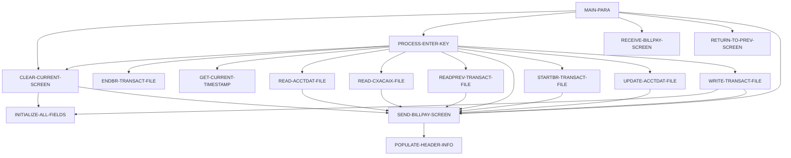

# 設計書: COBIL00C

_LegacyLens により自動生成。構造は静的解析、目的と業務ルールは LLM が作成し、各ルールはソースと照合済み。_

## 概要

| 種別 | オンライン (CICS) |
| --- | --- |
| コード行数 | 420 |
| ソース | [cbl/COBIL00C.cbl](https://github.com/aws-samples/aws-mainframe-modernization-carddemo/blob/59cc6c2fd7ebd7ef7925cad552a01a4b8b6e4d5e/app/cbl/COBIL00C.cbl) |

**目的.** このCOBOLプログラムは、ビジネスの支払い処理トランザクションを処理し、アカウントとトランザクションデータを読み取り、更新します。ユーザーのインタラクションを処理し、アカウント詳細を更新し、トランザクションをファイルにログ記録します。これにより、各支払いが正確に記録され、アカウントの残高が適切に更新されることを保証します。

## 入出力

| ファイル / データセット | モード | 行 |
| --- | --- | --- |
| ACCTDAT | 読込 | [345](https://github.com/aws-samples/aws-mainframe-modernization-carddemo/blob/59cc6c2fd7ebd7ef7925cad552a01a4b8b6e4d5e/app/cbl/COBIL00C.cbl#L345) |
| ACCTDAT | 書込 | [379](https://github.com/aws-samples/aws-mainframe-modernization-carddemo/blob/59cc6c2fd7ebd7ef7925cad552a01a4b8b6e4d5e/app/cbl/COBIL00C.cbl#L379) |
| CXACAIX | 読込 | [410](https://github.com/aws-samples/aws-mainframe-modernization-carddemo/blob/59cc6c2fd7ebd7ef7925cad552a01a4b8b6e4d5e/app/cbl/COBIL00C.cbl#L410) |
| TRANSACT | 読込 | [443](https://github.com/aws-samples/aws-mainframe-modernization-carddemo/blob/59cc6c2fd7ebd7ef7925cad552a01a4b8b6e4d5e/app/cbl/COBIL00C.cbl#L443) |
| TRANSACT | 書込 | [512](https://github.com/aws-samples/aws-mainframe-modernization-carddemo/blob/59cc6c2fd7ebd7ef7925cad552a01a4b8b6e4d5e/app/cbl/COBIL00C.cbl#L512) |

## 他プログラムへの遷移

| プログラム | 方式 | 行 |
| --- | --- | --- |
| COMEN01C | XCTL | [281](https://github.com/aws-samples/aws-mainframe-modernization-carddemo/blob/59cc6c2fd7ebd7ef7925cad552a01a4b8b6e4d5e/app/cbl/COBIL00C.cbl#L281) |
| COSGN00C | XCTL | [281](https://github.com/aws-samples/aws-mainframe-modernization-carddemo/blob/59cc6c2fd7ebd7ef7925cad552a01a4b8b6e4d5e/app/cbl/COBIL00C.cbl#L281) |

## コピー句

`COCOM01Y`, `COBIL00`, `COTTL01Y`, `CSDAT01Y`, `CSMSG01Y`, `CVACT01Y`, `CVACT03Y`, `CVTRA05Y`, `DFHAID`, `DFHBMSCA`

## 処理フロー (PERFORM)

## 業務ルール

| ID | 内容 | 条件 | 結果 | 根拠 | 検証 |
| --- | --- | --- | --- | --- | --- |
| COBIL00C-R1 | 入力が受け取られない場合、前の画面に戻ります。 | EIBCALEN = 0 | MOVE 'COSGN00C' TO CDEMO-TO-PROGRAM, PERFORM RETURN-TO-PREV-SCREEN | [107-109](https://github.com/aws-samples/aws-mainframe-modernization-carddemo/blob/59cc6c2fd7ebd7ef7925cad552a01a4b8b6e4d5e/app/cbl/COBIL00C.cbl#L107-L109) | OK |
| COBIL00C-R2 | プログラムが再入力されない場合、SEND-BILLPAY-SCREENを実行します。 | NOT CDEMO-PGM-REENTER | SET CDEMO-PGM-REENTER TO TRUE, MOVE LOW-VALUES TO COBIL0AO, MOVE -1 TO ACTIDINL OF COBIL0AI, IF CDEMO-CB00-TRN-SELECTED NOT = SPACES AND LOW-VALUES THEN MOVE CDEMO-CB00-TRN-SELECTED TO ACTIDINI OF COBIL0AI, PERFORM PROCESS-ENTER-KEY, PERFORM SEND-BILLPAY-SCREEN | [112-122](https://github.com/aws-samples/aws-mainframe-modernization-carddemo/blob/59cc6c2fd7ebd7ef7925cad552a01a4b8b6e4d5e/app/cbl/COBIL00C.cbl#L112-L122) | OK |
| COBIL00C-R3 | プログラムが再入力された場合、RECEIVE-BILLPAY-SCREENを実行します。 | CDEMO-PGM-REENTER | PERFORM RECEIVE-BILLPAY-SCREEN | [123-123](https://github.com/aws-samples/aws-mainframe-modernization-carddemo/blob/59cc6c2fd7ebd7ef7925cad552a01a4b8b6e4d5e/app/cbl/COBIL00C.cbl#L123-L123) | NG: cited lines contain none of the rule's fields, codes or messages |
| COBIL00C-R4 | エンターキーが押された場合、PROCESS-ENTER-KEYを実行します。 | EIBAID = DFHENTER | PERFORM PROCESS-ENTER-KEY | [126-127](https://github.com/aws-samples/aws-mainframe-modernization-carddemo/blob/59cc6c2fd7ebd7ef7925cad552a01a4b8b6e4d5e/app/cbl/COBIL00C.cbl#L126-L127) | OK |
| COBIL00C-R5 | PF3キーが押された場合、前のプログラムまたは画面に戻ります。 | EIBAID = DFHPF3 | IF CDEMO-FROM-PROGRAM = SPACES OR LOW-VALUES THEN MOVE 'COMEN01C' TO CDEMO-TO-PROGRAM ELSE MOVE CDEMO-FROM-PROGRAM TO CDEMO-TO-PROGRAM, PERFORM RETURN-TO-PREV-SCREEN | [129-135](https://github.com/aws-samples/aws-mainframe-modernization-carddemo/blob/59cc6c2fd7ebd7ef7925cad552a01a4b8b6e4d5e/app/cbl/COBIL00C.cbl#L129-L135) | OK |
| COBIL00C-R6 | PF4キーが押された場合、現在の画面をクリアします。 | EIBAID = DFHPF4 | PERFORM CLEAR-CURRENT-SCREEN | [137-138](https://github.com/aws-samples/aws-mainframe-modernization-carddemo/blob/59cc6c2fd7ebd7ef7925cad552a01a4b8b6e4d5e/app/cbl/COBIL00C.cbl#L137-L138) | OK |
| COBIL00C-R7 | 無効なキーが押された場合、エラーフラグとメッセージを設定します。 | EIBAID NOT IN (DFHENTER, DFHPF3, DFHPF4) | MOVE 'Y' TO WS-ERR-FLG, MOVE CCDA-MSG-INVALID-KEY TO WS-MESSAGE, PERFORM SEND-BILLPAY-SCREEN | [139-142](https://github.com/aws-samples/aws-mainframe-modernization-carddemo/blob/59cc6c2fd7ebd7ef7925cad552a01a4b8b6e4d5e/app/cbl/COBIL00C.cbl#L139-L142) | OK |
| COBIL00C-R8 | アカウントIDは空欄であってはなりません。 | ACTIDINI OF COBIL0AI = SPACES OR LOW-VALUES | WS-ERR-FLG = 'Y', WS-MESSAGE = 'Acct ID can NOT be empty...', ACTIDINL OF COBIL0AI = -1, PERFORM SEND-BILLPAY-SCREEN | [159-164](https://github.com/aws-samples/aws-mainframe-modernization-carddemo/blob/59cc6c2fd7ebd7ef7925cad552a01a4b8b6e4d5e/app/cbl/COBIL00C.cbl#L159-L164) | OK |
| COBIL00C-R9 | アカウントIDが有効な場合、続行します。 | NOT (ACTIDINI OF COBIL0AI = SPACES OR LOW-VALUES) | CONTINUE | [165-166](https://github.com/aws-samples/aws-mainframe-modernization-carddemo/blob/59cc6c2fd7ebd7ef7925cad552a01a4b8b6e4d5e/app/cbl/COBIL00C.cbl#L165-L166) | NG: cited lines contain none of the rule's fields, codes or messages |
| COBIL00C-R10 | 確認が 'Y' または 'y' の場合、確認フラグを設定します。 | CONFIRMI OF COBIL0AI = 'Y' OR 'y' | CONF-PAY-YES = TRUE, PERFORM READ-ACCTDAT-FILE | [173-176](https://github.com/aws-samples/aws-mainframe-modernization-carddemo/blob/59cc6c2fd7ebd7ef7925cad552a01a4b8b6e4d5e/app/cbl/COBIL00C.cbl#L173-L176) | OK |
| COBIL00C-R11 | 確認が 'N' または 'n' の場合、現在の画面をクリアします。 | CONFIRMI OF COBIL0AI = 'N' OR 'n' | PERFORM CLEAR-CURRENT-SCREEN | [178-180](https://github.com/aws-samples/aws-mainframe-modernization-carddemo/blob/59cc6c2fd7ebd7ef7925cad552a01a4b8b6e4d5e/app/cbl/COBIL00C.cbl#L178-L180) | OK |
| COBIL00C-R12 | 確認が無効な場合、エラー フラグを設定します。 | CONFIRMI OF COBIL0AI = SPACES OR LOW-VALUES OR OTHER | WS-ERR-FLG = 'Y', WS-MESSAGE = '無効な値です。有効な値は (Y/N)...', CONFIRML OF COBIL0AI = -1, PERFORM SEND-BILLPAY-SCREEN | [182-190](https://github.com/aws-samples/aws-mainframe-modernization-carddemo/blob/59cc6c2fd7ebd7ef7925cad552a01a4b8b6e4d5e/app/cbl/COBIL00C.cbl#L182-L190) | OK |
| COBIL00C-R13 | 現在の口座残高を画面フィールドに移動します。 | NOT WS-ERR-FLG | WS-CURR-BAL = ACCT-CURR-BAL, CURBALI OF COBIL0AI = WS-CURR-BAL | [193-195](https://github.com/aws-samples/aws-mainframe-modernization-carddemo/blob/59cc6c2fd7ebd7ef7925cad552a01a4b8b6e4d5e/app/cbl/COBIL00C.cbl#L193-L195) | OK |
| COBIL00C-R14 | 口座残高がゼロの場合、エラー フラグを設定します。 | ACCT-CURR-BAL <= ZEROS AND ACTIDINI OF COBIL0AI NOT = SPACES AND LOW-VALUES | WS-ERR-FLG = 'Y', WS-MESSAGE = '支払うべきものがありません...', ACTIDINL OF COBIL0AI = -1, PERFORM SEND-BILLPAY-SCREEN | [198-204](https://github.com/aws-samples/aws-mainframe-modernization-carddemo/blob/59cc6c2fd7ebd7ef7925cad552a01a4b8b6e4d5e/app/cbl/COBIL00C.cbl#L198-L204) | OK |
| COBIL00C-R15 | エラー フラグが存在しない場合、支払い確認を続行します。 | NOT ERR-FLG-ON AND CONF-PAY-YES | PERFORM READ-CXACAIX-FILE, STARTBR-TRANSACT-FILE, READPREV-TRANSACT-FILE, ENDBR-TRANSACT-FILE, WRITE-TRANSACT-FILE, UPDATE-ACCTDAT-FILE, SET WS-TRAN-ID-NUM, TRAN-RECORD, TRAN-ID, TRAN-TYPE-CD, TRAN-CAT-CD, TRAN-SOURCE, TRAN-DESC, TRAN-AMT, TRAN-CARD-NUM, TRAN-MERCHANT-ID, TRAN-MERCHANT-NAME, TRAN-MERCHANT-CITY, TRAN-MERCHANT-ZIP, WS-TIMESTAMP, ACCT-CURR-BAL | [208-236](https://github.com/aws-samples/aws-mainframe-modernization-carddemo/blob/59cc6c2fd7ebd7ef7925cad552a01a4b8b6e4d5e/app/cbl/COBIL00C.cbl#L208-L236) | OK |
| COBIL00C-R16 | エラー フラグが存在しない場合、かつ支払い確認が確認されていない場合、メッセージを設定し、確認画面に戻ります。 | NOT ERR-FLG-ON AND NOT CONF-PAY-YES | MOVE '支払い確認を行いますか...?' TO WS-MESSAGE, MOVE -1 TO CONFIRML OF COBIL0AI | [237-240](https://github.com/aws-samples/aws-mainframe-modernization-carddemo/blob/59cc6c2fd7ebd7ef7925cad552a01a4b8b6e4d5e/app/cbl/COBIL00C.cbl#L237-L240) | OK |
| COBIL00C-R17 | デフォルトのプログラムを設定する。現在のプログラムが無効な場合。 | CDEMO-TO-PROGRAM = LOW-VALUES OR SPACES | CDEMO-TO-PROGRAM = 'COSGN00C' | [275-277](https://github.com/aws-samples/aws-mainframe-modernization-carddemo/blob/59cc6c2fd7ebd7ef7925cad552a01a4b8b6e4d5e/app/cbl/COBIL00C.cbl#L275-L277) | OK |
| COBIL00C-R18 | トランザクションIDを通信領域に移動する。 | 常に | CDEMO-FROM-TRANID = WS-TRANID | [278-278](https://github.com/aws-samples/aws-mainframe-modernization-carddemo/blob/59cc6c2fd7ebd7ef7925cad552a01a4b8b6e4d5e/app/cbl/COBIL00C.cbl#L278-L278) | OK |
| COBIL00C-R19 | プログラム名を通信領域に移動する。 | 常に | CDEMO-FROM-PROGRAM = WS-PGMNAME | [279-279](https://github.com/aws-samples/aws-mainframe-modernization-carddemo/blob/59cc6c2fd7ebd7ef7925cad552a01a4b8b6e4d5e/app/cbl/COBIL00C.cbl#L279-L279) | OK |
| COBIL00C-R20 | プログラムコンテキストをゼロに設定する。 | 常に | CDEMO-PGM-CONTEXT = ZEROS | [280-280](https://github.com/aws-samples/aws-mainframe-modernization-carddemo/blob/59cc6c2fd7ebd7ef7925cad552a01a4b8b6e4d5e/app/cbl/COBIL00C.cbl#L280-L280) | OK |
| COBIL00C-R21 | CICS XCTLを実行して前の画面に戻る。 | 常に | EXEC CICS XCTL PROGRAM(CDEMO-TO-PROGRAM) COMMAREA(CARDDEMO-COMMAREA) | [281-284](https://github.com/aws-samples/aws-mainframe-modernization-carddemo/blob/59cc6c2fd7ebd7ef7925cad552a01a4b8b6e4d5e/app/cbl/COBIL00C.cbl#L281-L284) | OK |
| COBIL00C-R22 | アカウントデータをファイルから読み込む。 | EXEC CICS READ | READ-ACCTDAT-FILE | [345-352](https://github.com/aws-samples/aws-mainframe-modernization-carddemo/blob/59cc6c2fd7ebd7ef7925cad552a01a4b8b6e4d5e/app/cbl/COBIL00C.cbl#L345-L352) | OK |
| COBIL00C-R23 | アカウントIDが見つからない。 | WS-RESP-CD = DFHRESP(NOTFND) | WS-ERR-FLG = 'Y', WS-MESSAGE = 'Account ID NOT found...', ACTIDINL OF COBIL0AI = -1, PERFORM SEND-BILLPAY-SCREEN | [359-364](https://github.com/aws-samples/aws-mainframe-modernization-carddemo/blob/59cc6c2fd7ebd7ef7925cad552a01a4b8b6e4d5e/app/cbl/COBIL00C.cbl#L359-L364) | OK |
| COBIL00C-R24 | 予期しない応答コードを処理する。 | WS-RESP-CD != DFHRESP(NORMAL) AND WS-RESP-CD != DFHRESP(NOTFND) | DISPLAY 'RESP:' WS-RESP-CD 'REAS:' WS-REAS-CD, WS-ERR-FLG = 'Y', WS-MESSAGE = 'Unable to lookup Account...', ACTIDINL OF COBIL0AI = -1, PERFORM SEND-BILLPAY-SCREEN | [365-371](https://github.com/aws-samples/aws-mainframe-modernization-carddemo/blob/59cc6c2fd7ebd7ef7925cad552a01a4b8b6e4d5e/app/cbl/COBIL00C.cbl#L365-L371) | OK |
| COBIL00C-R25 | アカウントレコードを更新した際の通常の応答が期待されます。 | WS-RESP-CD = DFHRESP(NORMAL) | CONTINUE | [387-389](https://github.com/aws-samples/aws-mainframe-modernization-carddemo/blob/59cc6c2fd7ebd7ef7925cad552a01a4b8b6e4d5e/app/cbl/COBIL00C.cbl#L387-L389) | OK |
| COBIL00C-R26 | アカウントIDが見つからない場合、エラーフラグを設定しメッセージを送ります。 | WS-RESP-CD = DFHRESP(NOTFND) | WS-ERR-FLG = 'Y', WS-MESSAGE = 'Account ID NOT found...', ACTIDINL OF COBIL0AI = -1, PERFORM SEND-BILLPAY-SCREEN | [390-395](https://github.com/aws-samples/aws-mainframe-modernization-carddemo/blob/59cc6c2fd7ebd7ef7925cad552a01a4b8b6e4d5e/app/cbl/COBIL00C.cbl#L390-L395) | OK |
| COBIL00C-R27 | 予期しない応答の場合、エラーフラグを設定しメッセージを送ります。 | WS-RESP-CD != DFHRESP(NORMAL) AND WS-RESP-CD != DFHRESP(NOTFND) | DISPLAY 'RESP:' WS-RESP-CD 'REAS:' WS-REAS-CD, WS-ERR-FLG = 'Y', WS-MESSAGE = 'Unable to Update Account...', ACTIDINL OF COBIL0AI = -1, PERFORM SEND-BILLPAY-SCREEN | [396-402](https://github.com/aws-samples/aws-mainframe-modernization-carddemo/blob/59cc6c2fd7ebd7ef7925cad552a01a4b8b6e4d5e/app/cbl/COBIL00C.cbl#L396-L402) | OK |
| COBIL00C-R28 | 指定されたアカウントIDのCXACAIXファイルを読み込みます。 | EXEC CICS READ | WS-RESP-CD, WS-REAS-CD, CARD-XREF-RECORD | [410-417](https://github.com/aws-samples/aws-mainframe-modernization-carddemo/blob/59cc6c2fd7ebd7ef7925cad552a01a4b8b6e4d5e/app/cbl/COBIL00C.cbl#L410-L417) | OK |
| COBIL00C-R29 | アカウントIDが見つからない場合、エラーフラグを設定しメッセージを送ります。 | WS-RESP-CD = DFHRESP(NOTFND) | WS-ERR-FLG = 'Y', WS-MESSAGE = 'Account ID NOT found...', ACTIDINL OF COBIL0AI = -1, PERFORM SEND-BILLPAY-SCREEN | [423-428](https://github.com/aws-samples/aws-mainframe-modernization-carddemo/blob/59cc6c2fd7ebd7ef7925cad552a01a4b8b6e4d5e/app/cbl/COBIL00C.cbl#L423-L428) | OK |
| COBIL00C-R30 | 予期しない応答の場合、エラーフラグを設定しメッセージを送ります。 | WS-RESP-CD != DFHRESP(NORMAL) AND WS-RESP-CD != DFHRESP(NOTFND) | WS-ERR-FLG = 'Y', WS-MESSAGE = 'Unable to lookup XREF AIX file...', ACTIDINL OF COBIL0AI = -1, PERFORM SEND-BILLPAY-SCREEN | [430-435](https://github.com/aws-samples/aws-mainframe-modernization-carddemo/blob/59cc6c2fd7ebd7ef7925cad552a01a4b8b6e4d5e/app/cbl/COBIL00C.cbl#L430-L435) | OK |
| COBIL00C-R31 | トランザクションIDの照会が正常な応答を返します。 | WS-RESP-CD = DFHRESP(NORMAL) | CONTINUE | [451-453](https://github.com/aws-samples/aws-mainframe-modernization-carddemo/blob/59cc6c2fd7ebd7ef7925cad552a01a4b8b6e4d5e/app/cbl/COBIL00C.cbl#L451-L453) | OK |
| COBIL00C-R32 | トランザクションIDの照会が見つからない応答を返します。 | WS-RESP-CD = DFHRESP(NOTFND) | WS-ERR-FLG = 'Y', WS-MESSAGE = 'Transaction ID NOT found...', ACTIDINL OF COBIL0AI = -1, PERFORM SEND-BILLPAY-SCREEN | [454-459](https://github.com/aws-samples/aws-mainframe-modernization-carddemo/blob/59cc6c2fd7ebd7ef7925cad552a01a4b8b6e4d5e/app/cbl/COBIL00C.cbl#L454-L459) | OK |
| COBIL00C-R33 | トランザクションID検索が他の応答を返す | WS-RESP-CD != DFHRESP(NORMAL) AND WS-RESP-CD != DFHRESP(NOTFND) | DISPLAY 'RESP:' WS-RESP-CD 'REAS:' WS-REAS-CD, WS-ERR-FLG = 'Y', WS-MESSAGE = 'トランザクションIDの検索に失敗しました...', ACTIDINL OF COBIL0AI = -1, PERFORM SEND-BILLPAY-SCREEN | [460-466](https://github.com/aws-samples/aws-mainframe-modernization-carddemo/blob/59cc6c2fd7ebd7ef7925cad552a01a4b8b6e4d5e/app/cbl/COBIL00C.cbl#L460-L466) | OK |
| COBIL00C-R34 | 前のトランザクションレコードを読み込む | EXEC CICS READPREV | DATASET (WS-TRANSACT-FILE) INTO (TRAN-RECORD) | [474-480](https://github.com/aws-samples/aws-mainframe-modernization-carddemo/blob/59cc6c2fd7ebd7ef7925cad552a01a4b8b6e4d5e/app/cbl/COBIL00C.cbl#L474-L480) | OK |
| COBIL00C-R35 | CICS読み込みからの正常応答を処理する | WS-RESP-CD = DFHRESP(NORMAL) | CONTINUE | [484-486](https://github.com/aws-samples/aws-mainframe-modernization-carddemo/blob/59cc6c2fd7ebd7ef7925cad552a01a4b8b6e4d5e/app/cbl/COBIL00C.cbl#L484-L486) | OK |
| COBIL00C-R36 | CICS読み込みからのファイル終端応答を処理する | WS-RESP-CD = DFHRESP(ENDFILE) | MOVE ZEROS TO TRAN-ID | [487-488](https://github.com/aws-samples/aws-mainframe-modernization-carddemo/blob/59cc6c2fd7ebd7ef7925cad552a01a4b8b6e4d5e/app/cbl/COBIL00C.cbl#L487-L488) | OK |
| COBIL00C-R37 | CICS読み込みからの他の応答を処理する | WS-RESP-CD != DFHRESP(NORMAL) AND WS-RESP-CD != DFHRESP(ENDFILE) | DISPLAY 'RESP:' WS-RESP-CD 'REAS:' WS-REAS-CD, MOVE 'Y' TO WS-ERR-FLG, MOVE 'トランザクションIDの検索に失敗しました...' TO WS-MESSAGE, MOVE -1 TO ACTIDINL OF COBIL0AI, PERFORM SEND-BILLPAY-SCREEN | [489-495](https://github.com/aws-samples/aws-mainframe-modernization-carddemo/blob/59cc6c2fd7ebd7ef7925cad552a01a4b8b6e4d5e/app/cbl/COBIL00C.cbl#L489-L495) | OK |
| COBIL00C-R38 | トランザクションレコードの書き込み後の正常応答 | WS-RESP-CD = DFHRESP(NORMAL) | PERFORM INITIALIZE-ALL-FIELDS, WS-MESSAGE = '支払いが成功しました。あなたのトランザクションIDは <TRAN-ID> です。', ERRMSGC = DFHGREEN, PERFORM SEND-BILLPAY-SCREEN | [522-533](https://github.com/aws-samples/aws-mainframe-modernization-carddemo/blob/59cc6c2fd7ebd7ef7925cad552a01a4b8b6e4d5e/app/cbl/COBIL00C.cbl#L522-L533) | OK |
| COBIL00C-R39 | 重複キーまたはレコード応答でエラーメッセージを設定する | WS-RESP-CD = DFHRESP(DUPKEY) OR WS-RESP-CD = DFHRESP(DUPREC) | WS-ERR-FLG = 'Y', WS-MESSAGE = 'トランザクションIDが既に存在しています...', ACTIDINL = -1, PERFORM SEND-BILLPAY-SCREEN | [533-539](https://github.com/aws-samples/aws-mainframe-modernization-carddemo/blob/59cc6c2fd7ebd7ef7925cad552a01a4b8b6e4d5e/app/cbl/COBIL00C.cbl#L533-L539) | OK |
| COBIL00C-R40 | 予期しない応答でエラーメッセージを設定する | WS-RESP-CD != DFHRESP(NORMAL) AND WS-RESP-CD != DFHRESP(DUPKEY) AND WS-RESP-CD != DFHRESP(DUPREC) | DISPLAY 'RESP:' WS-RESP-CD 'REAS:' WS-REAS-CD, WS-ERR-FLG = 'Y', WS-MESSAGE = '支払いトランザクションの追加に失敗しました...', ACTIDINL = -1, PERFORM SEND-BILLPAY-SCREEN | [540-546](https://github.com/aws-samples/aws-mainframe-modernization-carddemo/blob/59cc6c2fd7ebd7ef7925cad552a01a4b8b6e4d5e/app/cbl/COBIL00C.cbl#L540-L546) | OK |
