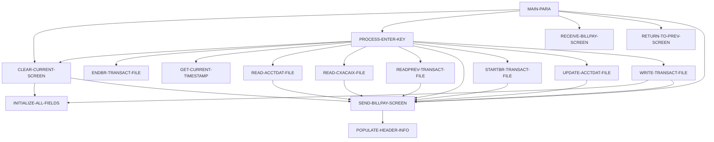

# 設計書: COBIL00C

_LegacyLens により自動生成。構造は静的解析、目的と業務ルールは LLM が作成し、各ルールはソースと照合済み。_

## 概要

| 種別 | オンライン (CICS) |
| --- | --- |
| コード行数 | 420 |
| ソース | [cbl/COBIL00C.cbl](../../data/carddemo/app/cbl/COBIL00C.cbl) |

## 入出力

| ファイル / データセット | モード | 行 |
| --- | --- | --- |
| ACCTDAT | 読込 | [345](../../data/carddemo/app/cbl/COBIL00C.cbl#L345) |
| ACCTDAT | 書込 | [379](../../data/carddemo/app/cbl/COBIL00C.cbl#L379) |
| CXACAIX | 読込 | [410](../../data/carddemo/app/cbl/COBIL00C.cbl#L410) |
| TRANSACT | 読込 | [443](../../data/carddemo/app/cbl/COBIL00C.cbl#L443) |
| TRANSACT | 書込 | [512](../../data/carddemo/app/cbl/COBIL00C.cbl#L512) |

## 他プログラムへの遷移

| プログラム | 方式 | 行 |
| --- | --- | --- |
| COMEN01C | XCTL | [281](../../data/carddemo/app/cbl/COBIL00C.cbl#L281) |
| COSGN00C | XCTL | [281](../../data/carddemo/app/cbl/COBIL00C.cbl#L281) |

## コピー句

`COCOM01Y`, `COBIL00`, `COTTL01Y`, `CSDAT01Y`, `CSMSG01Y`, `CVACT01Y`, `CVACT03Y`, `CVTRA05Y`, `DFHAID`, `DFHBMSCA`

## 処理フロー (PERFORM)

## 業務ルール

未抽出です。先に `legacylens extract` を実行してください。
