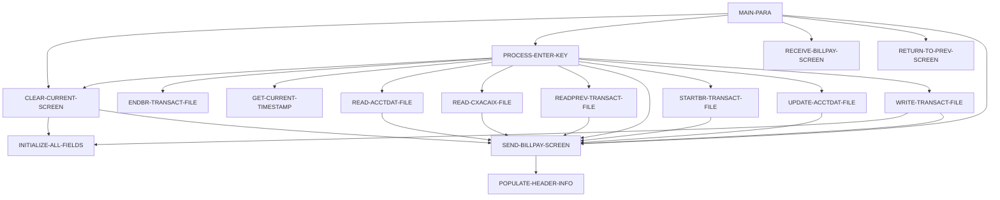

# Tài liệu thiết kế: COBIL00C

_Sinh tự động bởi LegacyLens. Phần cấu trúc lấy từ phân tích tĩnh; mục đích và quy tắc do LLM viết, mỗi quy tắc đã được đối chiếu với mã nguồn._

## Tổng quan

| Loại | Online (CICS) |
| --- | --- |
| Số dòng code | 420 |
| Mã nguồn | [cbl/COBIL00C.cbl](../../data/carddemo/app/cbl/COBIL00C.cbl) |

## Dữ liệu vào ra

| File / dataset | Chế độ | Dòng |
| --- | --- | --- |
| ACCTDAT | đọc | [345](../../data/carddemo/app/cbl/COBIL00C.cbl#L345) |
| ACCTDAT | ghi | [379](../../data/carddemo/app/cbl/COBIL00C.cbl#L379) |
| CXACAIX | đọc | [410](../../data/carddemo/app/cbl/COBIL00C.cbl#L410) |
| TRANSACT | đọc | [443](../../data/carddemo/app/cbl/COBIL00C.cbl#L443) |
| TRANSACT | ghi | [512](../../data/carddemo/app/cbl/COBIL00C.cbl#L512) |

## Chuyển sang chương trình khác

| Chương trình | Cách gọi | Dòng |
| --- | --- | --- |
| COMEN01C | XCTL | [281](../../data/carddemo/app/cbl/COBIL00C.cbl#L281) |
| COSGN00C | XCTL | [281](../../data/carddemo/app/cbl/COBIL00C.cbl#L281) |

## Copybook dùng

`COCOM01Y`, `COBIL00`, `COTTL01Y`, `CSDAT01Y`, `CSMSG01Y`, `CVACT01Y`, `CVACT03Y`, `CVTRA05Y`, `DFHAID`, `DFHBMSCA`

## Luồng xử lý (PERFORM)

## Quy tắc nghiệp vụ

Chưa trích xuất. Chạy `legacylens extract` trước.
