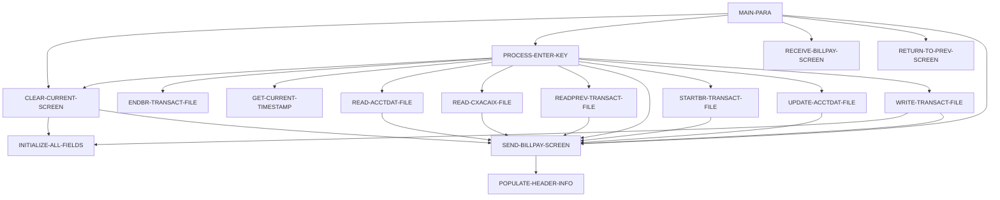

# Tài liệu thiết kế: COBIL00C

_Sinh tự động bởi LegacyLens. Phần cấu trúc lấy từ phân tích tĩnh; mục đích và quy tắc do LLM viết, mỗi quy tắc đã được đối chiếu với mã nguồn._

## Tổng quan

| Loại | Online (CICS) |
| --- | --- |
| Số dòng code | 420 |
| Mã nguồn | [cbl/COBIL00C.cbl](https://github.com/aws-samples/aws-mainframe-modernization-carddemo/blob/59cc6c2fd7ebd7ef7925cad552a01a4b8b6e4d5e/app/cbl/COBIL00C.cbl) |

**Mục đích.** Chương trình COBOL này xử lý giao dịch thanh toán hóa đơn cho một doanh nghiệp bằng cách đọc và cập nhật dữ liệu tài khoản và giao dịch. Nó xử lý tương tác người dùng, cập nhật chi tiết tài khoản và ghi lại giao dịch trong các tệp, đảm bảo rằng mỗi thanh toán được ghi lại chính xác và số dư tài khoản được cập nhật theo cách tương ứng.

## Dữ liệu vào ra

| File / dataset | Chế độ | Dòng |
| --- | --- | --- |
| ACCTDAT | đọc | [345](https://github.com/aws-samples/aws-mainframe-modernization-carddemo/blob/59cc6c2fd7ebd7ef7925cad552a01a4b8b6e4d5e/app/cbl/COBIL00C.cbl#L345) |
| ACCTDAT | ghi | [379](https://github.com/aws-samples/aws-mainframe-modernization-carddemo/blob/59cc6c2fd7ebd7ef7925cad552a01a4b8b6e4d5e/app/cbl/COBIL00C.cbl#L379) |
| CXACAIX | đọc | [410](https://github.com/aws-samples/aws-mainframe-modernization-carddemo/blob/59cc6c2fd7ebd7ef7925cad552a01a4b8b6e4d5e/app/cbl/COBIL00C.cbl#L410) |
| TRANSACT | đọc | [443](https://github.com/aws-samples/aws-mainframe-modernization-carddemo/blob/59cc6c2fd7ebd7ef7925cad552a01a4b8b6e4d5e/app/cbl/COBIL00C.cbl#L443) |
| TRANSACT | ghi | [512](https://github.com/aws-samples/aws-mainframe-modernization-carddemo/blob/59cc6c2fd7ebd7ef7925cad552a01a4b8b6e4d5e/app/cbl/COBIL00C.cbl#L512) |

## Chuyển sang chương trình khác

| Chương trình | Cách gọi | Dòng |
| --- | --- | --- |
| COMEN01C | XCTL | [281](https://github.com/aws-samples/aws-mainframe-modernization-carddemo/blob/59cc6c2fd7ebd7ef7925cad552a01a4b8b6e4d5e/app/cbl/COBIL00C.cbl#L281) |
| COSGN00C | XCTL | [281](https://github.com/aws-samples/aws-mainframe-modernization-carddemo/blob/59cc6c2fd7ebd7ef7925cad552a01a4b8b6e4d5e/app/cbl/COBIL00C.cbl#L281) |

## Copybook dùng

`COCOM01Y`, `COBIL00`, `COTTL01Y`, `CSDAT01Y`, `CSMSG01Y`, `CVACT01Y`, `CVACT03Y`, `CVTRA05Y`, `DFHAID`, `DFHBMSCA`

## Luồng xử lý (PERFORM)

## Quy tắc nghiệp vụ

| Mã | Nội dung | Điều kiện | Kết quả | Trích dẫn | Kiểm tra |
| --- | --- | --- | --- | --- | --- |
| COBIL00C-R1 | Nếu không nhận được đầu vào, quay lại màn hình trước đó. | EIBCALEN = 0 | MOVE 'COSGN00C' TO CDEMO-TO-PROGRAM, PERFORM RETURN-TO-PREV-SCREEN | [107-109](https://github.com/aws-samples/aws-mainframe-modernization-carddemo/blob/59cc6c2fd7ebd7ef7925cad552a01a4b8b6e4d5e/app/cbl/COBIL00C.cbl#L107-L109) | đúng |
| COBIL00C-R2 | Nếu chương trình không được nhập lại, thực hiện SEND-BILLPAY-SCREEN. | NOT CDEMO-PGM-REENTER | SET CDEMO-PGM-REENTER TO TRUE, MOVE LOW-VALUES TO COBIL0AO, MOVE -1 TO ACTIDINL OF COBIL0AI, IF CDEMO-CB00-TRN-SELECTED NOT = SPACES AND LOW-VALUES THEN MOVE CDEMO-CB00-TRN-SELECTED TO ACTIDINI OF COBIL0AI, PERFORM PROCESS-ENTER-KEY, PERFORM SEND-BILLPAY-SCREEN | [112-122](https://github.com/aws-samples/aws-mainframe-modernization-carddemo/blob/59cc6c2fd7ebd7ef7925cad552a01a4b8b6e4d5e/app/cbl/COBIL00C.cbl#L112-L122) | đúng |
| COBIL00C-R3 | Nếu chương trình được nhập lại, thực hiện RECEIVE-BILLPAY-SCREEN. | CDEMO-PGM-REENTER | PERFORM RECEIVE-BILLPAY-SCREEN | [123-123](https://github.com/aws-samples/aws-mainframe-modernization-carddemo/blob/59cc6c2fd7ebd7ef7925cad552a01a4b8b6e4d5e/app/cbl/COBIL00C.cbl#L123-L123) | sai: cited lines contain none of the rule's fields, codes or messages |
| COBIL00C-R4 | Nếu phím Enter được nhấn, thực hiện PROCESS-ENTER-KEY. | EIBAID = DFHENTER | PERFORM PROCESS-ENTER-KEY | [126-127](https://github.com/aws-samples/aws-mainframe-modernization-carddemo/blob/59cc6c2fd7ebd7ef7925cad552a01a4b8b6e4d5e/app/cbl/COBIL00C.cbl#L126-L127) | đúng |
| COBIL00C-R5 | Nếu phím PF3 được nhấn, quay lại chương trình hoặc màn hình trước đó. | EIBAID = DFHPF3 | IF CDEMO-FROM-PROGRAM = SPACES OR LOW-VALUES THEN MOVE 'COMEN01C' TO CDEMO-TO-PROGRAM ELSE MOVE CDEMO-FROM-PROGRAM TO CDEMO-TO-PROGRAM, PERFORM RETURN-TO-PREV-SCREEN | [129-135](https://github.com/aws-samples/aws-mainframe-modernization-carddemo/blob/59cc6c2fd7ebd7ef7925cad552a01a4b8b6e4d5e/app/cbl/COBIL00C.cbl#L129-L135) | đúng |
| COBIL00C-R6 | Nếu phím PF4 được nhấn, làm sạch màn hình hiện tại. | EIBAID = DFHPF4 | PERFORM CLEAR-CURRENT-SCREEN | [137-138](https://github.com/aws-samples/aws-mainframe-modernization-carddemo/blob/59cc6c2fd7ebd7ef7925cad552a01a4b8b6e4d5e/app/cbl/COBIL00C.cbl#L137-L138) | đúng |
| COBIL00C-R7 | Nếu một phím không hợp lệ được nhấn, đặt cờ lỗi và thông báo. | EIBAID NOT IN (DFHENTER, DFHPF3, DFHPF4) | MOVE 'Y' TO WS-ERR-FLG, MOVE CCDA-MSG-INVALID-KEY TO WS-MESSAGE, PERFORM SEND-BILLPAY-SCREEN | [139-142](https://github.com/aws-samples/aws-mainframe-modernization-carddemo/blob/59cc6c2fd7ebd7ef7925cad552a01a4b8b6e4d5e/app/cbl/COBIL00C.cbl#L139-L142) | đúng |
| COBIL00C-R8 | ID tài khoản không thể để trống. | ACTIDINI OF COBIL0AI = SPACES OR LOW-VALUES | WS-ERR-FLG = 'Y', WS-MESSAGE = 'ID tài khoản không thể để trống...', ACTIDINL OF COBIL0AI = -1, PERFORM SEND-BILLPAY-SCREEN | [159-164](https://github.com/aws-samples/aws-mainframe-modernization-carddemo/blob/59cc6c2fd7ebd7ef7925cad552a01a4b8b6e4d5e/app/cbl/COBIL00C.cbl#L159-L164) | đúng |
| COBIL00C-R9 | Tiếp tục nếu ID tài khoản hợp lệ. | NOT (ACTIDINI OF COBIL0AI = SPACES OR LOW-VALUES) | CONTINUE | [165-166](https://github.com/aws-samples/aws-mainframe-modernization-carddemo/blob/59cc6c2fd7ebd7ef7925cad552a01a4b8b6e4d5e/app/cbl/COBIL00C.cbl#L165-L166) | sai: cited lines contain none of the rule's fields, codes or messages |
| COBIL00C-R10 | Đặt cờ xác nhận nếu xác nhận là 'Y' hoặc 'y'. | CONFIRMI OF COBIL0AI = 'Y' OR 'y' | CONF-PAY-YES = TRUE, PERFORM READ-ACCTDAT-FILE | [173-176](https://github.com/aws-samples/aws-mainframe-modernization-carddemo/blob/59cc6c2fd7ebd7ef7925cad552a01a4b8b6e4d5e/app/cbl/COBIL00C.cbl#L173-L176) | đúng |
| COBIL00C-R11 | Xóa màn hình hiện tại nếu xác nhận là 'N' hoặc 'n'. | CONFIRMI OF COBIL0AI = 'N' OR 'n' | PERFORM CLEAR-CURRENT-SCREEN | [178-180](https://github.com/aws-samples/aws-mainframe-modernization-carddemo/blob/59cc6c2fd7ebd7ef7925cad552a01a4b8b6e4d5e/app/cbl/COBIL00C.cbl#L178-L180) | đúng |
| COBIL00C-R12 | Đặt cờ lỗi nếu xác nhận không hợp lệ. | CONFIRMI OF COBIL0AI = SPACES OR LOW-VALUES OR OTHER | WS-ERR-FLG = 'Y', WS-MESSAGE = 'Giá trị không hợp lệ. Giá trị hợp lệ là (Y/N)...', CONFIRML OF COBIL0AI = -1, PERFORM SEND-BILLPAY-SCREEN | [182-190](https://github.com/aws-samples/aws-mainframe-modernization-carddemo/blob/59cc6c2fd7ebd7ef7925cad552a01a4b8b6e4d5e/app/cbl/COBIL00C.cbl#L182-L190) | đúng |
| COBIL00C-R13 | Di chuyển số dư tài khoản hiện tại đến trường màn hình. | NOT WS-ERR-FLG | WS-CURR-BAL = ACCT-CURR-BAL, CURBALI OF COBIL0AI = WS-CURR-BAL | [193-195](https://github.com/aws-samples/aws-mainframe-modernization-carddemo/blob/59cc6c2fd7ebd7ef7925cad552a01a4b8b6e4d5e/app/cbl/COBIL00C.cbl#L193-L195) | đúng |
| COBIL00C-R14 | Đặt cờ lỗi nếu số dư tài khoản là không. | ACCT-CURR-BAL <= ZEROS AND ACTIDINI OF COBIL0AI NOT = SPACES AND LOW-VALUES | WS-ERR-FLG = 'Y', WS-MESSAGE = 'Bạn không có gì để thanh toán...', ACTIDINL OF COBIL0AI = -1, PERFORM SEND-BILLPAY-SCREEN | [198-204](https://github.com/aws-samples/aws-mainframe-modernization-carddemo/blob/59cc6c2fd7ebd7ef7925cad552a01a4b8b6e4d5e/app/cbl/COBIL00C.cbl#L198-L204) | đúng |
| COBIL00C-R15 | Nếu không có cờ lỗi, tiếp tục xác nhận thanh toán hóa đơn. | NOT ERR-FLG-ON AND CONF-PAY-YES | PERFORM READ-CXACAIX-FILE, STARTBR-TRANSACT-FILE, READPREV-TRANSACT-FILE, ENDBR-TRANSACT-FILE, WRITE-TRANSACT-FILE, UPDATE-ACCTDAT-FILE, SET WS-TRAN-ID-NUM, TRAN-RECORD, TRAN-ID, TRAN-TYPE-CD, TRAN-CAT-CD, TRAN-SOURCE, TRAN-DESC, TRAN-AMT, TRAN-CARD-NUM, TRAN-MERCHANT-ID, TRAN-MERCHANT-NAME, TRAN-MERCHANT-CITY, TRAN-MERCHANT-ZIP, WS-TIMESTAMP, ACCT-CURR-BAL | [208-236](https://github.com/aws-samples/aws-mainframe-modernization-carddemo/blob/59cc6c2fd7ebd7ef7925cad552a01a4b8b6e4d5e/app/cbl/COBIL00C.cbl#L208-L236) | đúng |
| COBIL00C-R16 | Nếu không có cờ lỗi và xác nhận thanh toán không được xác nhận, đặt một thông điệp và quay lại màn hình xác nhận. | NOT ERR-FLG-ON AND NOT CONF-PAY-YES | MOVE 'Xác nhận để thanh toán hóa đơn...' TO WS-MESSAGE, MOVE -1 TO CONFIRML OF COBIL0AI | [237-240](https://github.com/aws-samples/aws-mainframe-modernization-carddemo/blob/59cc6c2fd7ebd7ef7925cad552a01a4b8b6e4d5e/app/cbl/COBIL00C.cbl#L237-L240) | đúng |
| COBIL00C-R17 | Đặt chương trình mặc định nếu chương trình hiện tại không hợp lệ. | CDEMO-TO-PROGRAM = LOW-VALUES OR SPACES | CDEMO-TO-PROGRAM = 'COSGN00C' | [275-277](https://github.com/aws-samples/aws-mainframe-modernization-carddemo/blob/59cc6c2fd7ebd7ef7925cad552a01a4b8b6e4d5e/app/cbl/COBIL00C.cbl#L275-L277) | đúng |
| COBIL00C-R18 | Di chuyển ID giao dịch đến khu vực giao tiếp. | whenever | CDEMO-FROM-TRANID = WS-TRANID | [278-278](https://github.com/aws-samples/aws-mainframe-modernization-carddemo/blob/59cc6c2fd7ebd7ef7925cad552a01a4b8b6e4d5e/app/cbl/COBIL00C.cbl#L278-L278) | đúng |
| COBIL00C-R19 | Di chuyển tên chương trình đến khu vực giao tiếp. | whenever | CDEMO-FROM-PROGRAM = WS-PGMNAME | [279-279](https://github.com/aws-samples/aws-mainframe-modernization-carddemo/blob/59cc6c2fd7ebd7ef7925cad552a01a4b8b6e4d5e/app/cbl/COBIL00C.cbl#L279-L279) | đúng |
| COBIL00C-R20 | Đặt ngữ cảnh chương trình thành không. | whenever | CDEMO-PGM-CONTEXT = ZEROS | [280-280](https://github.com/aws-samples/aws-mainframe-modernization-carddemo/blob/59cc6c2fd7ebd7ef7925cad552a01a4b8b6e4d5e/app/cbl/COBIL00C.cbl#L280-L280) | đúng |
| COBIL00C-R21 | Thực hiện CICS XCTL để quay lại màn hình trước đó. | whenever | EXEC CICS XCTL PROGRAM(CDEMO-TO-PROGRAM) COMMAREA(CARDDEMO-COMMAREA) | [281-284](https://github.com/aws-samples/aws-mainframe-modernization-carddemo/blob/59cc6c2fd7ebd7ef7925cad552a01a4b8b6e4d5e/app/cbl/COBIL00C.cbl#L281-L284) | đúng |
| COBIL00C-R22 | Đọc dữ liệu tài khoản từ tệp. | EXEC CICS READ | READ-ACCTDAT-FILE | [345-352](https://github.com/aws-samples/aws-mainframe-modernization-carddemo/blob/59cc6c2fd7ebd7ef7925cad552a01a4b8b6e4d5e/app/cbl/COBIL00C.cbl#L345-L352) | đúng |
| COBIL00C-R23 | ID tài khoản không được tìm thấy. | WS-RESP-CD = DFHRESP(NOTFND) | WS-ERR-FLG = 'Y', WS-MESSAGE = 'ID tài khoản không được tìm thấy...', ACTIDINL OF COBIL0AI = -1, PERFORM SEND-BILLPAY-SCREEN | [359-364](https://github.com/aws-samples/aws-mainframe-modernization-carddemo/blob/59cc6c2fd7ebd7ef7925cad552a01a4b8b6e4d5e/app/cbl/COBIL00C.cbl#L359-L364) | đúng |
| COBIL00C-R24 | Xử lý mã phản hồi không mong đợi. | WS-RESP-CD != DFHRESP(NORMAL) AND WS-RESP-CD != DFHRESP(NOTFND) | DISPLAY 'RESP:' WS-RESP-CD 'REAS:' WS-REAS-CD, WS-ERR-FLG = 'Y', WS-MESSAGE = 'Không thể tra cứu tài khoản...', ACTIDINL OF COBIL0AI = -1, PERFORM SEND-BILLPAY-SCREEN | [365-371](https://github.com/aws-samples/aws-mainframe-modernization-carddemo/blob/59cc6c2fd7ebd7ef7925cad552a01a4b8b6e4d5e/app/cbl/COBIL00C.cbl#L365-L371) | đúng |
| COBIL00C-R25 | Một phản hồi bình thường khi cập nhật ghi tài khoản được mong đợi. | WS-RESP-CD = DFHRESP(NORMAL) | CONTINUE | [387-389](https://github.com/aws-samples/aws-mainframe-modernization-carddemo/blob/59cc6c2fd7ebd7ef7925cad552a01a4b8b6e4d5e/app/cbl/COBIL00C.cbl#L387-L389) | đúng |
| COBIL00C-R26 | Phản hồi tài khoản ID không tìm thấy đặt cờ lỗi và thông điệp. | WS-RESP-CD = DFHRESP(NOTFND) | WS-ERR-FLG = 'Y', WS-MESSAGE = 'Account ID NOT found...', ACTIDINL OF COBIL0AI = -1, PERFORM SEND-BILLPAY-SCREEN | [390-395](https://github.com/aws-samples/aws-mainframe-modernization-carddemo/blob/59cc6c2fd7ebd7ef7925cad552a01a4b8b6e4d5e/app/cbl/COBIL00C.cbl#L390-L395) | đúng |
| COBIL00C-R27 | Phản hồi không mong đợi đặt cờ lỗi và thông điệp. | WS-RESP-CD != DFHRESP(NORMAL) AND WS-RESP-CD != DFHRESP(NOTFND) | DISPLAY 'RESP:' WS-RESP-CD 'REAS:' WS-REAS-CD, WS-ERR-FLG = 'Y', WS-MESSAGE = 'Unable to Update Account...', ACTIDINL OF COBIL0AI = -1, PERFORM SEND-BILLPAY-SCREEN | [396-402](https://github.com/aws-samples/aws-mainframe-modernization-carddemo/blob/59cc6c2fd7ebd7ef7925cad552a01a4b8b6e4d5e/app/cbl/COBIL00C.cbl#L396-L402) | đúng |
| COBIL00C-R28 | Đọc tệp CXACAIX cho ID tài khoản đã cho. | EXEC CICS READ | WS-RESP-CD, WS-REAS-CD, CARD-XREF-RECORD | [410-417](https://github.com/aws-samples/aws-mainframe-modernization-carddemo/blob/59cc6c2fd7ebd7ef7925cad552a01a4b8b6e4d5e/app/cbl/COBIL00C.cbl#L410-L417) | đúng |
| COBIL00C-R29 | Đặt cờ lỗi và thông điệp nếu ID tài khoản không tìm thấy. | WS-RESP-CD = DFHRESP(NOTFND) | WS-ERR-FLG = 'Y', WS-MESSAGE = 'Account ID NOT found...', ACTIDINL OF COBIL0AI = -1, PERFORM SEND-BILLPAY-SCREEN | [423-428](https://github.com/aws-samples/aws-mainframe-modernization-carddemo/blob/59cc6c2fd7ebd7ef7925cad552a01a4b8b6e4d5e/app/cbl/COBIL00C.cbl#L423-L428) | đúng |
| COBIL00C-R30 | Đặt cờ lỗi và thông điệp cho phản hồi không mong đợi. | WS-RESP-CD != DFHRESP(NORMAL) AND WS-RESP-CD != DFHRESP(NOTFND) | WS-ERR-FLG = 'Y', WS-MESSAGE = 'Unable to lookup XREF AIX file...', ACTIDINL OF COBIL0AI = -1, PERFORM SEND-BILLPAY-SCREEN | [430-435](https://github.com/aws-samples/aws-mainframe-modernization-carddemo/blob/59cc6c2fd7ebd7ef7925cad552a01a4b8b6e4d5e/app/cbl/COBIL00C.cbl#L430-L435) | đúng |
| COBIL00C-R31 | Phản hồi tra cứu ID giao dịch trả về phản hồi bình thường. | WS-RESP-CD = DFHRESP(NORMAL) | CONTINUE | [451-453](https://github.com/aws-samples/aws-mainframe-modernization-carddemo/blob/59cc6c2fd7ebd7ef7925cad552a01a4b8b6e4d5e/app/cbl/COBIL00C.cbl#L451-L453) | đúng |
| COBIL00C-R32 | Phản hồi tra cứu ID giao dịch trả về phản hồi không tìm thấy. | WS-RESP-CD = DFHRESP(NOTFND) | WS-ERR-FLG = 'Y', WS-MESSAGE = 'Transaction ID NOT found...', ACTIDINL OF COBIL0AI = -1, PERFORM SEND-BILLPAY-SCREEN | [454-459](https://github.com/aws-samples/aws-mainframe-modernization-carddemo/blob/59cc6c2fd7ebd7ef7925cad552a01a4b8b6e4d5e/app/cbl/COBIL00C.cbl#L454-L459) | đúng |
| COBIL00C-R33 | Transaction ID lookup returns other response. | WS-RESP-CD != DFHRESP(NORMAL) AND WS-RESP-CD != DFHRESP(NOTFND) | DISPLAY 'RESP:' WS-RESP-CD 'REAS:' WS-REAS-CD, WS-ERR-FLG = 'Y', WS-MESSAGE = 'Không thể tra cứu Transaction...', ACTIDINL OF COBIL0AI = -1, PERFORM SEND-BILLPAY-SCREEN | [460-466](https://github.com/aws-samples/aws-mainframe-modernization-carddemo/blob/59cc6c2fd7ebd7ef7925cad552a01a4b8b6e4d5e/app/cbl/COBIL00C.cbl#L460-L466) | đúng |
| COBIL00C-R34 | Read previous transaction record. | EXEC CICS READPREV | DATASET (WS-TRANSACT-FILE) INTO (TRAN-RECORD) | [474-480](https://github.com/aws-samples/aws-mainframe-modernization-carddemo/blob/59cc6c2fd7ebd7ef7925cad552a01a4b8b6e4d5e/app/cbl/COBIL00C.cbl#L474-L480) | đúng |
| COBIL00C-R35 | Handle normal response from CICS read. | WS-RESP-CD = DFHRESP(NORMAL) | CONTINUE | [484-486](https://github.com/aws-samples/aws-mainframe-modernization-carddemo/blob/59cc6c2fd7ebd7ef7925cad552a01a4b8b6e4d5e/app/cbl/COBIL00C.cbl#L484-L486) | đúng |
| COBIL00C-R36 | Handle end of file response from CICS read. | WS-RESP-CD = DFHRESP(ENDFILE) | MOVE ZEROS TO TRAN-ID | [487-488](https://github.com/aws-samples/aws-mainframe-modernization-carddemo/blob/59cc6c2fd7ebd7ef7925cad552a01a4b8b6e4d5e/app/cbl/COBIL00C.cbl#L487-L488) | đúng |
| COBIL00C-R37 | Handle other responses from CICS read. | WS-RESP-CD != DFHRESP(NORMAL) AND WS-RESP-CD != DFHRESP(ENDFILE) | DISPLAY 'RESP:' WS-RESP-CD 'REAS:' WS-REAS-CD, MOVE 'Y' TO WS-ERR-FLG, MOVE 'Không thể tra cứu Transaction...' TO WS-MESSAGE, MOVE -1 TO ACTIDINL OF COBIL0AI, PERFORM SEND-BILLPAY-SCREEN | [489-495](https://github.com/aws-samples/aws-mainframe-modernization-carddemo/blob/59cc6c2fd7ebd7ef7925cad552a01a4b8b6e4d5e/app/cbl/COBIL00C.cbl#L489-L495) | đúng |
| COBIL00C-R38 | A normal response after writing a transaction record. | WS-RESP-CD = DFHRESP(NORMAL) | PERFORM INITIALIZE-ALL-FIELDS, WS-MESSAGE = 'Thanh toán thành công. Mã giao dịch của bạn là <TRAN-ID>.', ERRMSGC = DFHGREEN, PERFORM SEND-BILLPAY-SCREEN | [522-533](https://github.com/aws-samples/aws-mainframe-modernization-carddemo/blob/59cc6c2fd7ebd7ef7925cad552a01a4b8b6e4d5e/app/cbl/COBIL00C.cbl#L522-L533) | đúng |
| COBIL00C-R39 | A duplicate key or record response sets an error message. | WS-RESP-CD = DFHRESP(DUPKEY) OR WS-RESP-CD = DFHRESP(DUPREC) | WS-ERR-FLG = 'Y', WS-MESSAGE = 'Tran ID đã tồn tại...', ACTIDINL = -1, PERFORM SEND-BILLPAY-SCREEN | [533-539](https://github.com/aws-samples/aws-mainframe-modernization-carddemo/blob/59cc6c2fd7ebd7ef7925cad552a01a4b8b6e4d5e/app/cbl/COBIL00C.cbl#L533-L539) | đúng |
| COBIL00C-R40 | An unexpected response sets an error message. | WS-RESP-CD != DFHRESP(NORMAL) AND WS-RESP-CD != DFHRESP(DUPKEY) AND WS-RESP-CD != DFHRESP(DUPREC) | DISPLAY 'RESP:' WS-RESP-CD 'REAS:' WS-REAS-CD, WS-ERR-FLG = 'Y', WS-MESSAGE = 'Không thể thêm giao dịch thanh toán...', ACTIDINL = -1, PERFORM SEND-BILLPAY-SCREEN | [540-546](https://github.com/aws-samples/aws-mainframe-modernization-carddemo/blob/59cc6c2fd7ebd7ef7925cad552a01a4b8b6e4d5e/app/cbl/COBIL00C.cbl#L540-L546) | đúng |
