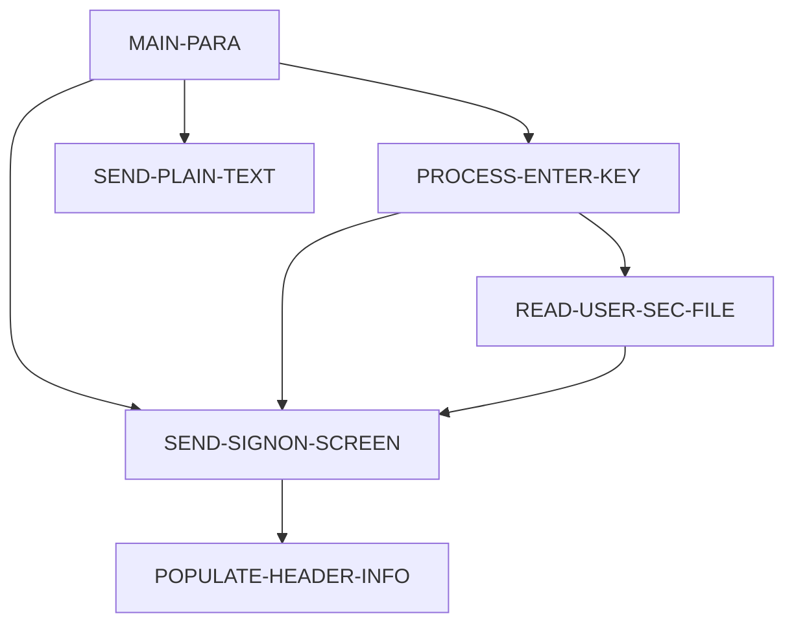

# 設計書: COSGN00C

_LegacyLens により自動生成。構造は静的解析、目的と業務ルールは LLM が作成し、各ルールはソースと照合済み。_

## 概要

| 種別 | オンライン (CICS) |
| --- | --- |
| コード行数 | 172 |
| ソース | [cbl/COSGN00C.cbl](../../data/carddemo/app/cbl/COSGN00C.cbl) |

**目的.** This program handles user sign-on for a system, validating user credentials and routing them to appropriate programs based on their role.

## 入出力

| ファイル / データセット | モード | 行 |
| --- | --- | --- |
| USRSEC | 読込 | [211](../../data/carddemo/app/cbl/COSGN00C.cbl#L211) |

## 他プログラムへの遷移

| プログラム | 方式 | 行 |
| --- | --- | --- |
| COADM01C | XCTL | [231](../../data/carddemo/app/cbl/COSGN00C.cbl#L231) |
| COMEN01C | XCTL | [236](../../data/carddemo/app/cbl/COSGN00C.cbl#L236) |

## 呼び出し元

COADM01C, COBIL00C, COMEN01C, COPAUS0C, CORPT00C, COTRN00C, COTRN01C, COTRN02C, COUSR00C, COUSR01C, COUSR02C, COUSR03C

## コピー句

`COCOM01Y`, `COSGN00`, `COTTL01Y`, `CSDAT01Y`, `CSMSG01Y`, `CSUSR01Y`, `DFHAID`, `DFHBMSCA`

## 処理フロー (PERFORM)

## 業務ルール

| ID | 内容 | 条件 | 結果 | 根拠 | 検証 |
| --- | --- | --- | --- | --- | --- |
| CBTRN02C-R1 | Check if the user entered a valid key and route accordingly. | The program receives a key from the user. | If the key is DFHENTER, it processes the enter key; if DFHPF3, it sends a thank you message; otherwise, it sends an invalid key message. | [80-95](../../data/carddemo/app/cbl/COSGN00C.cbl#L80-L95) | OK |
| CBTRN02C-R2 | Validate user ID and password upon sign-on. | The user enters a user ID and password. | If the user ID or password is invalid, it sends an error message and prompts the user to re-enter. | [110-140](../../data/carddemo/app/cbl/COSGN00C.cbl#L110-L140) | OK |
| CBTRN02C-R3 | Route the user to the appropriate program based on their role. | The user's role is determined after validating their credentials. | If the user is an administrator, it routes to COADM01C; otherwise, it routes to COMEN01C. | [230-257](../../data/carddemo/app/cbl/COSGN00C.cbl#L230-L257) | OK |
| CBTRN02C-R4 | Read user security data from a file. | The program needs to validate the user's password. | It reads the user's security data from the USRSEC file and compares the password. | [209-257](../../data/carddemo/app/cbl/COSGN00C.cbl#L209-L257) | OK |
