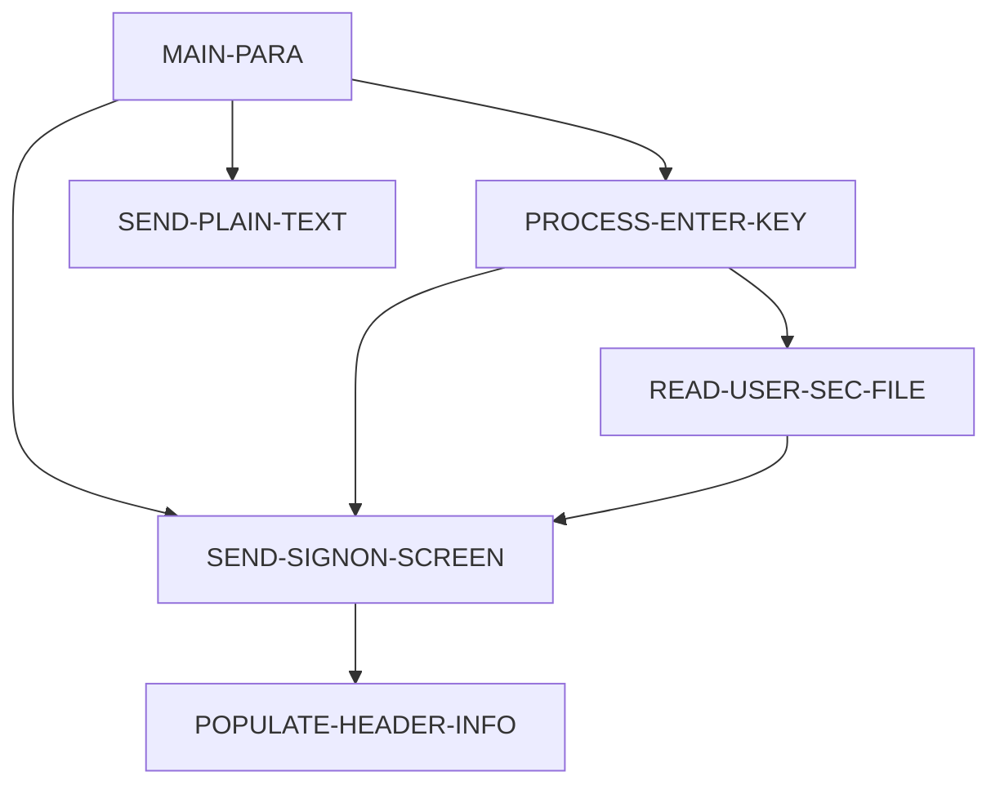

# 設計書: COSGN00C

_LegacyLens により自動生成。構造は静的解析、目的と業務ルールは LLM が作成し、各ルールはソースと照合済み。_

## 概要

| 種別 | オンライン (CICS) |
| --- | --- |
| コード行数 | 172 |
| ソース | [cbl/COSGN00C.cbl](https://github.com/aws-samples/aws-mainframe-modernization-carddemo/blob/59cc6c2fd7ebd7ef7925cad552a01a4b8b6e4d5e/app/cbl/COSGN00C.cbl) |

**目的.** プログラム COSGN00C は、ユーザーのセキュリティ情報を読み取り、ユーザーからの入力に基づいて適切なサインオン画面またはプレーンテキストの応答をユーザーに送信します。また、ユーザーのアクションに基づいて他のプログラムへの制御を移譲し、安全で効率的なユーザー認証とインタラクションを確保します。

## 入出力

| ファイル / データセット | モード | 行 |
| --- | --- | --- |
| USRSEC | 読込 | [211](https://github.com/aws-samples/aws-mainframe-modernization-carddemo/blob/59cc6c2fd7ebd7ef7925cad552a01a4b8b6e4d5e/app/cbl/COSGN00C.cbl#L211) |

## 他プログラムへの遷移

| プログラム | 方式 | 行 |
| --- | --- | --- |
| COADM01C | XCTL | [231](https://github.com/aws-samples/aws-mainframe-modernization-carddemo/blob/59cc6c2fd7ebd7ef7925cad552a01a4b8b6e4d5e/app/cbl/COSGN00C.cbl#L231) |
| COMEN01C | XCTL | [236](https://github.com/aws-samples/aws-mainframe-modernization-carddemo/blob/59cc6c2fd7ebd7ef7925cad552a01a4b8b6e4d5e/app/cbl/COSGN00C.cbl#L236) |

## 呼び出し元

COADM01C, COBIL00C, COMEN01C, COPAUS0C, CORPT00C, COTRN00C, COTRN01C, COTRN02C, COUSR00C, COUSR01C, COUSR02C, COUSR03C

## コピー句

`COCOM01Y`, `COSGN00`, `COTTL01Y`, `CSDAT01Y`, `CSMSG01Y`, `CSUSR01Y`, `DFHAID`, `DFHBMSCA`

## 処理フロー (PERFORM)

## 業務ルール

| ID | 内容 | 条件 | 結果 | 根拠 | 検証 |
| --- | --- | --- | --- | --- | --- |
| COSGN00C-R1 | 入力が受け取られない場合、COMMAREA を初期化し、USERIDL を -1 に設定します。 | EIBCALEN = 0 | MOVE LOW-VALUES TO COSGN0AO, MOVE -1 TO USERIDL OF COSGN0AI, PERFORM SEND-SIGNON-SCREEN | [80-83](https://github.com/aws-samples/aws-mainframe-modernization-carddemo/blob/59cc6c2fd7ebd7ef7925cad552a01a4b8b6e4d5e/app/cbl/COSGN00C.cbl#L80-L83) | OK |
| COSGN00C-R2 | DFHENTER キーが押された場合、エンターキーを処理します。 | EIBAID = DFHENTER | PERFORM PROCESS-ENTER-KEY | [86-87](https://github.com/aws-samples/aws-mainframe-modernization-carddemo/blob/59cc6c2fd7ebd7ef7925cad552a01a4b8b6e4d5e/app/cbl/COSGN00C.cbl#L86-L87) | OK |
| COSGN00C-R3 | DFHPF3 キーが押された場合、感謝のメッセージを表示します。 | EIBAID = DFHPF3 | MOVE CCDA-MSG-THANK-YOU TO WS-MESSAGE, PERFORM SEND-PLAIN-TEXT | [88-90](https://github.com/aws-samples/aws-mainframe-modernization-carddemo/blob/59cc6c2fd7ebd7ef7925cad552a01a4b8b6e4d5e/app/cbl/COSGN00C.cbl#L88-L90) | OK |
| COSGN00C-R4 | 無効なキーが押された場合、エラーフラグを設定し、無効なキーのメッセージを表示します。 | EIBAID NOT IN (DFHENTER, DFHPF3) | MOVE 'Y' TO WS-ERR-FLG, MOVE CCDA-MSG-INVALID-KEY TO WS-MESSAGE, PERFORM SEND-SIGNON-SCREEN | [91-94](https://github.com/aws-samples/aws-mainframe-modernization-carddemo/blob/59cc6c2fd7ebd7ef7925cad552a01a4b8b6e4d5e/app/cbl/COSGN00C.cbl#L91-L94) | OK |
| COSGN00C-R5 | ユーザーIDが入力されていなければなりません。 | USERIDI OF COSGN0AI = SPACES OR LOW-VALUES | WS-ERR-FLG = 'Y', WS-MESSAGE = 'ユーザーIDを入力してください...', USERIDL OF COSGN0AI = -1, PERFORM SEND-SIGNON-SCREEN | [118-122](https://github.com/aws-samples/aws-mainframe-modernization-carddemo/blob/59cc6c2fd7ebd7ef7925cad552a01a4b8b6e4d5e/app/cbl/COSGN00C.cbl#L118-L122) | OK |
| COSGN00C-R6 | パスワードが入力されていなければなりません。 | PASSWDI OF COSGN0AI = SPACES OR LOW-VALUES | WS-ERR-FLG = 'Y', WS-MESSAGE = 'パスワードを入力してください...', PASSWDL OF COSGN0AI = -1, PERFORM SEND-SIGNON-SCREEN | [123-127](https://github.com/aws-samples/aws-mainframe-modernization-carddemo/blob/59cc6c2fd7ebd7ef7925cad552a01a4b8b6e4d5e/app/cbl/COSGN00C.cbl#L123-L127) | OK |
| COSGN00C-R7 | エラーがない場合、ユーザーのセキュリティファイルを読み込みます。 | NOT ERR-FLG-ON | PERFORM READ-USER-SEC-FILE | [138-140](https://github.com/aws-samples/aws-mainframe-modernization-carddemo/blob/59cc6c2fd7ebd7ef7925cad552a01a4b8b6e4d5e/app/cbl/COSGN00C.cbl#L138-L140) | OK |
| COSGN00C-R8 | ユーザーのレコードが正常に読み込まれ、パスワードが一致した場合。 | WS-RESP-CD = 0 AND SEC-USR-PWD = WS-USER-PWD | MOVE WS-TRANID TO CDEMO-FROM-TRANID, MOVE WS-PGMNAME TO CDEMO-FROM-PROGRAM, MOVE WS-USER-ID TO CDEMO-USER-ID, MOVE SEC-USR-TYPE TO CDEMO-USER-TYPE, MOVE ZEROS TO CDEMO-PGM-CONTEXT, IF CDEMO-USRTYP-ADMIN THEN XCTL TO COADM01C ELSE XCTL TO COMEN01C | [221-241](https://github.com/aws-samples/aws-mainframe-modernization-carddemo/blob/59cc6c2fd7ebd7ef7925cad552a01a4b8b6e4d5e/app/cbl/COSGN00C.cbl#L221-L241) | OK |
| COSGN00C-R9 | ユーザー記録を正常に読み取りましたが、パスワードが一致しません。 | WS-RESP-CD = 0 AND SEC-USR-PWD NOT = WS-USER-PWD | MOVE 'パスワードが間違っています。再度試行してください ...' TO WS-MESSAGE, MOVE -1 TO PASSWDL OF COSGN0AI, PERFORM SEND-SIGNON-SCREEN | [242-246](https://github.com/aws-samples/aws-mainframe-modernization-carddemo/blob/59cc6c2fd7ebd7ef7925cad552a01a4b8b6e4d5e/app/cbl/COSGN00C.cbl#L242-L246) | OK |
| COSGN00C-R10 | ユーザー記録が見つかりません。 | WS-RESP-CD = 13 | MOVE 'Y' TO WS-ERR-FLG, MOVE 'ユーザーが見つかりません。再度試行してください ...' TO WS-MESSAGE, MOVE -1 TO USERIDL OF COSGN0AI, PERFORM SEND-SIGNON-SCREEN | [247-251](https://github.com/aws-samples/aws-mainframe-modernization-carddemo/blob/59cc6c2fd7ebd7ef7925cad552a01a4b8b6e4d5e/app/cbl/COSGN00C.cbl#L247-L251) | OK |
| COSGN00C-R11 | CICS リード操作からの予期しない応答コード。 | WS-RESP-CD NOT = 0 AND WS-RESP-CD NOT = 13 | MOVE 'Y' TO WS-ERR-FLG, MOVE 'ユーザーを確認できません ...' TO WS-MESSAGE, MOVE -1 TO USERIDL OF COSGN0AI, PERFORM SEND-SIGNON-SCREEN | [252-256](https://github.com/aws-samples/aws-mainframe-modernization-carddemo/blob/59cc6c2fd7ebd7ef7925cad552a01a4b8b6e4d5e/app/cbl/COSGN00C.cbl#L252-L256) | OK |
