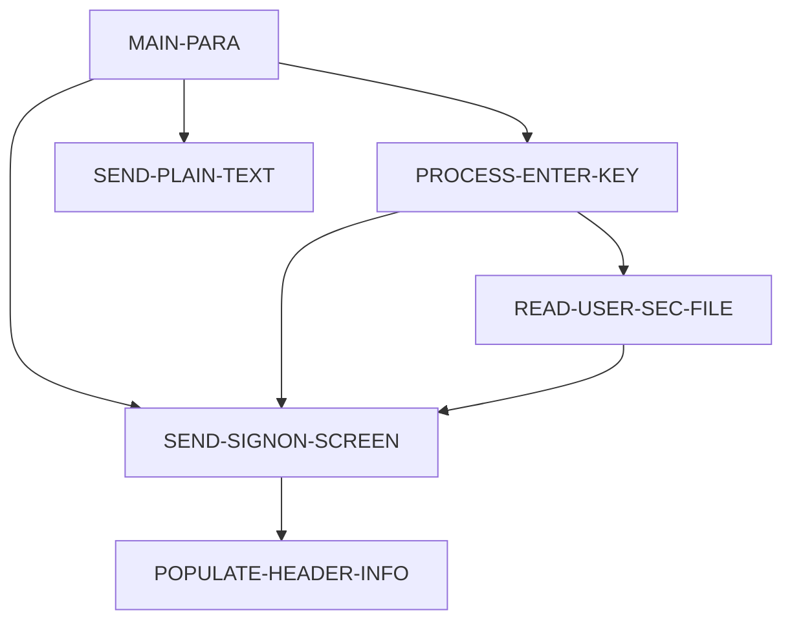

# Tài liệu thiết kế: COSGN00C

_Sinh tự động bởi LegacyLens. Phần cấu trúc lấy từ phân tích tĩnh; mục đích và quy tắc do LLM viết, mỗi quy tắc đã được đối chiếu với mã nguồn._

## Tổng quan

| Loại | Online (CICS) |
| --- | --- |
| Số dòng code | 172 |
| Mã nguồn | [cbl/COSGN00C.cbl](https://github.com/aws-samples/aws-mainframe-modernization-carddemo/blob/59cc6c2fd7ebd7ef7925cad552a01a4b8b6e4d5e/app/cbl/COSGN00C.cbl) |

**Mục đích.** Chương trình COSGN00C xử lý quy trình đăng nhập người dùng bằng cách đọc thông tin bảo mật người dùng và gửi các màn hình đăng nhập hoặc phản hồi văn bản thuần túy đến người dùng. Nó cũng chuyển quyền điều khiển đến các chương trình khác dựa trên hành động của người dùng, đảm bảo xác thực và tương tác người dùng an toàn và hiệu quả.

## Dữ liệu vào ra

| File / dataset | Chế độ | Dòng |
| --- | --- | --- |
| USRSEC | đọc | [211](https://github.com/aws-samples/aws-mainframe-modernization-carddemo/blob/59cc6c2fd7ebd7ef7925cad552a01a4b8b6e4d5e/app/cbl/COSGN00C.cbl#L211) |

## Chuyển sang chương trình khác

| Chương trình | Cách gọi | Dòng |
| --- | --- | --- |
| COADM01C | XCTL | [231](https://github.com/aws-samples/aws-mainframe-modernization-carddemo/blob/59cc6c2fd7ebd7ef7925cad552a01a4b8b6e4d5e/app/cbl/COSGN00C.cbl#L231) |
| COMEN01C | XCTL | [236](https://github.com/aws-samples/aws-mainframe-modernization-carddemo/blob/59cc6c2fd7ebd7ef7925cad552a01a4b8b6e4d5e/app/cbl/COSGN00C.cbl#L236) |

## Được gọi từ

COADM01C, COBIL00C, COMEN01C, COPAUS0C, CORPT00C, COTRN00C, COTRN01C, COTRN02C, COUSR00C, COUSR01C, COUSR02C, COUSR03C

## Copybook dùng

`COCOM01Y`, `COSGN00`, `COTTL01Y`, `CSDAT01Y`, `CSMSG01Y`, `CSUSR01Y`, `DFHAID`, `DFHBMSCA`

## Luồng xử lý (PERFORM)

## Quy tắc nghiệp vụ

| Mã | Nội dung | Điều kiện | Kết quả | Trích dẫn | Kiểm tra |
| --- | --- | --- | --- | --- | --- |
| COSGN00C-R1 | Nếu không nhận được đầu vào, khởi tạo COMMAREA và đặt USERIDL thành -1. | EIBCALEN = 0 | MOVE LOW-VALUES TO COSGN0AO, MOVE -1 TO USERIDL OF COSGN0AI, PERFORM SEND-SIGNON-SCREEN | [80-83](https://github.com/aws-samples/aws-mainframe-modernization-carddemo/blob/59cc6c2fd7ebd7ef7925cad552a01a4b8b6e4d5e/app/cbl/COSGN00C.cbl#L80-L83) | đúng |
| COSGN00C-R2 | Nếu phím DFHENTER được nhấn, xử lý phím enter. | EIBAID = DFHENTER | PERFORM PROCESS-ENTER-KEY | [86-87](https://github.com/aws-samples/aws-mainframe-modernization-carddemo/blob/59cc6c2fd7ebd7ef7925cad552a01a4b8b6e4d5e/app/cbl/COSGN00C.cbl#L86-L87) | đúng |
| COSGN00C-R3 | Nếu phím DFHPF3 được nhấn, hiển thị thông điệp cảm ơn. | EIBAID = DFHPF3 | MOVE CCDA-MSG-THANK-YOU TO WS-MESSAGE, PERFORM SEND-PLAIN-TEXT | [88-90](https://github.com/aws-samples/aws-mainframe-modernization-carddemo/blob/59cc6c2fd7ebd7ef7925cad552a01a4b8b6e4d5e/app/cbl/COSGN00C.cbl#L88-L90) | đúng |
| COSGN00C-R4 | Nếu phím không hợp lệ được nhấn, đặt cờ lỗi và hiển thị thông điệp phím không hợp lệ. | EIBAID NOT IN (DFHENTER, DFHPF3) | MOVE 'Y' TO WS-ERR-FLG, MOVE CCDA-MSG-INVALID-KEY TO WS-MESSAGE, PERFORM SEND-SIGNON-SCREEN | [91-94](https://github.com/aws-samples/aws-mainframe-modernization-carddemo/blob/59cc6c2fd7ebd7ef7925cad552a01a4b8b6e4d5e/app/cbl/COSGN00C.cbl#L91-L94) | đúng |
| COSGN00C-R5 | Tên người dùng phải được nhập. | USERIDI OF COSGN0AI = SPACES OR LOW-VALUES | WS-ERR-FLG = 'Y', WS-MESSAGE = 'Vui lòng nhập tên người dùng ...', USERIDL OF COSGN0AI = -1, PERFORM SEND-SIGNON-SCREEN | [118-122](https://github.com/aws-samples/aws-mainframe-modernization-carddemo/blob/59cc6c2fd7ebd7ef7925cad552a01a4b8b6e4d5e/app/cbl/COSGN00C.cbl#L118-L122) | đúng |
| COSGN00C-R6 | Mật khẩu phải được nhập. | PASSWDI OF COSGN0AI = SPACES OR LOW-VALUES | WS-ERR-FLG = 'Y', WS-MESSAGE = 'Vui lòng nhập mật khẩu ...', PASSWDL OF COSGN0AI = -1, PERFORM SEND-SIGNON-SCREEN | [123-127](https://github.com/aws-samples/aws-mainframe-modernization-carddemo/blob/59cc6c2fd7ebd7ef7925cad552a01a4b8b6e4d5e/app/cbl/COSGN00C.cbl#L123-L127) | đúng |
| COSGN00C-R7 | Nếu không có lỗi, tiếp tục đọc tệp bảo mật người dùng. | NOT ERR-FLG-ON | PERFORM READ-USER-SEC-FILE | [138-140](https://github.com/aws-samples/aws-mainframe-modernization-carddemo/blob/59cc6c2fd7ebd7ef7925cad552a01a4b8b6e4d5e/app/cbl/COSGN00C.cbl#L138-L140) | đúng |
| COSGN00C-R8 | Ghi lại người dùng được đọc thành công và mật khẩu khớp. | WS-RESP-CD = 0 AND SEC-USR-PWD = WS-USER-PWD | MOVE WS-TRANID TO CDEMO-FROM-TRANID, MOVE WS-PGMNAME TO CDEMO-FROM-PROGRAM, MOVE WS-USER-ID TO CDEMO-USER-ID, MOVE SEC-USR-TYPE TO CDEMO-USER-TYPE, MOVE ZEROS TO CDEMO-PGM-CONTEXT, IF CDEMO-USRTYP-ADMIN THEN XCTL TO COADM01C ELSE XCTL TO COMEN01C | [221-241](https://github.com/aws-samples/aws-mainframe-modernization-carddemo/blob/59cc6c2fd7ebd7ef7925cad552a01a4b8b6e4d5e/app/cbl/COSGN00C.cbl#L221-L241) | đúng |
| COSGN00C-R9 | Đọc ghi chú người dùng thành công nhưng mật khẩu không khớp. | WS-RESP-CD = 0 AND SEC-USR-PWD NOT = WS-USER-PWD | MOVE 'Mật khẩu sai. Hãy thử lại ...' TO WS-MESSAGE, MOVE -1 TO PASSWDL OF COSGN0AI, PERFORM SEND-SIGNON-SCREEN | [242-246](https://github.com/aws-samples/aws-mainframe-modernization-carddemo/blob/59cc6c2fd7ebd7ef7925cad552a01a4b8b6e4d5e/app/cbl/COSGN00C.cbl#L242-L246) | đúng |
| COSGN00C-R10 | Không tìm thấy ghi chú người dùng. | WS-RESP-CD = 13 | MOVE 'Y' TO WS-ERR-FLG, MOVE 'Không tìm thấy người dùng. Hãy thử lại ...' TO WS-MESSAGE, MOVE -1 TO USERIDL OF COSGN0AI, PERFORM SEND-SIGNON-SCREEN | [247-251](https://github.com/aws-samples/aws-mainframe-modernization-carddemo/blob/59cc6c2fd7ebd7ef7925cad552a01a4b8b6e4d5e/app/cbl/COSGN00C.cbl#L247-L251) | đúng |
| COSGN00C-R11 | Mã phản hồi không mong đợi từ thao tác đọc của CICS. | WS-RESP-CD NOT = 0 AND WS-RESP-CD NOT = 13 | MOVE 'Y' TO WS-ERR-FLG, MOVE 'Không thể xác minh người dùng ...' TO WS-MESSAGE, MOVE -1 TO USERIDL OF COSGN0AI, PERFORM SEND-SIGNON-SCREEN | [252-256](https://github.com/aws-samples/aws-mainframe-modernization-carddemo/blob/59cc6c2fd7ebd7ef7925cad552a01a4b8b6e4d5e/app/cbl/COSGN00C.cbl#L252-L256) | đúng |
