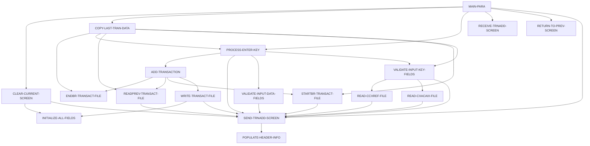

# 設計書: COTRN02C

_LegacyLens により自動生成。構造は静的解析、目的と業務ルールは LLM が作成し、各ルールはソースと照合済み。_

## 概要

| 種別 | オンライン (CICS) |
| --- | --- |
| コード行数 | 614 |
| ソース | [cbl/COTRN02C.cbl](https://github.com/aws-samples/aws-mainframe-modernization-carddemo/blob/59cc6c2fd7ebd7ef7925cad552a01a4b8b6e4d5e/app/cbl/COTRN02C.cbl) |

**目的.** プログラムCOTRN02Cは、ユーザーが入力した取引データを処理および検証し、取引ファイルを更新し、参照ファイルと比較してデータの整合性を確保します。ユーザー入力を処理し、新しい取引を追加するか、前の画面に戻るための画面インタラクションを管理します。

## 入出力

| ファイル / データセット | モード | 行 |
| --- | --- | --- |
| CXACAIX | 読込 | [578](https://github.com/aws-samples/aws-mainframe-modernization-carddemo/blob/59cc6c2fd7ebd7ef7925cad552a01a4b8b6e4d5e/app/cbl/COTRN02C.cbl#L578) |
| CCXREF | 読込 | [611](https://github.com/aws-samples/aws-mainframe-modernization-carddemo/blob/59cc6c2fd7ebd7ef7925cad552a01a4b8b6e4d5e/app/cbl/COTRN02C.cbl#L611) |
| TRANSACT | 読込 | [644](https://github.com/aws-samples/aws-mainframe-modernization-carddemo/blob/59cc6c2fd7ebd7ef7925cad552a01a4b8b6e4d5e/app/cbl/COTRN02C.cbl#L644) |
| TRANSACT | 書込 | [713](https://github.com/aws-samples/aws-mainframe-modernization-carddemo/blob/59cc6c2fd7ebd7ef7925cad552a01a4b8b6e4d5e/app/cbl/COTRN02C.cbl#L713) |

## 他プログラムへの遷移

| プログラム | 方式 | 行 |
| --- | --- | --- |
| COMEN01C | XCTL | [508](https://github.com/aws-samples/aws-mainframe-modernization-carddemo/blob/59cc6c2fd7ebd7ef7925cad552a01a4b8b6e4d5e/app/cbl/COTRN02C.cbl#L508) |
| COSGN00C | XCTL | [508](https://github.com/aws-samples/aws-mainframe-modernization-carddemo/blob/59cc6c2fd7ebd7ef7925cad552a01a4b8b6e4d5e/app/cbl/COTRN02C.cbl#L508) |
| CSUTLDTC | CALL | [393](https://github.com/aws-samples/aws-mainframe-modernization-carddemo/blob/59cc6c2fd7ebd7ef7925cad552a01a4b8b6e4d5e/app/cbl/COTRN02C.cbl#L393) |
| CSUTLDTC | CALL | [413](https://github.com/aws-samples/aws-mainframe-modernization-carddemo/blob/59cc6c2fd7ebd7ef7925cad552a01a4b8b6e4d5e/app/cbl/COTRN02C.cbl#L413) |

## コピー句

`COCOM01Y`, `COTRN02`, `COTTL01Y`, `CSDAT01Y`, `CSMSG01Y`, `CVTRA05Y`, `CVACT01Y`, `CVACT03Y`, `DFHAID`, `DFHBMSCA`

## 処理フロー (PERFORM)

## 業務ルール

| ID | 内容 | 条件 | 結果 | 根拠 | 検証 |
| --- | --- | --- | --- | --- | --- |
| COTRN02C-R1 | 入力が受け取られない場合、前の画面に戻ります。 | EIBCALEN = 0 | CDEMO-TO-PROGRAM = 'COSGN00C', PERFORM RETURN-TO-PREV-SCREEN | [115-117](https://github.com/aws-samples/aws-mainframe-modernization-carddemo/blob/59cc6c2fd7ebd7ef7925cad552a01a4b8b6e4d5e/app/cbl/COTRN02C.cbl#L115-L117) | OK |
| COTRN02C-R2 | プログラムが再起動されていない場合、COMMAREAを設定し、アクションを実行します。 | NOT CDEMO-PGM-REENTER | CDEMO-PGM-REENTER = TRUE, COTRN2AO = LOW-VALUES, ACTIDINL OF COTRN2AI = -1, PERFORM PROCESS-ENTER-KEY, PERFORM SEND-TRNADD-SCREEN | [120-131](https://github.com/aws-samples/aws-mainframe-modernization-carddemo/blob/59cc6c2fd7ebd7ef7925cad552a01a4b8b6e4d5e/app/cbl/COTRN02C.cbl#L120-L131) | OK |
| COTRN02C-R3 | プログラムが再起動されている場合、取引追加画面を受信し、EIBAIDに基づいて処理します。 | CDEMO-PGM-REENTER | PERFORM RECEIVE-TRNADD-SCREEN, EVALUATE EIBAID | [132-152](https://github.com/aws-samples/aws-mainframe-modernization-carddemo/blob/59cc6c2fd7ebd7ef7925cad552a01a4b8b6e4d5e/app/cbl/COTRN02C.cbl#L132-L152) | OK |
| COTRN02C-R4 | 無効なキーが押された場合、エラーフラグとメッセージを設定します。 | EIBAID NOT IN (DFHENTER, DFHPF3, DFHPF4, DFHPF5) | WS-ERR-FLG = 'Y', WS-MESSAGE = CCDA-MSG-INVALID-KEY, PERFORM SEND-TRNADD-SCREEN | [149-152](https://github.com/aws-samples/aws-mainframe-modernization-carddemo/blob/59cc6c2fd7ebd7ef7925cad552a01a4b8b6e4d5e/app/cbl/COTRN02C.cbl#L149-L152) | OK |
| COTRN02C-R5 | CONFIRMIが'Y'または'y'の場合、取引を追加します。 | CONFIRMI = 'Y' OR CONFIRMI = 'y' | PERFORM ADD-TRANSACTION | [170-172](https://github.com/aws-samples/aws-mainframe-modernization-carddemo/blob/59cc6c2fd7ebd7ef7925cad552a01a4b8b6e4d5e/app/cbl/COTRN02C.cbl#L170-L172) | OK |
| COTRN02C-R6 | CONFIRMIが'Y'または'y'でない場合、エラーフラグとメッセージを設定します。 | CONFIRMI NOT IN ('Y', 'y') | WS-ERR-FLG = 'Y', WS-MESSAGE = 'Confirm to add this transaction...', CONFIRML = -1, PERFORM SEND-TRNADD-SCREEN | [175-181](https://github.com/aws-samples/aws-mainframe-modernization-carddemo/blob/59cc6c2fd7ebd7ef7925cad552a01a4b8b6e4d5e/app/cbl/COTRN02C.cbl#L175-L181) | OK |
| COTRN02C-R7 | CONFIRMIが無効な場合、エラーフラグとメッセージを設定します。 | CONFIRMI NOT IN ('Y', 'y', 'N', 'n', SPACES, LOW-VALUES) | WS-ERR-FLG = 'Y', WS-MESSAGE = 'Invalid value. Valid values are (Y/N)...', CONFIRML = -1, PERFORM SEND-TRNADD-SCREEN | [182-187](https://github.com/aws-samples/aws-mainframe-modernization-carddemo/blob/59cc6c2fd7ebd7ef7925cad552a01a4b8b6e4d5e/app/cbl/COTRN02C.cbl#L182-L187) | OK |
| COTRN02C-R8 | アカウントIDは数値でなければなりません。 | ACTIDINI OF COTRN2AI NOT = SPACES AND LOW-VALUES AND ACTIDINI OF COTRN2AI IS NOT NUMERIC | WS-ERR-FLG = 'Y', WS-MESSAGE = 'Account ID must be Numeric...', ACTIDINL OF COTRN2AI = -1, PERFORM SEND-TRNADD-SCREEN | [196-202](https://github.com/aws-samples/aws-mainframe-modernization-carddemo/blob/59cc6c2fd7ebd7ef7925cad552a01a4b8b6e4d5e/app/cbl/COTRN02C.cbl#L196-L202) | OK |
| COTRN02C-R9 | 数値のアカウントIDを変換して保存する。 | ACTIDINI OF COTRN2AI NOT = SPACES AND LOW-VALUES AND ACTIDINI OF COTRN2AI IS NUMERIC | WS-ACCT-ID-N = FUNCTION NUMVAL(ACTIDINI OF COTRN2AI), XREF-ACCT-ID = WS-ACCT-ID-N, ACTIDINI OF COTRN2AI = WS-ACCT-ID-N, PERFORM READ-CXACAIX-FILE | [204-208](https://github.com/aws-samples/aws-mainframe-modernization-carddemo/blob/59cc6c2fd7ebd7ef7925cad552a01a4b8b6e4d5e/app/cbl/COTRN02C.cbl#L204-L208) | OK |
| COTRN02C-R10 | カード番号は数値でなければなりません。 | CARDNINI OF COTRN2AI NOT = SPACES AND LOW-VALUES AND CARDNINI OF COTRN2AI IS NOT NUMERIC | WS-ERR-FLG = 'Y', WS-MESSAGE = 'Card Number must be Numeric...', CARDNINL OF COTRN2AI = -1, PERFORM SEND-TRNADD-SCREEN | [210-216](https://github.com/aws-samples/aws-mainframe-modernization-carddemo/blob/59cc6c2fd7ebd7ef7925cad552a01a4b8b6e4d5e/app/cbl/COTRN02C.cbl#L210-L216) | OK |
| COTRN02C-R11 | 数値のカード番号を変換して保存する。 | CARDNINI OF COTRN2AI NOT = SPACES AND LOW-VALUES AND CARDNINI OF COTRN2AI IS NUMERIC | WS-CARD-NUM-N = FUNCTION NUMVAL(CARDNINI OF COTRN2AI), XREF-CARD-NUM = WS-CARD-NUM-N, CARDNINI OF COTRN2AI = WS-CARD-NUM-N, PERFORM READ-CCXREF-FILE | [218-222](https://github.com/aws-samples/aws-mainframe-modernization-carddemo/blob/59cc6c2fd7ebd7ef7925cad552a01a4b8b6e4d5e/app/cbl/COTRN02C.cbl#L218-L222) | OK |
| COTRN02C-R12 | アカウント番号またはカード番号を入力する必要があります。 | OTHER | WS-ERR-FLG = 'Y', WS-MESSAGE = 'Account or Card Number must be entered...', ACTIDINL OF COTRN2AI = -1, PERFORM SEND-TRNADD-SCREEN | [224-229](https://github.com/aws-samples/aws-mainframe-modernization-carddemo/blob/59cc6c2fd7ebd7ef7925cad552a01a4b8b6e4d5e/app/cbl/COTRN02C.cbl#L224-L229) | OK |
| COTRN02C-R13 | エラーが発生した場合、入力フィールドをクリアする。 | ERR-FLG-ON | TTYPCDI, TCATCDI, TRNSRCI, TRNAMTI, TDESCI, TORIGDTI, TPROCDTI, MIDI, MNAMEI, MCITYI, MZIPI of COTRN2AI set to SPACES | [237-249](https://github.com/aws-samples/aws-mainframe-modernization-carddemo/blob/59cc6c2fd7ebd7ef7925cad552a01a4b8b6e4d5e/app/cbl/COTRN02C.cbl#L237-L249) | OK |
| COTRN02C-R14 | タイプコードは空白であってはなりません。 | TTYPCDI OF COTRN2AI = SPACES OR LOW-VALUES | WS-ERR-FLG = 'Y', WS-MESSAGE = 'Type CD can NOT be empty...', TTYPCDL OF COTRN2AI = -1, PERFORM SEND-TRNADD-SCREEN | [252-258](https://github.com/aws-samples/aws-mainframe-modernization-carddemo/blob/59cc6c2fd7ebd7ef7925cad552a01a4b8b6e4d5e/app/cbl/COTRN02C.cbl#L252-L258) | OK |
| COTRN02C-R15 | カテゴリコードは空白であってはなりません。 | TCATCDI OF COTRN2AI = SPACES OR LOW-VALUES | WS-ERR-FLG = 'Y', WS-MESSAGE = 'Category CD can NOT be empty...', TCATCDL OF COTRN2AI = -1, PERFORM SEND-TRNADD-SCREEN | [259-263](https://github.com/aws-samples/aws-mainframe-modernization-carddemo/blob/59cc6c2fd7ebd7ef7925cad552a01a4b8b6e4d5e/app/cbl/COTRN02C.cbl#L259-L263) | OK |
| COTRN02C-R16 | ソースは空白であってはなりません。 | TRNSRCI OF COTRN2AI = SPACES OR LOW-VALUES | WS-ERR-FLG = 'Y', WS-MESSAGE = 'Source can NOT be empty...', TRNSRCL OF COTRN2AI = -1, PERFORM SEND-TRNADD-SCREEN | [264-269](https://github.com/aws-samples/aws-mainframe-modernization-carddemo/blob/59cc6c2fd7ebd7ef7925cad552a01a4b8b6e4d5e/app/cbl/COTRN02C.cbl#L264-L269) | OK |
| COTRN02C-R17 | 説明は空欄にできません。 | TDESCI OF COTRN2AI = SPACES OR LOW-VALUES | WS-ERR-FLG = 'Y', WS-MESSAGE = '説明は空欄にできません...', TDESCL OF COTRN2AI = -1, PERFORM SEND-TRNADD-SCREEN | [270-275](https://github.com/aws-samples/aws-mainframe-modernization-carddemo/blob/59cc6c2fd7ebd7ef7925cad552a01a4b8b6e4d5e/app/cbl/COTRN02C.cbl#L270-L275) | OK |
| COTRN02C-R18 | 金額は空欄にできません。 | TRNAMTI OF COTRN2AI = SPACES OR LOW-VALUES | WS-ERR-FLG = 'Y', WS-MESSAGE = '金額は空欄にできません...', TRNAMTL OF COTRN2AI = -1, PERFORM SEND-TRNADD-SCREEN | [276-281](https://github.com/aws-samples/aws-mainframe-modernization-carddemo/blob/59cc6c2fd7ebd7ef7925cad552a01a4b8b6e4d5e/app/cbl/COTRN02C.cbl#L276-L281) | OK |
| COTRN02C-R19 | 元の日付は空欄にできません。 | TORIGDTI OF COTRN2AI = SPACES OR LOW-VALUES | WS-ERR-FLG = 'Y', WS-MESSAGE = '元の日付は空欄にできません...', TORIGDTL OF COTRN2AI = -1, PERFORM SEND-TRNADD-SCREEN | [282-287](https://github.com/aws-samples/aws-mainframe-modernization-carddemo/blob/59cc6c2fd7ebd7ef7925cad552a01a4b8b6e4d5e/app/cbl/COTRN02C.cbl#L282-L287) | OK |
| COTRN02C-R20 | 処理日付は空欄にできません。 | TPROCDTI OF COTRN2AI = SPACES OR LOW-VALUES | WS-ERR-FLG = 'Y', WS-MESSAGE = '処理日付は空欄にできません...', TPROCDTL OF COTRN2AI = -1, PERFORM SEND-TRNADD-SCREEN | [288-293](https://github.com/aws-samples/aws-mainframe-modernization-carddemo/blob/59cc6c2fd7ebd7ef7925cad552a01a4b8b6e4d5e/app/cbl/COTRN02C.cbl#L288-L293) | OK |
| COTRN02C-R21 | マーチャントIDは空欄にできません。 | MIDI OF COTRN2AI = SPACES OR LOW-VALUES | WS-ERR-FLG = 'Y', WS-MESSAGE = 'マーチャントIDは空欄にできません...', MIDL OF COTRN2AI = -1, PERFORM SEND-TRNADD-SCREEN | [294-299](https://github.com/aws-samples/aws-mainframe-modernization-carddemo/blob/59cc6c2fd7ebd7ef7925cad552a01a4b8b6e4d5e/app/cbl/COTRN02C.cbl#L294-L299) | OK |
| COTRN02C-R22 | マーチャント名は空欄にできません。 | MNAMEI OF COTRN2AI = SPACES OR LOW-VALUES | WS-ERR-FLG = 'Y', WS-MESSAGE = 'マーチャント名は空欄にできません...', MNAMEL OF COTRN2AI = -1, PERFORM SEND-TRNADD-SCREEN | [300-305](https://github.com/aws-samples/aws-mainframe-modernization-carddemo/blob/59cc6c2fd7ebd7ef7925cad552a01a4b8b6e4d5e/app/cbl/COTRN02C.cbl#L300-L305) | OK |
| COTRN02C-R23 | マーチャント都市は空欄にできません。 | MCITYI OF COTRN2AI = SPACES OR LOW-VALUES | WS-ERR-FLG = 'Y', WS-MESSAGE = 'マーチャント都市は空欄にできません...', MCITYL OF COTRN2AI = -1, PERFORM SEND-TRNADD-SCREEN | [306-311](https://github.com/aws-samples/aws-mainframe-modernization-carddemo/blob/59cc6c2fd7ebd7ef7925cad552a01a4b8b6e4d5e/app/cbl/COTRN02C.cbl#L306-L311) | OK |
| COTRN02C-R24 | マーチャント郵便番号は空欄にできません。 | MZIPI OF COTRN2AI = SPACES OR LOW-VALUES | WS-ERR-FLG = 'Y', WS-MESSAGE = 'マーチャント郵便番号は空欄にできません...', MZIPL OF COTRN2AI = -1, PERFORM SEND-TRNADD-SCREEN | [312-317](https://github.com/aws-samples/aws-mainframe-modernization-carddemo/blob/59cc6c2fd7ebd7ef7925cad552a01a4b8b6e4d5e/app/cbl/COTRN02C.cbl#L312-L317) | OK |
| COTRN02C-R25 | タイプCDは数値でなければなりません。 | TTYPDCDI OF COTRN2AI NOT NUMERIC | WS-ERR-FLG = 'Y', WS-MESSAGE = 'Type CD must be Numeric...', TTYPCDL OF COTRN2AI = -1, PERFORM SEND-TRNADD-SCREEN | [323-328](https://github.com/aws-samples/aws-mainframe-modernization-carddemo/blob/59cc6c2fd7ebd7ef7925cad552a01a4b8b6e4d5e/app/cbl/COTRN02C.cbl#L323-L328) | OK |
| COTRN02C-R26 | カテゴリCDは数値でなければなりません。 | TCATCDI OF COTRN2AI NOT NUMERIC | WS-ERR-FLG = 'Y', WS-MESSAGE = 'Category CD must be Numeric...', TCATCDL OF COTRN2AI = -1, PERFORM SEND-TRNADD-SCREEN | [329-334](https://github.com/aws-samples/aws-mainframe-modernization-carddemo/blob/59cc6c2fd7ebd7ef7925cad552a01a4b8b6e4d5e/app/cbl/COTRN02C.cbl#L329-L334) | OK |
| COTRN02C-R27 | 取引金額は-99999999.99の形式でなければなりません。 | TRNAMTI OF COTRN2AI(1:1) NOT EQUAL '-' AND '+', TRNAMTI OF COTRN2AI(2:8) NOT NUMERIC, TRNAMTI OF COTRN2AI(10:1) NOT = '.', TRNAMTI OF COTRN2AI(11:2) IS NOT NUMERIC | WS-ERR-FLG = 'Y', WS-MESSAGE = 'Amount should be in format -99999999.99', TRNAMTL OF COTRN2AI = -1, PERFORM SEND-TRNADD-SCREEN | [339-348](https://github.com/aws-samples/aws-mainframe-modernization-carddemo/blob/59cc6c2fd7ebd7ef7925cad552a01a4b8b6e4d5e/app/cbl/COTRN02C.cbl#L339-L348) | OK |
| COTRN02C-R28 | 元の日付はYYYY-MM-DDの形式でなければなりません。 | TORIGDTI OF COTRN2AI(1:4) IS NOT NUMERIC OR TORIGDTI OF COTRN2AI(5:1) NOT EQUAL '-' OR TORIGDTI OF COTRN2AI(6:2) NOT NUMERIC OR TORIGDTI OF COTRN2AI(8:1) NOT EQUAL '-' OR TORIGDTI OF COTRN2AI(9:2) NOT NUMERIC | WS-ERR-FLG = 'Y', WS-MESSAGE = 'Orig Date should be in format YYYY-MM-DD', TORIGDTL OF COTRN2AI = -1, PERFORM SEND-TRNADD-SCREEN | [354-363](https://github.com/aws-samples/aws-mainframe-modernization-carddemo/blob/59cc6c2fd7ebd7ef7925cad552a01a4b8b6e4d5e/app/cbl/COTRN02C.cbl#L354-L363) | OK |
| COTRN02C-R29 | 処理日付はYYYY-MM-DDの形式でなければなりません。 | TPROCDTI OF COTRN2AI(1:4) IS NOT NUMERIC OR TPROCDTI OF COTRN2AI(5:1) NOT EQUAL '-' OR TPROCDTI OF COTRN2AI(6:2) NOT NUMERIC OR TPROCDTI OF COTRN2AI(8:1) NOT EQUAL '-' OR TPROCDTI OF COTRN2AI(9:2) NOT NUMERIC | WS-ERR-FLG = 'Y', WS-MESSAGE = 'Proc Date should be in format YYYY-MM-DD', TPROCDTL OF COTRN2AI = -1, PERFORM SEND-TRNADD-SCREEN | [369-378](https://github.com/aws-samples/aws-mainframe-modernization-carddemo/blob/59cc6c2fd7ebd7ef7925cad552a01a4b8b6e4d5e/app/cbl/COTRN02C.cbl#L369-L378) | OK |
| COTRN02C-R30 | 元の日付は有効な日付でなければなりません。 | CSUTLDTC-RESULT-SEV-CD NOT = '0000' AND CSUTLDTC-RESULT-MSG-NUM NOT = '2513' | WS-MESSAGE = 'Orig Date - Not a valid date...', WS-ERR-FLG = 'Y', TORIGDTL OF COTRN2AI = -1, PERFORM SEND-TRNADD-SCREEN | [399-406](https://github.com/aws-samples/aws-mainframe-modernization-carddemo/blob/59cc6c2fd7ebd7ef7925cad552a01a4b8b6e4d5e/app/cbl/COTRN02C.cbl#L399-L406) | OK |
| COTRN02C-R31 | 日付が有効でない場合、エラーメッセージとフラグを設定します。 | CSUTLDTC-RESULT-SEV-CD NOT = '0000' AND CSUTLDTC-RESULT-MSG-NUM NOT = '2513' | WS-MESSAGE = 'Proc Date - Not a valid date...', WS-ERR-FLG = 'Y', TPROCDTL OF COTRN2AI = -1, PERFORM SEND-TRNADD-SCREEN | [417-426](https://github.com/aws-samples/aws-mainframe-modernization-carddemo/blob/59cc6c2fd7ebd7ef7925cad552a01a4b8b6e4d5e/app/cbl/COTRN02C.cbl#L417-L426) | OK |
| COTRN02C-R32 | マーチャントIDが数値でない場合、エラーメッセージとフラグを設定します。 | MIDI OF COTRN2AI IS NOT NUMERIC | WS-ERR-FLG = 'Y', WS-MESSAGE = 'Merchant ID must be Numeric...', MIDL OF COTRN2AI = -1, PERFORM SEND-TRNADD-SCREEN | [430-436](https://github.com/aws-samples/aws-mainframe-modernization-carddemo/blob/59cc6c2fd7ebd7ef7925cad552a01a4b8b6e4d5e/app/cbl/COTRN02C.cbl#L430-L436) | OK |
| COTRN02C-R33 | トランザクションデータをエラーフラグが設定されていない場合、ワーキングストレージにコピーする。 | NOT ERR-FLG-ON | TRAN-の各種フィールドをWS-およびCOTRN2AIのフィールドにMOVE | [480-491](https://github.com/aws-samples/aws-mainframe-modernization-carddemo/blob/59cc6c2fd7ebd7ef7925cad552a01a4b8b6e4d5e/app/cbl/COTRN02C.cbl#L480-L491) | OK |
| COTRN02C-R34 | CDEMO-TO-PROGRAMが設定されていない場合、デフォルトで'COSGN00C'を設定する。 | CDEMO-TO-PROGRAM = LOW-VALUES OR SPACES | CDEMO-TO-PROGRAM = 'COSGN00C' | [502-504](https://github.com/aws-samples/aws-mainframe-modernization-carddemo/blob/59cc6c2fd7ebd7ef7925cad552a01a4b8b6e4d5e/app/cbl/COTRN02C.cbl#L502-L504) | OK |
| COTRN02C-R35 | WS-TRANIDをCDEMO-FROM-TRANIDにMOVEする。 | 常に | CDEMO-FROM-TRANID = WS-TRANID | [505-505](https://github.com/aws-samples/aws-mainframe-modernization-carddemo/blob/59cc6c2fd7ebd7ef7925cad552a01a4b8b6e4d5e/app/cbl/COTRN02C.cbl#L505-L505) | OK |
| COTRN02C-R36 | WS-PGMNAMEをCDEMO-FROM-PROGRAMにMOVEする。 | 常に | CDEMO-FROM-PROGRAM = WS-PGMNAME | [506-506](https://github.com/aws-samples/aws-mainframe-modernization-carddemo/blob/59cc6c2fd7ebd7ef7925cad552a01a4b8b6e4d5e/app/cbl/COTRN02C.cbl#L506-L506) | OK |
| COTRN02C-R37 | CDEMO-PGM-CONTEXTをゼロに設定する。 | 常に | CDEMO-PGM-CONTEXT = ZEROS | [507-507](https://github.com/aws-samples/aws-mainframe-modernization-carddemo/blob/59cc6c2fd7ebd7ef7925cad552a01a4b8b6e4d5e/app/cbl/COTRN02C.cbl#L507-L507) | OK |
| COTRN02C-R38 | CICS XCTLを使用して、CDEMO-TO-PROGRAMで指定されたプログラムを実行する。 | 常に | EXEC CICS XCTL PROGRAM(CDEMO-TO-PROGRAM) | [508-511](https://github.com/aws-samples/aws-mainframe-modernization-carddemo/blob/59cc6c2fd7ebd7ef7925cad552a01a4b8b6e4d5e/app/cbl/COTRN02C.cbl#L508-L511) | OK |
| COTRN02C-R39 | 指定されたアカウントIDのCXACAIXファイルを読み込む。 | EXEC CICS READ | CXACAIXファイルをCARD-XREF-RECORDにREAD | [578-584](https://github.com/aws-samples/aws-mainframe-modernization-carddemo/blob/59cc6c2fd7ebd7ef7925cad552a01a4b8b6e4d5e/app/cbl/COTRN02C.cbl#L578-L584) | OK |
| COTRN02C-R40 | CXACAIXファイルのレコードが見つからない場合、エラーをフラグに設定し、メッセージを設定する。 | WS-RESP-CD = DFHRESP(NOTFND) | WS-ERR-FLG = 'Y', WS-MESSAGE = 'Account ID NOT found...', COTRN2AIのACTIDINL = -1, SEND-TRNADD-SCREENをPERFORM | [591-596](https://github.com/aws-samples/aws-mainframe-modernization-carddemo/blob/59cc6c2fd7ebd7ef7925cad552a01a4b8b6e4d5e/app/cbl/COTRN02C.cbl#L591-L596) | OK |
| COTRN02C-R41 | CXACAIX ファイルの読み込みに失敗した場合、エラーフラグを設定し、メッセージを表示します。 | WS-RESP-CD NOT DFHRESP(NORMAL) AND NOT DFHRESP(NOTFND) | WS-ERR-FLG = 'Y', WS-MESSAGE = 'XREF AIX ファイルでアカウントを検索できません...', ACTIDINL OF COTRN2AI = -1, PERFORM SEND-TRNADD-SCREEN | [598-602](https://github.com/aws-samples/aws-mainframe-modernization-carddemo/blob/59cc6c2fd7ebd7ef7925cad552a01a4b8b6e4d5e/app/cbl/COTRN02C.cbl#L598-L602) | OK |
| COTRN02C-R42 | カード番号参照ファイルからカード番号を読み込みます。 | EXEC CICS READ | READ-CCXREF-FILE | [611-618](https://github.com/aws-samples/aws-mainframe-modernization-carddemo/blob/59cc6c2fd7ebd7ef7925cad552a01a4b8b6e4d5e/app/cbl/COTRN02C.cbl#L611-L618) | OK |
| COTRN02C-R43 | 参照ファイルにカード番号が見つかりません。 | WS-RESP-CD = DFHRESP(NOTFND) | WS-ERR-FLG = 'Y', WS-MESSAGE = 'カード番号が見つかりません...', CARDNINL OF COTRN2AI = -1, PERFORM SEND-TRNADD-SCREEN | [624-629](https://github.com/aws-samples/aws-mainframe-modernization-carddemo/blob/59cc6c2fd7ebd7ef7925cad552a01a4b8b6e4d5e/app/cbl/COTRN02C.cbl#L624-L629) | OK |
| COTRN02C-R44 | ファイル読み込みからの予期しない応答を処理します。 | WS-RESP-CD NOT DFHRESP(NORMAL) AND NOT DFHRESP(NOTFND) | DISPLAY 'RESP:' WS-RESP-CD 'REAS:' WS-REAS-CD, WS-ERR-FLG = 'Y', WS-MESSAGE = 'カード番号を XREF ファイルで検索できません...', CARDNINL OF COTRN2AI = -1, PERFORM SEND-TRNADD-SCREEN | [630-636](https://github.com/aws-samples/aws-mainframe-modernization-carddemo/blob/59cc6c2fd7ebd7ef7925cad552a01a4b8b6e4d5e/app/cbl/COTRN02C.cbl#L630-L636) | OK |
| COTRN02C-R45 | トランザクション ID が見つかった場合、通常通り処理します。 | WS-RESP-CD = DFHRESP(NORMAL) | CONTINUE | [652-653](https://github.com/aws-samples/aws-mainframe-modernization-carddemo/blob/59cc6c2fd7ebd7ef7925cad552a01a4b8b6e4d5e/app/cbl/COTRN02C.cbl#L652-L653) | OK |
| COTRN02C-R46 | トランザクション ID が見つからない場合、エラーフラグを設定し、メッセージを表示します。 | WS-RESP-CD = DFHRESP(NOTFND) | WS-ERR-FLG = 'Y', WS-MESSAGE = 'トランザクション ID が見つかりません...', ACTIDINL OF COTRN2AI = -1, PERFORM SEND-TRNADD-SCREEN | [654-660](https://github.com/aws-samples/aws-mainframe-modernization-carddemo/blob/59cc6c2fd7ebd7ef7925cad552a01a4b8b6e4d5e/app/cbl/COTRN02C.cbl#L654-L660) | OK |
| COTRN02C-R47 | 他の応答の場合、エラーフラグを設定し、メッセージを表示します。 | WS-RESP-CD != DFHRESP(NORMAL) AND WS-RESP-CD != DFHRESP(NOTFND) | DISPLAY 'RESP:' WS-RESP-CD 'REAS:' WS-REAS-CD, WS-ERR-FLG = 'Y', WS-MESSAGE = 'トランザクションを検索できません...', ACTIDINL OF COTRN2AI = -1, PERFORM SEND-TRNADD-SCREEN | [661-667](https://github.com/aws-samples/aws-mainframe-modernization-carddemo/blob/59cc6c2fd7ebd7ef7925cad552a01a4b8b6e4d5e/app/cbl/COTRN02C.cbl#L661-L667) | OK |
| COTRN02C-R48 | ファイルから前のトランザクションレコードを読み込みます。 | EXEC CICS READPREV | DATASET (WS-TRANSACT-FILE) INTO (TRAN-RECORD) | [675-681](https://github.com/aws-samples/aws-mainframe-modernization-carddemo/blob/59cc6c2fd7ebd7ef7925cad552a01a4b8b6e4d5e/app/cbl/COTRN02C.cbl#L675-L681) | OK |
| COTRN02C-R49 | 通常の応答がCICSから返ってきた場合、処理を継続する。 | WS-RESP-CD = DFHRESP(NORMAL) | CONTINUE | [686-686](https://github.com/aws-samples/aws-mainframe-modernization-carddemo/blob/59cc6c2fd7ebd7ef7925cad552a01a4b8b6e4d5e/app/cbl/COTRN02C.cbl#L686-L686) | NG: cited lines contain none of the rule's fields, codes or messages |
| COTRN02C-R50 | ファイルの終端に達した場合、トランザクションIDをゼロに設定する。 | WS-RESP-CD = DFHRESP(ENDFILE) | MOVE ZEROS TO TRAN-ID | [688-689](https://github.com/aws-samples/aws-mainframe-modernization-carddemo/blob/59cc6c2fd7ebd7ef7925cad552a01a4b8b6e4d5e/app/cbl/COTRN02C.cbl#L688-L689) | OK |
| COTRN02C-R51 | 他の応答の場合、エラーメッセージを表示し、エラーフラグを設定する。 | WS-RESP-CD != DFHRESP(NORMAL) AND WS-RESP-CD != DFHRESP(ENDFILE) | DISPLAY 'RESP:' WS-RESP-CD 'REAS:' WS-REAS-CD, MOVE 'Y' TO WS-ERR-FLG, MOVE 'トランザクションを検索できません...' TO WS-MESSAGE, MOVE -1 TO ACTIDINL OF COTRN2AI, PERFORM SEND-TRNADD-SCREEN | [690-696](https://github.com/aws-samples/aws-mainframe-modernization-carddemo/blob/59cc6c2fd7ebd7ef7925cad552a01a4b8b6e4d5e/app/cbl/COTRN02C.cbl#L690-L696) | OK |
| COTRN02C-R52 | トランザクションがファイルに正常に書き込まれた。 | WS-RESP-CD = DFHRESP(NORMAL) | WS-ERR-FLG = 'N', WS-MESSAGE = 'トランザクションを追加しました。あなたのトランザクションIDは [TRAN-ID] です。', PERFORM SEND-TRNADD-SCREEN | [723-735](https://github.com/aws-samples/aws-mainframe-modernization-carddemo/blob/59cc6c2fd7ebd7ef7925cad552a01a4b8b6e4d5e/app/cbl/COTRN02C.cbl#L723-L735) | OK |
| COTRN02C-R53 | 重複したトランザクションIDは拒否される。 | WS-RESP-CD = DFHRESP(DUPKEY) OR WS-RESP-CD = DFHRESP(DUPREC) | WS-ERR-FLG = 'Y', WS-MESSAGE = 'トランザクションIDは既に存在しています...', PERFORM SEND-TRNADD-SCREEN | [735-741](https://github.com/aws-samples/aws-mainframe-modernization-carddemo/blob/59cc6c2fd7ebd7ef7925cad552a01a4b8b6e4d5e/app/cbl/COTRN02C.cbl#L735-L741) | OK |
| COTRN02C-R54 | 他のエラーは処理される。 | WS-RESP-CD != DFHRESP(NORMAL) AND WS-RESP-CD != DFHRESP(DUPKEY) AND WS-RESP-CD != DFHRESP(DUPREC) | WS-ERR-FLG = 'Y', WS-MESSAGE = 'トランザクションを追加できません...', PERFORM SEND-TRNADD-SCREEN | [743-748](https://github.com/aws-samples/aws-mainframe-modernization-carddemo/blob/59cc6c2fd7ebd7ef7925cad552a01a4b8b6e4d5e/app/cbl/COTRN02C.cbl#L743-L748) | OK |
