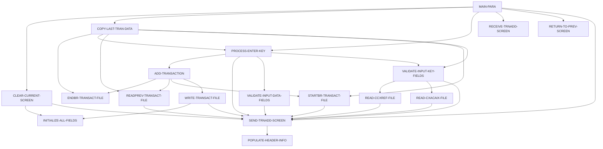

# 設計書: COTRN02C

_LegacyLens により自動生成。構造は静的解析、目的と業務ルールは LLM が作成し、各ルールはソースと照合済み。_

## 概要

| 種別 | オンライン (CICS) |
| --- | --- |
| コード行数 | 614 |
| ソース | [cbl/COTRN02C.cbl](../../data/carddemo/app/cbl/COTRN02C.cbl) |

## 入出力

| ファイル / データセット | モード | 行 |
| --- | --- | --- |
| CXACAIX | 読込 | [578](../../data/carddemo/app/cbl/COTRN02C.cbl#L578) |
| CCXREF | 読込 | [611](../../data/carddemo/app/cbl/COTRN02C.cbl#L611) |
| TRANSACT | 読込 | [644](../../data/carddemo/app/cbl/COTRN02C.cbl#L644) |
| TRANSACT | 書込 | [713](../../data/carddemo/app/cbl/COTRN02C.cbl#L713) |

## 他プログラムへの遷移

| プログラム | 方式 | 行 |
| --- | --- | --- |
| COMEN01C | XCTL | [508](../../data/carddemo/app/cbl/COTRN02C.cbl#L508) |
| COSGN00C | XCTL | [508](../../data/carddemo/app/cbl/COTRN02C.cbl#L508) |
| CSUTLDTC | CALL | [393](../../data/carddemo/app/cbl/COTRN02C.cbl#L393) |
| CSUTLDTC | CALL | [413](../../data/carddemo/app/cbl/COTRN02C.cbl#L413) |

## コピー句

`COCOM01Y`, `COTRN02`, `COTTL01Y`, `CSDAT01Y`, `CSMSG01Y`, `CVTRA05Y`, `CVACT01Y`, `CVACT03Y`, `DFHAID`, `DFHBMSCA`

## 処理フロー (PERFORM)

## 業務ルール

未抽出です。先に `legacylens extract` を実行してください。
