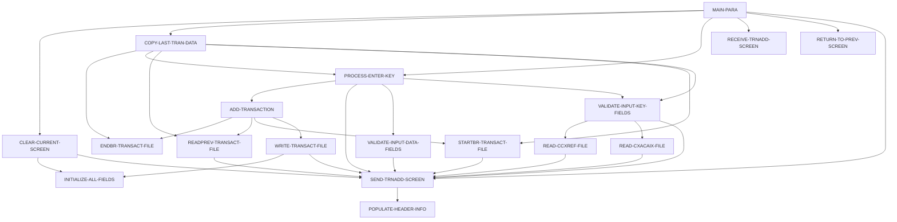

# Tài liệu thiết kế: COTRN02C

_Sinh tự động bởi LegacyLens. Phần cấu trúc lấy từ phân tích tĩnh; mục đích và quy tắc do LLM viết, mỗi quy tắc đã được đối chiếu với mã nguồn._

## Tổng quan

| Loại | Online (CICS) |
| --- | --- |
| Số dòng code | 614 |
| Mã nguồn | [cbl/COTRN02C.cbl](https://github.com/aws-samples/aws-mainframe-modernization-carddemo/blob/59cc6c2fd7ebd7ef7925cad552a01a4b8b6e4d5e/app/cbl/COTRN02C.cbl) |

**Mục đích.** Chương trình COTRN02C xử lý và kiểm tra dữ liệu giao dịch được nhập bởi người dùng, cập nhật tệp giao dịch và đảm bảo tính toàn vẹn dữ liệu bằng cách đọc từ và ghi vào các tệp khác nhau. Nó xử lý đầu vào của người dùng, kiểm tra dữ liệu so với các tệp tham chiếu và quản lý các tương tác màn hình để thêm giao dịch mới hoặc quay lại màn hình trước đó.

## Dữ liệu vào ra

| File / dataset | Chế độ | Dòng |
| --- | --- | --- |
| CXACAIX | đọc | [578](https://github.com/aws-samples/aws-mainframe-modernization-carddemo/blob/59cc6c2fd7ebd7ef7925cad552a01a4b8b6e4d5e/app/cbl/COTRN02C.cbl#L578) |
| CCXREF | đọc | [611](https://github.com/aws-samples/aws-mainframe-modernization-carddemo/blob/59cc6c2fd7ebd7ef7925cad552a01a4b8b6e4d5e/app/cbl/COTRN02C.cbl#L611) |
| TRANSACT | đọc | [644](https://github.com/aws-samples/aws-mainframe-modernization-carddemo/blob/59cc6c2fd7ebd7ef7925cad552a01a4b8b6e4d5e/app/cbl/COTRN02C.cbl#L644) |
| TRANSACT | ghi | [713](https://github.com/aws-samples/aws-mainframe-modernization-carddemo/blob/59cc6c2fd7ebd7ef7925cad552a01a4b8b6e4d5e/app/cbl/COTRN02C.cbl#L713) |

## Chuyển sang chương trình khác

| Chương trình | Cách gọi | Dòng |
| --- | --- | --- |
| COMEN01C | XCTL | [508](https://github.com/aws-samples/aws-mainframe-modernization-carddemo/blob/59cc6c2fd7ebd7ef7925cad552a01a4b8b6e4d5e/app/cbl/COTRN02C.cbl#L508) |
| COSGN00C | XCTL | [508](https://github.com/aws-samples/aws-mainframe-modernization-carddemo/blob/59cc6c2fd7ebd7ef7925cad552a01a4b8b6e4d5e/app/cbl/COTRN02C.cbl#L508) |
| CSUTLDTC | CALL | [393](https://github.com/aws-samples/aws-mainframe-modernization-carddemo/blob/59cc6c2fd7ebd7ef7925cad552a01a4b8b6e4d5e/app/cbl/COTRN02C.cbl#L393) |
| CSUTLDTC | CALL | [413](https://github.com/aws-samples/aws-mainframe-modernization-carddemo/blob/59cc6c2fd7ebd7ef7925cad552a01a4b8b6e4d5e/app/cbl/COTRN02C.cbl#L413) |

## Copybook dùng

`COCOM01Y`, `COTRN02`, `COTTL01Y`, `CSDAT01Y`, `CSMSG01Y`, `CVTRA05Y`, `CVACT01Y`, `CVACT03Y`, `DFHAID`, `DFHBMSCA`

## Luồng xử lý (PERFORM)

## Quy tắc nghiệp vụ

| Mã | Nội dung | Điều kiện | Kết quả | Trích dẫn | Kiểm tra |
| --- | --- | --- | --- | --- | --- |
| COTRN02C-R1 | Nếu không có đầu vào nào được nhận, quay lại màn hình trước đó. | EIBCALEN = 0 | CDEMO-TO-PROGRAM = 'COSGN00C', PERFORM RETURN-TO-PREV-SCREEN | [115-117](https://github.com/aws-samples/aws-mainframe-modernization-carddemo/blob/59cc6c2fd7ebd7ef7925cad552a01a4b8b6e4d5e/app/cbl/COTRN02C.cbl#L115-L117) | đúng |
| COTRN02C-R2 | Nếu chương trình không được nhập lại, thiết lập COMMAREA và thực hiện các hành động. | NOT CDEMO-PGM-REENTER | CDEMO-PGM-REENTER = TRUE, COTRN2AO = LOW-VALUES, ACTIDINL OF COTRN2AI = -1, PERFORM PROCESS-ENTER-KEY, PERFORM SEND-TRNADD-SCREEN | [120-131](https://github.com/aws-samples/aws-mainframe-modernization-carddemo/blob/59cc6c2fd7ebd7ef7925cad552a01a4b8b6e4d5e/app/cbl/COTRN02C.cbl#L120-L131) | đúng |
| COTRN02C-R3 | Nếu chương trình được nhập lại, nhận màn hình thêm giao dịch và xử lý dựa trên EIBAID. | CDEMO-PGM-REENTER | PERFORM RECEIVE-TRNADD-SCREEN, EVALUATE EIBAID | [132-152](https://github.com/aws-samples/aws-mainframe-modernization-carddemo/blob/59cc6c2fd7ebd7ef7925cad552a01a4b8b6e4d5e/app/cbl/COTRN02C.cbl#L132-L152) | đúng |
| COTRN02C-R4 | Nếu một phím không hợp lệ được nhấn, thiết lập cờ lỗi và thông điệp. | EIBAID NOT IN (DFHENTER, DFHPF3, DFHPF4, DFHPF5) | WS-ERR-FLG = 'Y', WS-MESSAGE = CCDA-MSG-INVALID-KEY, PERFORM SEND-TRNADD-SCREEN | [149-152](https://github.com/aws-samples/aws-mainframe-modernization-carddemo/blob/59cc6c2fd7ebd7ef7925cad552a01a4b8b6e4d5e/app/cbl/COTRN02C.cbl#L149-L152) | đúng |
| COTRN02C-R5 | Nếu CONFIRMI là 'Y' hoặc 'y', thêm giao dịch. | CONFIRMI = 'Y' OR CONFIRMI = 'y' | PERFORM ADD-TRANSACTION | [170-172](https://github.com/aws-samples/aws-mainframe-modernization-carddemo/blob/59cc6c2fd7ebd7ef7925cad552a01a4b8b6e4d5e/app/cbl/COTRN02C.cbl#L170-L172) | đúng |
| COTRN02C-R6 | Nếu CONFIRMI không phải là 'Y' hoặc 'y', thiết lập cờ lỗi và thông điệp. | CONFIRMI NOT IN ('Y', 'y') | WS-ERR-FLG = 'Y', WS-MESSAGE = 'Confirm to add this transaction...', CONFIRML = -1, PERFORM SEND-TRNADD-SCREEN | [175-181](https://github.com/aws-samples/aws-mainframe-modernization-carddemo/blob/59cc6c2fd7ebd7ef7925cad552a01a4b8b6e4d5e/app/cbl/COTRN02C.cbl#L175-L181) | đúng |
| COTRN02C-R7 | Nếu CONFIRMI không hợp lệ, thiết lập cờ lỗi và thông điệp. | CONFIRMI NOT IN ('Y', 'y', 'N', 'n', SPACES, LOW-VALUES) | WS-ERR-FLG = 'Y', WS-MESSAGE = 'Invalid value. Valid values are (Y/N)...', CONFIRML = -1, PERFORM SEND-TRNADD-SCREEN | [182-187](https://github.com/aws-samples/aws-mainframe-modernization-carddemo/blob/59cc6c2fd7ebd7ef7925cad552a01a4b8b6e4d5e/app/cbl/COTRN02C.cbl#L182-L187) | đúng |
| COTRN02C-R8 | ID tài khoản phải là số. | ACTIDINI OF COTRN2AI NOT = SPACES AND LOW-VALUES AND ACTIDINI OF COTRN2AI IS NOT NUMERIC | WS-ERR-FLG = 'Y', WS-MESSAGE = 'Account ID must be Numeric...', ACTIDINL OF COTRN2AI = -1, PERFORM SEND-TRNADD-SCREEN | [196-202](https://github.com/aws-samples/aws-mainframe-modernization-carddemo/blob/59cc6c2fd7ebd7ef7925cad552a01a4b8b6e4d5e/app/cbl/COTRN02C.cbl#L196-L202) | đúng |
| COTRN02C-R9 | Chuyển đổi và lưu trữ ID tài khoản số. | ACTIDINI OF COTRN2AI NOT = SPACES AND LOW-VALUES AND ACTIDINI OF COTRN2AI IS NUMERIC | WS-ACCT-ID-N = FUNCTION NUMVAL(ACTIDINI OF COTRN2AI), XREF-ACCT-ID = WS-ACCT-ID-N, ACTIDINI OF COTRN2AI = WS-ACCT-ID-N, PERFORM READ-CXACAIX-FILE | [204-208](https://github.com/aws-samples/aws-mainframe-modernization-carddemo/blob/59cc6c2fd7ebd7ef7925cad552a01a4b8b6e4d5e/app/cbl/COTRN02C.cbl#L204-L208) | đúng |
| COTRN02C-R10 | Số thẻ phải là số. | CARDNINI OF COTRN2AI NOT = SPACES AND LOW-VALUES AND CARDNINI OF COTRN2AI IS NOT NUMERIC | WS-ERR-FLG = 'Y', WS-MESSAGE = 'Số thẻ phải là số...', CARDNINL OF COTRN2AI = -1, PERFORM SEND-TRNADD-SCREEN | [210-216](https://github.com/aws-samples/aws-mainframe-modernization-carddemo/blob/59cc6c2fd7ebd7ef7925cad552a01a4b8b6e4d5e/app/cbl/COTRN02C.cbl#L210-L216) | đúng |
| COTRN02C-R11 | Chuyển đổi và lưu trữ số thẻ số. | CARDNINI OF COTRN2AI NOT = SPACES AND LOW-VALUES AND CARDNINI OF COTRN2AI IS NUMERIC | WS-CARD-NUM-N = FUNCTION NUMVAL(CARDNINI OF COTRN2AI), XREF-CARD-NUM = WS-CARD-NUM-N, CARDNINI OF COTRN2AI = WS-CARD-NUM-N, PERFORM READ-CCXREF-FILE | [218-222](https://github.com/aws-samples/aws-mainframe-modernization-carddemo/blob/59cc6c2fd7ebd7ef7925cad552a01a4b8b6e4d5e/app/cbl/COTRN02C.cbl#L218-L222) | đúng |
| COTRN02C-R12 | Phải nhập số tài khoản hoặc số thẻ. | OTHER | WS-ERR-FLG = 'Y', WS-MESSAGE = 'Phải nhập số tài khoản hoặc số thẻ...', ACTIDINL OF COTRN2AI = -1, PERFORM SEND-TRNADD-SCREEN | [224-229](https://github.com/aws-samples/aws-mainframe-modernization-carddemo/blob/59cc6c2fd7ebd7ef7925cad552a01a4b8b6e4d5e/app/cbl/COTRN02C.cbl#L224-L229) | đúng |
| COTRN02C-R13 | Xóa các trường nhập liệu nếu cờ lỗi được bật. | ERR-FLG-ON | TTYPCDI, TCATCDI, TRNSRCI, TRNAMTI, TDESCI, TORIGDTI, TPROCDTI, MIDI, MNAMEI, MCITYI, MZIPI of COTRN2AI set to SPACES | [237-249](https://github.com/aws-samples/aws-mainframe-modernization-carddemo/blob/59cc6c2fd7ebd7ef7925cad552a01a4b8b6e4d5e/app/cbl/COTRN02C.cbl#L237-L249) | đúng |
| COTRN02C-R14 | Mã loại không thể để trống. | TTYPCDI OF COTRN2AI = SPACES OR LOW-VALUES | WS-ERR-FLG = 'Y', WS-MESSAGE = 'Mã loại không thể để trống...', TTYPCDL OF COTRN2AI = -1, PERFORM SEND-TRNADD-SCREEN | [252-258](https://github.com/aws-samples/aws-mainframe-modernization-carddemo/blob/59cc6c2fd7ebd7ef7925cad552a01a4b8b6e4d5e/app/cbl/COTRN02C.cbl#L252-L258) | đúng |
| COTRN02C-R15 | Mã danh mục không thể để trống. | TCATCDI OF COTRN2AI = SPACES OR LOW-VALUES | WS-ERR-FLG = 'Y', WS-MESSAGE = 'Mã danh mục không thể để trống...', TCATCDL OF COTRN2AI = -1, PERFORM SEND-TRNADD-SCREEN | [259-263](https://github.com/aws-samples/aws-mainframe-modernization-carddemo/blob/59cc6c2fd7ebd7ef7925cad552a01a4b8b6e4d5e/app/cbl/COTRN02C.cbl#L259-L263) | đúng |
| COTRN02C-R16 | Nguồn không thể để trống. | TRNSRCI OF COTRN2AI = SPACES OR LOW-VALUES | WS-ERR-FLG = 'Y', WS-MESSAGE = 'Nguồn không thể để trống...', TRNSRCL OF COTRN2AI = -1, PERFORM SEND-TRNADD-SCREEN | [264-269](https://github.com/aws-samples/aws-mainframe-modernization-carddemo/blob/59cc6c2fd7ebd7ef7925cad552a01a4b8b6e4d5e/app/cbl/COTRN02C.cbl#L264-L269) | đúng |
| COTRN02C-R17 | Mô tả không được để trống. | TDESCI OF COTRN2AI = SPACES OR LOW-VALUES | WS-ERR-FLG = 'Y', WS-MESSAGE = 'Mô tả không thể để trống...', TDESCL OF COTRN2AI = -1, PERFORM SEND-TRNADD-SCREEN | [270-275](https://github.com/aws-samples/aws-mainframe-modernization-carddemo/blob/59cc6c2fd7ebd7ef7925cad552a01a4b8b6e4d5e/app/cbl/COTRN02C.cbl#L270-L275) | đúng |
| COTRN02C-R18 | Số tiền không được để trống. | TRNAMTI OF COTRN2AI = SPACES OR LOW-VALUES | WS-ERR-FLG = 'Y', WS-MESSAGE = 'Số tiền không thể để trống...', TRNAMTL OF COTRN2AI = -1, PERFORM SEND-TRNADD-SCREEN | [276-281](https://github.com/aws-samples/aws-mainframe-modernization-carddemo/blob/59cc6c2fd7ebd7ef7925cad552a01a4b8b6e4d5e/app/cbl/COTRN02C.cbl#L276-L281) | đúng |
| COTRN02C-R19 | Ngày gốc không được để trống. | TORIGDTI OF COTRN2AI = SPACES OR LOW-VALUES | WS-ERR-FLG = 'Y', WS-MESSAGE = 'Ngày gốc không thể để trống...', TORIGDTL OF COTRN2AI = -1, PERFORM SEND-TRNADD-SCREEN | [282-287](https://github.com/aws-samples/aws-mainframe-modernization-carddemo/blob/59cc6c2fd7ebd7ef7925cad552a01a4b8b6e4d5e/app/cbl/COTRN02C.cbl#L282-L287) | đúng |
| COTRN02C-R20 | Ngày xử lý không được để trống. | TPROCDTI OF COTRN2AI = SPACES OR LOW-VALUES | WS-ERR-FLG = 'Y', WS-MESSAGE = 'Ngày xử lý không thể để trống...', TPROCDTL OF COTRN2AI = -1, PERFORM SEND-TRNADD-SCREEN | [288-293](https://github.com/aws-samples/aws-mainframe-modernization-carddemo/blob/59cc6c2fd7ebd7ef7925cad552a01a4b8b6e4d5e/app/cbl/COTRN02C.cbl#L288-L293) | đúng |
| COTRN02C-R21 | ID Nhà cung cấp không được để trống. | MIDI OF COTRN2AI = SPACES OR LOW-VALUES | WS-ERR-FLG = 'Y', WS-MESSAGE = 'ID Nhà cung cấp không thể để trống...', MIDL OF COTRN2AI = -1, PERFORM SEND-TRNADD-SCREEN | [294-299](https://github.com/aws-samples/aws-mainframe-modernization-carddemo/blob/59cc6c2fd7ebd7ef7925cad552a01a4b8b6e4d5e/app/cbl/COTRN02C.cbl#L294-L299) | đúng |
| COTRN02C-R22 | Tên Nhà cung cấp không được để trống. | MNAMEI OF COTRN2AI = SPACES OR LOW-VALUES | WS-ERR-FLG = 'Y', WS-MESSAGE = 'Tên Nhà cung cấp không thể để trống...', MNAMEL OF COTRN2AI = -1, PERFORM SEND-TRNADD-SCREEN | [300-305](https://github.com/aws-samples/aws-mainframe-modernization-carddemo/blob/59cc6c2fd7ebd7ef7925cad552a01a4b8b6e4d5e/app/cbl/COTRN02C.cbl#L300-L305) | đúng |
| COTRN02C-R23 | Thành phố Nhà cung cấp không được để trống. | MCITYI OF COTRN2AI = SPACES OR LOW-VALUES | WS-ERR-FLG = 'Y', WS-MESSAGE = 'Thành phố Nhà cung cấp không thể để trống...', MCITYL OF COTRN2AI = -1, PERFORM SEND-TRNADD-SCREEN | [306-311](https://github.com/aws-samples/aws-mainframe-modernization-carddemo/blob/59cc6c2fd7ebd7ef7925cad552a01a4b8b6e4d5e/app/cbl/COTRN02C.cbl#L306-L311) | đúng |
| COTRN02C-R24 | Mã bưu chính Nhà cung cấp không được để trống. | MZIPI OF COTRN2AI = SPACES OR LOW-VALUES | WS-ERR-FLG = 'Y', WS-MESSAGE = 'Mã bưu chính Nhà cung cấp không thể để trống...', MZIPL OF COTRN2AI = -1, PERFORM SEND-TRNADD-SCREEN | [312-317](https://github.com/aws-samples/aws-mainframe-modernization-carddemo/blob/59cc6c2fd7ebd7ef7925cad552a01a4b8b6e4d5e/app/cbl/COTRN02C.cbl#L312-L317) | đúng |
| COTRN02C-R25 | Loại CD phải là số. | TTYPDCDI OF COTRN2AI NOT NUMERIC | WS-ERR-FLG = 'Y', WS-MESSAGE = 'Loại CD phải là số...', TTYPCDL OF COTRN2AI = -1, PERFORM SEND-TRNADD-SCREEN | [323-328](https://github.com/aws-samples/aws-mainframe-modernization-carddemo/blob/59cc6c2fd7ebd7ef7925cad552a01a4b8b6e4d5e/app/cbl/COTRN02C.cbl#L323-L328) | đúng |
| COTRN02C-R26 | Mã danh mục phải là số. | TCATCDI OF COTRN2AI NOT NUMERIC | WS-ERR-FLG = 'Y', WS-MESSAGE = 'Mã danh mục phải là số...', TCATCDL OF COTRN2AI = -1, PERFORM SEND-TRNADD-SCREEN | [329-334](https://github.com/aws-samples/aws-mainframe-modernization-carddemo/blob/59cc6c2fd7ebd7ef7925cad552a01a4b8b6e4d5e/app/cbl/COTRN02C.cbl#L329-L334) | đúng |
| COTRN02C-R27 | Số tiền giao dịch phải có định dạng -99999999.99. | TRNAMTI OF COTRN2AI(1:1) NOT EQUAL '-' AND '+', TRNAMTI OF COTRN2AI(2:8) NOT NUMERIC, TRNAMTI OF COTRN2AI(10:1) NOT = '.', TRNAMTI OF COTRN2AI(11:2) IS NOT NUMERIC | WS-ERR-FLG = 'Y', WS-MESSAGE = 'Số tiền phải có định dạng -99999999.99', TRNAMTL OF COTRN2AI = -1, PERFORM SEND-TRNADD-SCREEN | [339-348](https://github.com/aws-samples/aws-mainframe-modernization-carddemo/blob/59cc6c2fd7ebd7ef7925cad552a01a4b8b6e4d5e/app/cbl/COTRN02C.cbl#L339-L348) | đúng |
| COTRN02C-R28 | Ngày gốc phải có định dạng YYYY-MM-DD. | TORIGDTI OF COTRN2AI(1:4) IS NOT NUMERIC OR TORIGDTI OF COTRN2AI(5:1) NOT EQUAL '-' OR TORIGDTI OF COTRN2AI(6:2) NOT NUMERIC OR TORIGDTI OF COTRN2AI(8:1) NOT EQUAL '-' OR TORIGDTI OF COTRN2AI(9:2) NOT NUMERIC | WS-ERR-FLG = 'Y', WS-MESSAGE = 'Ngày gốc phải có định dạng YYYY-MM-DD', TORIGDTL OF COTRN2AI = -1, PERFORM SEND-TRNADD-SCREEN | [354-363](https://github.com/aws-samples/aws-mainframe-modernization-carddemo/blob/59cc6c2fd7ebd7ef7925cad552a01a4b8b6e4d5e/app/cbl/COTRN02C.cbl#L354-L363) | đúng |
| COTRN02C-R29 | Ngày xử lý phải có định dạng YYYY-MM-DD. | TPROCDTI OF COTRN2AI(1:4) IS NOT NUMERIC OR TPROCDTI OF COTRN2AI(5:1) NOT EQUAL '-' OR TPROCDTI OF COTRN2AI(6:2) NOT NUMERIC OR TPROCDTI OF COTRN2AI(8:1) NOT EQUAL '-' OR TPROCDTI OF COTRN2AI(9:2) NOT NUMERIC | WS-ERR-FLG = 'Y', WS-MESSAGE = 'Ngày xử lý phải có định dạng YYYY-MM-DD', TPROCDTL OF COTRN2AI = -1, PERFORM SEND-TRNADD-SCREEN | [369-378](https://github.com/aws-samples/aws-mainframe-modernization-carddemo/blob/59cc6c2fd7ebd7ef7925cad552a01a4b8b6e4d5e/app/cbl/COTRN02C.cbl#L369-L378) | đúng |
| COTRN02C-R30 | Ngày gốc phải là ngày hợp lệ. | CSUTLDTC-RESULT-SEV-CD NOT = '0000' AND CSUTLDTC-RESULT-MSG-NUM NOT = '2513' | WS-MESSAGE = 'Ngày gốc - Không phải là ngày hợp lệ...', WS-ERR-FLG = 'Y', TORIGDTL OF COTRN2AI = -1, PERFORM SEND-TRNADD-SCREEN | [399-406](https://github.com/aws-samples/aws-mainframe-modernization-carddemo/blob/59cc6c2fd7ebd7ef7925cad552a01a4b8b6e4d5e/app/cbl/COTRN02C.cbl#L399-L406) | đúng |
| COTRN02C-R31 | Nếu ngày không hợp lệ, đặt thông báo lỗi và cờ. | CSUTLDTC-RESULT-SEV-CD NOT = '0000' AND CSUTLDTC-RESULT-MSG-NUM NOT = '2513' | WS-MESSAGE = 'Ngày xử lý - Không phải là ngày hợp lệ...', WS-ERR-FLG = 'Y', TPROCDTL OF COTRN2AI = -1, PERFORM SEND-TRNADD-SCREEN | [417-426](https://github.com/aws-samples/aws-mainframe-modernization-carddemo/blob/59cc6c2fd7ebd7ef7925cad552a01a4b8b6e4d5e/app/cbl/COTRN02C.cbl#L417-L426) | đúng |
| COTRN02C-R32 | Nếu ID nhà cung cấp không phải là số, đặt thông báo lỗi và cờ. | MIDI OF COTRN2AI IS NOT NUMERIC | WS-ERR-FLG = 'Y', WS-MESSAGE = 'ID nhà cung cấp phải là số...', MIDL OF COTRN2AI = -1, PERFORM SEND-TRNADD-SCREEN | [430-436](https://github.com/aws-samples/aws-mainframe-modernization-carddemo/blob/59cc6c2fd7ebd7ef7925cad552a01a4b8b6e4d5e/app/cbl/COTRN02C.cbl#L430-L436) | đúng |
| COTRN02C-R33 | Sao chép dữ liệu giao dịch vào vùng làm việc nếu cờ lỗi không được đặt. | NOT ERR-FLG-ON | MOVE các trường từ TRAN- đến WS- và COTRN2AI fields | [480-491](https://github.com/aws-samples/aws-mainframe-modernization-carddemo/blob/59cc6c2fd7ebd7ef7925cad552a01a4b8b6e4d5e/app/cbl/COTRN02C.cbl#L480-L491) | đúng |
| COTRN02C-R34 | Nếu CDEMO-TO-PROGRAM không được đặt, mặc định là 'COSGN00C'. | CDEMO-TO-PROGRAM = LOW-VALUES OR SPACES | CDEMO-TO-PROGRAM = 'COSGN00C' | [502-504](https://github.com/aws-samples/aws-mainframe-modernization-carddemo/blob/59cc6c2fd7ebd7ef7925cad552a01a4b8b6e4d5e/app/cbl/COTRN02C.cbl#L502-L504) | đúng |
| COTRN02C-R35 | Sao chép WS-TRANID đến CDEMO-FROM-TRANID. | whenever | CDEMO-FROM-TRANID = WS-TRANID | [505-505](https://github.com/aws-samples/aws-mainframe-modernization-carddemo/blob/59cc6c2fd7ebd7ef7925cad552a01a4b8b6e4d5e/app/cbl/COTRN02C.cbl#L505-L505) | đúng |
| COTRN02C-R36 | Sao chép WS-PGMNAME đến CDEMO-FROM-PROGRAM. | whenever | CDEMO-FROM-PROGRAM = WS-PGMNAME | [506-506](https://github.com/aws-samples/aws-mainframe-modernization-carddemo/blob/59cc6c2fd7ebd7ef7925cad552a01a4b8b6e4d5e/app/cbl/COTRN02C.cbl#L506-L506) | đúng |
| COTRN02C-R37 | Đặt CDEMO-PGM-CONTEXT thành không. | whenever | CDEMO-PGM-CONTEXT = ZEROS | [507-507](https://github.com/aws-samples/aws-mainframe-modernization-carddemo/blob/59cc6c2fd7ebd7ef7925cad552a01a4b8b6e4d5e/app/cbl/COTRN02C.cbl#L507-L507) | đúng |
| COTRN02C-R38 | Thực hiện CICS XCTL đến chương trình được chỉ định trong CDEMO-TO-PROGRAM. | whenever | EXEC CICS XCTL PROGRAM(CDEMO-TO-PROGRAM) | [508-511](https://github.com/aws-samples/aws-mainframe-modernization-carddemo/blob/59cc6c2fd7ebd7ef7925cad552a01a4b8b6e4d5e/app/cbl/COTRN02C.cbl#L508-L511) | đúng |
| COTRN02C-R39 | Đọc tệp CXACAIX cho một ID tài khoản cụ thể. | EXEC CICS READ | READ CXACAIX FILE INTO CARD-XREF-RECORD | [578-584](https://github.com/aws-samples/aws-mainframe-modernization-carddemo/blob/59cc6c2fd7ebd7ef7925cad552a01a4b8b6e4d5e/app/cbl/COTRN02C.cbl#L578-L584) | đúng |
| COTRN02C-R40 | Nếu không tìm thấy bản ghi trong tệp CXACAIX, đặt cờ lỗi và thông báo. | WS-RESP-CD = DFHRESP(NOTFND) | WS-ERR-FLG = 'Y', WS-MESSAGE = 'ID tài khoản không được tìm thấy...', ACTIDINL OF COTRN2AI = -1, PERFORM SEND-TRNADD-SCREEN | [591-596](https://github.com/aws-samples/aws-mainframe-modernization-carddemo/blob/59cc6c2fd7ebd7ef7925cad552a01a4b8b6e4d5e/app/cbl/COTRN02C.cbl#L591-L596) | đúng |
| COTRN02C-R41 | Nếu đọc file CXACAIX thất bại, đặt cờ lỗi và thông báo. | WS-RESP-CD NOT DFHRESP(NORMAL) AND NOT DFHRESP(NOTFND) | WS-ERR-FLG = 'Y', WS-MESSAGE = 'Không thể tra cứu tài khoản trong file XREF AIX...', ACTIDINL OF COTRN2AI = -1, PERFORM SEND-TRNADD-SCREEN | [598-602](https://github.com/aws-samples/aws-mainframe-modernization-carddemo/blob/59cc6c2fd7ebd7ef7925cad552a01a4b8b6e4d5e/app/cbl/COTRN02C.cbl#L598-L602) | đúng |
| COTRN02C-R42 | Đọc số thẻ tham chiếu từ file. | EXEC CICS READ | READ-CCXREF-FILE | [611-618](https://github.com/aws-samples/aws-mainframe-modernization-carddemo/blob/59cc6c2fd7ebd7ef7925cad552a01a4b8b6e4d5e/app/cbl/COTRN02C.cbl#L611-L618) | đúng |
| COTRN02C-R43 | Số thẻ không được tìm thấy trong file tham chiếu. | WS-RESP-CD = DFHRESP(NOTFND) | WS-ERR-FLG = 'Y', WS-MESSAGE = 'Số thẻ KHÔNG được tìm thấy...', CARDNINL OF COTRN2AI = -1, PERFORM SEND-TRNADD-SCREEN | [624-629](https://github.com/aws-samples/aws-mainframe-modernization-carddemo/blob/59cc6c2fd7ebd7ef7925cad552a01a4b8b6e4d5e/app/cbl/COTRN02C.cbl#L624-L629) | đúng |
| COTRN02C-R44 | Xử lý phản hồi không mong đợi từ việc đọc file. | WS-RESP-CD NOT DFHRESP(NORMAL) AND NOT DFHRESP(NOTFND) | DISPLAY 'RESP:' WS-RESP-CD 'REAS:' WS-REAS-CD, WS-ERR-FLG = 'Y', WS-MESSAGE = 'Không thể tra cứu số thẻ # trong file XREF...', CARDNINL OF COTRN2AI = -1, PERFORM SEND-TRNADD-SCREEN | [630-636](https://github.com/aws-samples/aws-mainframe-modernization-carddemo/blob/59cc6c2fd7ebd7ef7925cad552a01a4b8b6e4d5e/app/cbl/COTRN02C.cbl#L630-L636) | đúng |
| COTRN02C-R45 | ID giao dịch được tìm thấy được xử lý bình thường. | WS-RESP-CD = DFHRESP(NORMAL) | CONTINUE | [652-653](https://github.com/aws-samples/aws-mainframe-modernization-carddemo/blob/59cc6c2fd7ebd7ef7925cad552a01a4b8b6e4d5e/app/cbl/COTRN02C.cbl#L652-L653) | đúng |
| COTRN02C-R46 | ID giao dịch không được tìm thấy đặt cờ lỗi và thông báo. | WS-RESP-CD = DFHRESP(NOTFND) | WS-ERR-FLG = 'Y', WS-MESSAGE = 'ID giao dịch KHÔNG được tìm thấy...', ACTIDINL OF COTRN2AI = -1, PERFORM SEND-TRNADD-SCREEN | [654-660](https://github.com/aws-samples/aws-mainframe-modernization-carddemo/blob/59cc6c2fd7ebd7ef7925cad552a01a4b8b6e4d5e/app/cbl/COTRN02C.cbl#L654-L660) | đúng |
| COTRN02C-R47 | Phản hồi khác đặt cờ lỗi và thông báo. | WS-RESP-CD != DFHRESP(NORMAL) AND WS-RESP-CD != DFHRESP(NOTFND) | DISPLAY 'RESP:' WS-RESP-CD 'REAS:' WS-REAS-CD, WS-ERR-FLG = 'Y', WS-MESSAGE = 'Không thể tra cứu giao dịch...', ACTIDINL OF COTRN2AI = -1, PERFORM SEND-TRNADD-SCREEN | [661-667](https://github.com/aws-samples/aws-mainframe-modernization-carddemo/blob/59cc6c2fd7ebd7ef7925cad552a01a4b8b6e4d5e/app/cbl/COTRN02C.cbl#L661-L667) | đúng |
| COTRN02C-R48 | Đọc ghi chú giao dịch trước đó từ file. | EXEC CICS READPREV | DATASET (WS-TRANSACT-FILE) INTO (TRAN-RECORD) | [675-681](https://github.com/aws-samples/aws-mainframe-modernization-carddemo/blob/59cc6c2fd7ebd7ef7925cad552a01a4b8b6e4d5e/app/cbl/COTRN02C.cbl#L675-L681) | đúng |
| COTRN02C-R49 | Tiếp tục nếu có phản hồi bình thường từ CICS. | WS-RESP-CD = DFHRESP(NORMAL) | CONTINUE | [686-686](https://github.com/aws-samples/aws-mainframe-modernization-carddemo/blob/59cc6c2fd7ebd7ef7925cad552a01a4b8b6e4d5e/app/cbl/COTRN02C.cbl#L686-L686) | sai: cited lines contain none of the rule's fields, codes or messages |
| COTRN02C-R50 | Đặt ID giao dịch thành không nếu đến cuối file. | WS-RESP-CD = DFHRESP(ENDFILE) | MOVE ZEROS TO TRAN-ID | [688-689](https://github.com/aws-samples/aws-mainframe-modernization-carddemo/blob/59cc6c2fd7ebd7ef7925cad552a01a4b8b6e4d5e/app/cbl/COTRN02C.cbl#L688-L689) | đúng |
| COTRN02C-R51 | Hiển thị thông báo lỗi và đặt cờ lỗi nếu có phản hồi khác. | WS-RESP-CD != DFHRESP(NORMAL) AND WS-RESP-CD != DFHRESP(ENDFILE) | DISPLAY 'RESP:' WS-RESP-CD 'REAS:' WS-REAS-CD, MOVE 'Y' TO WS-ERR-FLG, MOVE 'Unable to lookup Transaction...' TO WS-MESSAGE, MOVE -1 TO ACTIDINL OF COTRN2AI, PERFORM SEND-TRNADD-SCREEN | [690-696](https://github.com/aws-samples/aws-mainframe-modernization-carddemo/blob/59cc6c2fd7ebd7ef7925cad552a01a4b8b6e4d5e/app/cbl/COTRN02C.cbl#L690-L696) | đúng |
| COTRN02C-R52 | Giao dịch được ghi thành công vào file. | WS-RESP-CD = DFHRESP(NORMAL) | WS-ERR-FLG = 'N', WS-MESSAGE = 'Transaction added successfully. Your Tran ID is [TRAN-ID].', PERFORM SEND-TRNADD-SCREEN | [723-735](https://github.com/aws-samples/aws-mainframe-modernization-carddemo/blob/59cc6c2fd7ebd7ef7925cad552a01a4b8b6e4d5e/app/cbl/COTRN02C.cbl#L723-L735) | đúng |
| COTRN02C-R53 | Giao dịch trùng ID bị từ chối. | WS-RESP-CD = DFHRESP(DUPKEY) OR WS-RESP-CD = DFHRESP(DUPREC) | WS-ERR-FLG = 'Y', WS-MESSAGE = 'Tran ID already exist...', PERFORM SEND-TRNADD-SCREEN | [735-741](https://github.com/aws-samples/aws-mainframe-modernization-carddemo/blob/59cc6c2fd7ebd7ef7925cad552a01a4b8b6e4d5e/app/cbl/COTRN02C.cbl#L735-L741) | đúng |
| COTRN02C-R54 | Lỗi khác được xử lý. | WS-RESP-CD != DFHRESP(NORMAL) AND WS-RESP-CD != DFHRESP(DUPKEY) AND WS-RESP-CD != DFHRESP(DUPREC) | WS-ERR-FLG = 'Y', WS-MESSAGE = 'Unable to Add Transaction...', PERFORM SEND-TRNADD-SCREEN | [743-748](https://github.com/aws-samples/aws-mainframe-modernization-carddemo/blob/59cc6c2fd7ebd7ef7925cad552a01a4b8b6e4d5e/app/cbl/COTRN02C.cbl#L743-L748) | đúng |
