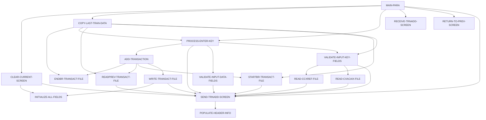

# Tài liệu thiết kế: COTRN02C

_Sinh tự động bởi LegacyLens. Phần cấu trúc lấy từ phân tích tĩnh; mục đích và quy tắc do LLM viết, mỗi quy tắc đã được đối chiếu với mã nguồn._

## Tổng quan

| Loại | Online (CICS) |
| --- | --- |
| Số dòng code | 614 |
| Mã nguồn | [cbl/COTRN02C.cbl](../../data/carddemo/app/cbl/COTRN02C.cbl) |

## Dữ liệu vào ra

| File / dataset | Chế độ | Dòng |
| --- | --- | --- |
| CXACAIX | đọc | [578](../../data/carddemo/app/cbl/COTRN02C.cbl#L578) |
| CCXREF | đọc | [611](../../data/carddemo/app/cbl/COTRN02C.cbl#L611) |
| TRANSACT | đọc | [644](../../data/carddemo/app/cbl/COTRN02C.cbl#L644) |
| TRANSACT | ghi | [713](../../data/carddemo/app/cbl/COTRN02C.cbl#L713) |

## Chuyển sang chương trình khác

| Chương trình | Cách gọi | Dòng |
| --- | --- | --- |
| COMEN01C | XCTL | [508](../../data/carddemo/app/cbl/COTRN02C.cbl#L508) |
| COSGN00C | XCTL | [508](../../data/carddemo/app/cbl/COTRN02C.cbl#L508) |
| CSUTLDTC | CALL | [393](../../data/carddemo/app/cbl/COTRN02C.cbl#L393) |
| CSUTLDTC | CALL | [413](../../data/carddemo/app/cbl/COTRN02C.cbl#L413) |

## Copybook dùng

`COCOM01Y`, `COTRN02`, `COTTL01Y`, `CSDAT01Y`, `CSMSG01Y`, `CVTRA05Y`, `CVACT01Y`, `CVACT03Y`, `DFHAID`, `DFHBMSCA`

## Luồng xử lý (PERFORM)

## Quy tắc nghiệp vụ

Chưa trích xuất. Chạy `legacylens extract` trước.
